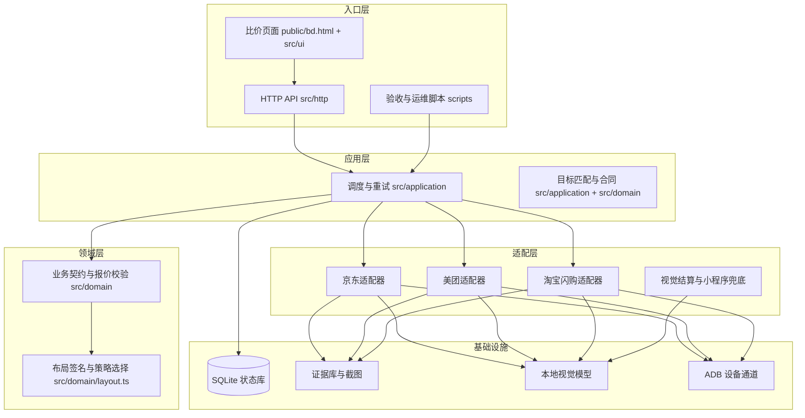
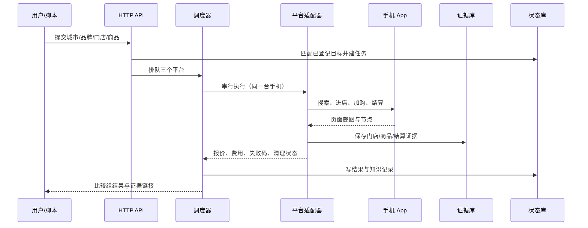
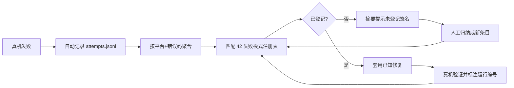

# 系统架构

## 分层与依赖规则

依赖方向只有一条：入口层调用应用层，应用层依赖领域契约，适配器和基础设施实现领域接口。领域层不引用设备、模型或数据库；适配器之间不互相调用；页面定位和金额读取不写进调度器。

## 关键模块

| 模块 | 职责 | 不负责 |
| --- | --- | --- |
| `src/domain/` | 任务与报价契约、目标匹配、布局签名 | 页面操作、数据库写入 |
| `src/application/` | 调度、重试、暂停、映射和结果校验 | 具体平台页面细节 |
| `src/adapters/` | 京东、美团、淘宝的页面操作与读取，视觉兜底 | 跨平台调度和业务口径 |
| `src/infra/` | SQLite 状态、证据文件、模型调用、ADB 传输 | 页面策略选择 |
| `src/http/` | 对内对外的 HTTP 接口 | 采集逻辑 |
| `scripts/` | 基线冻结、验收批次、证据复核、知识库与布局注册表命令 | 生产运行时逻辑 |

## 一次比较组的数据流

## 自愈闭环

## 文件系统约定

- 代码只放 `src/`、`scripts/`、`tests/`，页面资源放 `public/`。
- 本地运行数据、证据、验收产物放 `.runtime/` 和 `artifacts/`，不入库。
- 当前有效的产品判断放 `产品目标/`，过程数据放 `进度与实验记录/`，方案与知识库放 `前期调研/`。
- 历史调研、旧演示和一次性截图已清理；需要追溯时用 Git 历史，不把历史材料堆回工作区。
