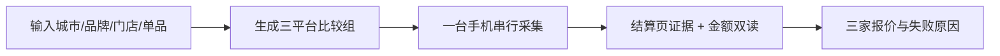

# 三平台外卖比价工具

三平台外卖比价工具是给连锁餐饮品牌和外卖代运营团队的价格情报工具。它的差异点是用一台手机串行采集京东、美团、淘宝闪购三家同店同品的外卖结算应付价，并为每一次报价留下可以复核的证据链。


## 为什么需要它

品牌在三个平台卖同一道菜，到手价却由商品价、打包费、配送费、满减和优惠券共同决定，只看标价会判断错。人工在三个 App 之间切换、核对结算页、记录证据，一组要二三十分钟，还容易漏看费用行。

这个工具把这件事做成可重复的流水线：输入城市、品牌、门店和单品，系统生成一个比较组，按京东、美团、淘宝闪购的顺序在一台手机上采价，输出三家结算应付价、费用明细、证据和失败原因。当前处于 alpha 阶段，内部验证为主。

## 能做什么

- **同一比较组拿三家结算价。** 三家平台串行执行，组内观察时间差记录下来；现有[基线](进度与实验记录/02_实验记录_基线A_2026-11-19.md)跑完 20 组，其中 8 组三家完全有效，其余失败原因逐条保留。
- **每次报价都有证据。** 保存结算页、门店、商品三类截图，结算页顶部隐私区域涂黑，金额做两次独立读取，一致才发布；证据和报价绑定，可逐份复核，数据流见[架构说明](ARCHITECTURE.md)。
- **购物车安全。** 开始前确认空车，只撤本次加购，恢复状态可验证；混合购物车不碰，恢复不了就停下来等人处理，恢复流程见[自愈闭环说明](进度与实验记录/07_自愈闭环说明.md)。
- **页面变化有兜底。** 京东 WebView 走节点链路，京东小程序门店走截图加视觉定位，美团结算页走整页截图读取，淘宝闪购走纯视觉链路；布局类型和策略登记在[布局签名表](前期调研/43_门店布局签名表.json)。
- **失败会进知识库。** 每次真机失败自动记录平台、错误码、清理状态和最近步骤，并匹配 16 条[失败模式](前期调研/42_失败模式注册表.json)；修复后标注验证运行编号，同一错误再次出现会被识别为回退风险。

## 快速开始

前置条件：Windows 10 或 11、Node.js 24.15 以上、一台开启 USB 调试的安卓手机。真机采价还需要 ADB 和本地视觉模型服务，仓库不携带模型文件和真机配置。

```powershell
npm install
npm run check        # 类型检查
npm test             # 133 项单元与回归测试
npm run build        # 构建 dist 和页面资源
npm start            # 启动服务，默认 http://127.0.0.1:4318
```

测试通过时输出 `tests 133 / pass 133 / fail 0`。没有手机和模型时，`npm test`、`npm run check`、`npm run build` 仍然可以跑通。

真机使用前，把 `android-sources.example.json` 复制为 `.runtime/android-sources.json`，填入设备序列号、应用版本和账号信息；真实配置只放在本地，`.runtime/` 已在 `.gitignore` 中排除。

## 一次比较组怎么跑



1. 系统在商品目录里匹配目标，确认城市、门店和商品在平台上可售。
2. 调度器按京东、美团、淘宝闪购顺序串行执行，避免三个 App 抢前台。
3. 每个平台完成搜索、进店、加购或立即购买、进入结算页，读取应付金额和费用行。
4. 结果写入状态库，截图写入证据库；失败的组保留错误码和现场截图，不删除、不改写。

更细的分层依赖和数据流见 [ARCHITECTURE.md](ARCHITECTURE.md)。

## 更多用法

跑一次验收批次：

```powershell
npm run acceptance -- --label=A --groups=20 --input=scripts/bd-batch.mcd.json
npx tsx scripts/bd-acceptance-report.ts --a=<A目录> --b=<B目录> --out=<报告路径>
```

冻结一次基线，记录代码提交、构建产物、配置哈希和数据库副本：

```powershell
npx tsx scripts/freeze-baseline.ts --label=A
```

检查失败知识库和布局策略：

```powershell
npx tsx scripts/knowledge-registry.ts check --days=7
npx tsx scripts/layout-registry.ts match --platform=jd --text=0
```

## 状态与边界

**成熟度：alpha。** 适合内部验证和小范围定制交付，不建议直接用于生产决策。当前验证版本为京东 16.1.0、美团 12.68.402、淘宝闪购 10.69.0；应用升级后需要重新验证。

| 项目 | 现状 |
| --- | --- |
| 三平台有效组率 | 40%（20 组基线中 8 组三家有效） |
| 完整成功组 | 0，京东费用明细尚未补齐 |
| 有效组耗时 | 中位数约 648 秒，90 分位约 707 秒 |
| 自动化测试 | 133 项全部通过 |
| 设备规模 | 单手机、单账号、串行执行 |
| 平台版本 | 京东 16.1.0、美团 12.68.402、淘宝闪购 10.69.0 |

已知限制：

- 单台手机串行执行，日吞吐有限，没有多设备调度。
- 京东门店页存在 WebView 和小程序两种容器，视觉兜底已接入，正式真机验证尚未完成。
- 本地视觉模型偶发超时，已做降级重试，批量稳定性仍待验证。
- 平台改版、验证码和账号限制是长期维护成本。
- 本工具不收集遥测数据，也不把采集数据回传到第三方服务。

这个项目明确不做的事：不破解验证码、不伪造登录身份、不采集收件人姓名电话地址、不转售平台原始数据、不承诺任意门店商品百分之百成功。完整的合规边界见 [约束与合规](产品目标/04_约束与合规.md)，能力路线见 [任意组合自适应能力评估](产品目标/07_任意组合自适应能力评估与迭代路线.md)。

## 文档

- [产品目标](产品目标/README.md)：定位、护城河、市场 Benchmark、估值和任意组合路线。
- [进度与实验记录](进度与实验记录/README.md)：实施进度、逐组实验、验收汇总、阶段复盘和自愈闭环说明。
- [前期调研](前期调研/README.md)：v2 优化计划、失败与修复知识库、失败模式注册表和布局签名表。
- [数据治理表](数据治理/数据治理表.md)：字段、对象关系和来源状态。
- [架构说明](ARCHITECTURE.md)：分层依赖、一次比较组的数据流和自愈闭环。
- [贡献说明](CONTRIBUTING.md)：问题反馈和代码变更约定。

## License

本仓库公开用于展示与评估，未授予复制、分发或商业使用许可，详见 [LICENSE](LICENSE)。
