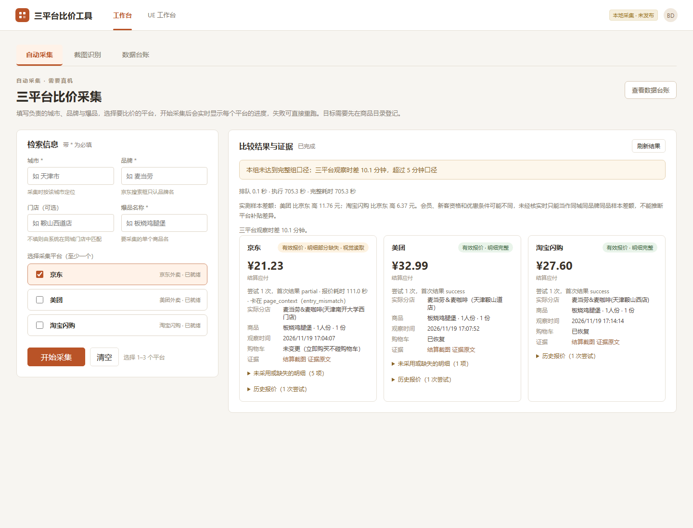
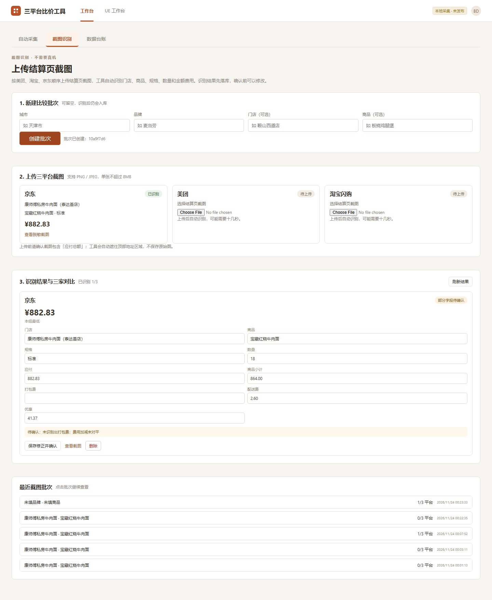
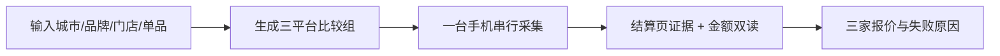

# 三平台外卖比价工具

三平台外卖比价工具是给连锁餐饮品牌和外卖代运营团队的价格情报工具。它的差异点是用一台手机串行采集京东、美团、淘宝闪购三家同店同品的外卖结算应付价，并为每一次报价留下可以复核的证据链。


## 为什么需要它

品牌在三个平台卖同一道菜，到手价却由商品价、打包费、配送费、满减和优惠券共同决定，只看标价会判断错。人工在三个 App 之间切换、核对结算页、记录证据，一组要二三十分钟，还容易漏看费用行。

这个工具把这件事做成可重复的流水线：输入城市、品牌、门店和单品，系统生成一个比较组，按京东、美团、淘宝闪购的顺序在一台手机上采价，输出三家结算应付价、费用明细、证据和失败原因。当前处于 alpha 阶段，内部验证为主。

## 能做什么

- **同一比较组拿三家结算价。** 三家平台串行执行，组内观察时间差记录下来；现有[基线](进度与实验记录/02_实验记录_基线A_2026-11-19.md)跑完 20 组，其中 8 组三家完全有效，其余失败原因逐条保留。
- **每次报价都有证据。** 保存结算页、门店、商品三类截图，结算页顶部隐私区域涂黑，金额做两次独立读取，一致才发布；证据和报价绑定，可逐份复核，数据流见[架构说明](ARCHITECTURE.md)。
- **购物车安全。** 开始前确认空车，只撤本次加购，恢复状态可验证；混合购物车不碰，恢复不了就停下来等人处理，恢复流程见[自愈闭环说明](进度与实验记录/07_自愈闭环说明.md)。
- **页面变化有兜底。** 京东 WebView 走节点链路，京东小程序门店走截图加视觉定位，美团结算页走整页截图读取，淘宝闪购走纯视觉链路；布局类型和策略登记在[布局签名表](前期调研/43_门店布局签名表.json)。
- **上传截图也能采数。** 不连手机时，BD 可以按美团、淘宝、京东顺序上传结算页截图，工具自动识别店名、商品、规格、数量和金额费用，结果落库并可人工修正；和自动采集是两个独立入口。
- **报价台账可查可导出。** 自动采集和截图识别的记录统一在数据台账里筛选，按批次看三家对比、完整性和证据，并一键下载 CSV；数据库状态也在一页里展示。
- **失败会进知识库。** 每次真机失败自动记录平台、错误码、清理状态和最近步骤，并匹配 16 条[失败模式](前期调研/42_失败模式注册表.json)；修复后标注验证运行编号，同一错误再次出现会被识别为回退风险。

## 快速开始

前置条件：Windows 10 或 11、Node.js 24.15 以上、一台开启 USB 调试的安卓手机。真机采价还需要 ADB 和本地视觉模型服务，仓库不携带模型文件和真机配置。

```powershell
npm install
npm run check        # 类型检查
npm test             # 140 项单元与回归测试
npm run build        # 构建 dist 和页面资源
npm start            # 启动服务，默认 http://127.0.0.1:4318
```

测试通过时输出 `tests 140 / pass 140 / fail 0`。没有手机和模型时，`npm test`、`npm run check`、`npm run build` 仍然可以跑通。

真机使用前，把 `android-sources.example.json` 复制为 `.runtime/android-sources.json`，填入设备序列号、应用版本和账号信息；真实配置只放在本地，`.runtime/` 已在 `.gitignore` 中排除。

## 在另一台电脑部署（从 GitHub 开始）

这一节写给要独立使用工具的 BD：使用自己的 Windows 电脑、自己的安卓手机和自己的平台账号，从 GitHub 下载代码开始，到能打开页面、开始采集为止。

仓库只包含程序代码，不包含模型文件、手机配置、平台账号和数据库。第一次部署通常需要 30 到 60 分钟，主要时间花在安装 Node.js、手机驱动和模型文件上。

### 第一步：准备清单

- Windows 10 或 Windows 11 64 位电脑，至少有 10GB 空闲磁盘（模型、截图证据和数据库都占空间）。
- Node.js 24.15 或更高版本，安装后在 PowerShell 里执行 `node -v` 能看到版本号。
- Git（用来下载代码）；不想装 Git 也可以直接在 GitHub 页面点 Code → Download ZIP。
- 一台安卓手机、一根能传数据的 USB 线，手机开发者选项里的「USB 调试」已经打开。
- 从项目负责人处拿到本地部署包，里面应该有：模型服务目录（llama-server、Qwen3-VL-2B 模型文件和启动脚本）、模型 API 密钥、`.runtime/android-sources.json`（手机序列号、App 版本和页面配置）。这些文件不会出现在 GitHub 上。
- 安卓 platform-tools（里面有 `adb.exe`），或者直接复用部署包里已经带好的 ADB。

如果只使用「截图识别」，可以不接手机，但仍然需要模型服务和 `.env`，因为识别是本地模型做的。

### 第二步：下载代码

在 PowerShell 里执行：

```powershell
cd D:\
git clone https://github.com/lny-cookiie/takeout-price-monitor.git
cd takeout-price-monitor
```

路径建议用简单的英文目录，例如 `D:\takeout-price-monitor`，避免后续 ADB 和模型路径里出现难处理的空格或特殊字符。如果下载 ZIP，解压后同样进入这个目录。

### 第三步：安装依赖并构建

```powershell
node -v
npm ci
npm run build
```

`npm ci` 安装项目依赖，`npm run build` 把 TypeScript 编译成 `dist/`，并生成页面脚本。两步都成功后再启动，否则 `npm start` 会提示找不到 `dist/main.js`。

### 第四步：放入本地配置和模型

先把仓库里的模板复制成 `.env`：

```powershell
Copy-Item .env.example .env
```

再按项目负责人提供的模型地址和密钥填写 `.env`，把 `android-sources.json` 放到 `.runtime/android-sources.json`。`.env` 至少需要这些内容：

```text
MIDSCENE_ADB_PATH=D:\takeout-price-monitor\.runtime\adb\adb.exe
TAKEOUT_MODEL_BASE_URL=http://127.0.0.1:11436/v1
TAKEOUT_MODEL_NAME=qwen3-vl-2b-local
TAKEOUT_MODEL_FAMILY=qwen3-vl
TAKEOUT_MODEL_API_KEY=由负责人提供
TAKEOUT_MODEL_STRUCTURED_OUTPUT=json_object
```

模型地址只允许 HTTPS，或者本机 `localhost`、`127.0.0.1` 的 HTTP；不要填带用户名、密码或查询参数的地址。模型服务要在这台电脑上先启动，浏览器或 PowerShell 访问 `http://127.0.0.1:11436/health` 返回 200 才算就绪。部署包里通常带有 `start-model.cmd` 或类似的启动脚本，先运行它；如果没有，按项目负责人给的模型启动命令运行，不要自己改模型文件名。

安卓配置需要和这台电脑实际连接的手机、手机上安装的 App 版本一致。京东、美团、淘宝三个平台分别有一条配置；任何一个平台没有配置，自动采集页里对应的平台会显示为不可用，不会让人反复点。

自动采集还需要目标商品已经登记在「商品目录」里。新电脑的数据库是空的，第一次使用前让负责人导入该 BD 负责的城市、品牌、门店和商品；没有目录时自动采集会提示找不到目标，截图识别不受影响。

### 第五步：连接手机并检查

1. 用 USB 线连接手机，手机上如果弹出「允许 USB 调试」的授权框，勾选始终允许并确认。
2. 在 PowerShell 里执行 `adb devices`，能看到一行 `device` 才算连接成功；显示 `unauthorized` 时重新在手机上确认授权。
3. 检查 `.runtime/android-sources.json` 里的 `device` 是否是 `adb devices` 显示的序列号，`appVersion` 是否和手机设置里看到的 App 版本一致。
4. 启动模型服务，确认 `http://127.0.0.1:11436/health` 返回 200。

### 第六步：启动服务

```powershell
npm start
```

看到 `http://127.0.0.1:4318` 后，在浏览器打开：

```text
http://127.0.0.1:4318/bd
```

这个 PowerShell 窗口要一直开着；关闭窗口服务就停止。第一次启动会自动在 `.runtime/` 下创建数据库和证据目录。

### 第七步：逐项确认能用

1. 页面顶部能看到「自动采集」「截图识别」「数据台账」三个入口。
2. 自动采集页的平台卡片显示「已连接手机」；显示「手机未连接，暂不可用」时回到第五步检查 ADB 和序列号。
3. 截图识别页上传一张包含「应付总额」的结算页截图，能看到门店、商品、金额和费用，说明模型服务正常。
4. 自动采集页填写一个已经在商品目录里登记过的城市、品牌、门店和商品，选择平台开始采集，进度条和日志会开始变化。
5. 数据台账页能看到刚才的截图识别记录；点「下载 CSV」能打开中文不乱码的表格。

### 第八步：停止、备份和更新

- 停止服务：在运行 `npm start` 的窗口按 `Ctrl+C`。
- 备份数据：停止服务后复制整个 `.runtime/` 目录，里面有数据库、证据截图和本地配置；不要在服务运行时直接复制数据库。
- 更新代码：执行 `git pull`，再执行 `npm ci`、`npm run build`，然后重新 `npm start`。更新前先备份 `.runtime/`。
- 更换手机或 App 自动更新后，`.runtime/android-sources.json` 里的 `device`、`appVersion` 要同步修改，然后重启服务；版本不一致时自动采集会拒绝启动，这是为了避免按旧页面结构误操作。

### 常见问题

| 现象 | 原因和处理 |
| --- | --- |
| `npm start` 提示端口被占用 | 用 `$env:PORT = 4320` 换端口，再打开 `http://127.0.0.1:4320/bd` |
| 自动采集页平台全部显示不可用 | 手机没连、ADB 路径不对，或者 `.runtime/android-sources.json` 里没有对应平台配置 |
| 提交采集提示找不到目标 | 商品目录没有这个城市、品牌、门店、商品的记录，让负责人导入后再试 |
| 截图识别提示模型未配置 | `.env` 没有放到项目根目录，或者模型地址、密钥填错 |
| 截图识别提示网络错误 | 本地模型服务没有启动，先打开 `http://127.0.0.1:11436/health` 确认 |
| 启动时报 App 版本不一致 | 更新 `.runtime/android-sources.json` 的 `appVersion` 和 `device`，重启服务 |
| 页面能打开但采集没有进度 | 看窗口里的日志和失败原因，按日志里的错误码查 [失败与修复知识库](前期调研/41_失败与修复知识库.md) |

### 安全提醒

`.env` 和 `.runtime/` 都不能提交到 GitHub，里面可能有模型密钥、手机序列号、账号和采集证据。这个工具默认只监听本机，不要直接把 4318 端口映射到公网；需要多人共用时先加登录认证和 HTTPS，并遵守平台使用条款和公司数据合规要求。

## 界面操作

打开 `http://127.0.0.1:4318/bd`，页面顶部有三个入口：**自动采集**、**截图识别**、**数据台账**。下面的截图来自本地真实页面。

### 1. 自动采集：填写信息并开始


在「自动采集」里填写城市、品牌、门店（可选）和爆品名称，勾选要比较的平台。门店不填时系统会在同城门店中匹配。点「开始采集」后会出现每个平台的进度条和实时日志，能看出当前卡在搜索、进店、结算还是恢复阶段。

### 2. 看进度和结果

采集过程中页面会显示排队、搜索、结算、恢复等阶段。结束后结果卡片显示三家应付金额、实际分店、商品、观察时间、购物车状态和结算证据链接；没有取得有效报价的平台会写明失败原因。



### 3. 截图识别：上传结算页截图


点「截图识别」，直接按平台上传结算页截图即可，系统会自动创建批次；城市、品牌、商品可以留空。上传后自动识别门店、商品、规格、数量和金额费用；绿色表示置信度高，黄色表示有字段需要人工确认。确认或修正后点「保存修正并确认」，记录会落进数据库。三张齐全后页面会显示三家应付金额和差额。



### 4. 数据台账：筛选、看证据、下载 CSV


「数据台账」把自动采集和截图识别记录放在一张表里，可以按日期、来源、平台、门店和商品筛选。顶部是记录数、来源分布、字段齐全数和证据数；下面能看到每条报价的金额、费用、状态和证据截图。点「下载 CSV」会按当前筛选条件导出，中文用 UTF-8 BOM，Excel 打开不乱码。同一页下方是数据库状态，包括表行数、最近运行、暂停资源和证据体量。

## 一次比较组怎么跑



1. 系统在商品目录里匹配目标，确认城市、门店和商品在平台上可售。
2. 调度器按京东、美团、淘宝闪购顺序串行执行，避免三个 App 抢前台。
3. 每个平台完成搜索、进店、加购或立即购买、进入结算页，读取应付金额和费用行。
4. 结果写入状态库，截图写入证据库；失败的组保留错误码和现场截图，不删除、不改写。

更细的分层依赖和数据流见 [ARCHITECTURE.md](ARCHITECTURE.md)。

## 更多用法

跑一次验收批次：

```powershell
npm run acceptance -- --label=A --groups=20 --input=scripts/bd-batch.mcd.json
npx tsx scripts/bd-acceptance-report.ts --a=<A目录> --b=<B目录> --out=<报告路径>
```

冻结一次基线，记录代码提交、构建产物、配置哈希和数据库副本：

```powershell
npx tsx scripts/freeze-baseline.ts --label=A
```

检查失败知识库和布局策略：

```powershell
npx tsx scripts/knowledge-registry.ts check --days=7
npx tsx scripts/layout-registry.ts match --platform=jd --text=0
```

## 状态与边界

**成熟度：alpha。** 适合内部验证和小范围定制交付，不建议直接用于生产决策。当前验证版本为京东 16.1.0、美团 12.68.402、淘宝闪购 10.69.0；应用升级后需要重新验证。

| 项目 | 现状 |
| --- | --- |
| 三平台有效组率 | 40%（20 组基线中 8 组三家有效） |
| 有效组耗时 | 中位数约 648 秒，90 分位约 707 秒 |
| 自动化测试 | 140 项全部通过 |
| 设备规模 | 单手机、单账号、串行执行 |
| 平台版本 | 京东 16.1.0、美团 12.68.402、淘宝闪购 10.69.0 |

已知限制：

- 单台手机串行执行，日吞吐有限，没有多设备调度。
- 京东门店页存在 WebView 和小程序两种容器，视觉兜底已接入，正式真机验证尚未完成。
- 本地视觉模型偶发超时，已做降级重试，批量稳定性仍待验证。
- 平台改版、验证码和账号限制是长期维护成本。
- 本工具不收集遥测数据，也不把采集数据回传到第三方服务。

这个项目明确不做的事：不破解验证码、不伪造登录身份、不采集收件人姓名电话地址、不转售平台原始数据、不承诺任意门店商品百分之百成功。完整的合规边界见 [约束与合规](产品目标/04_约束与合规.md)，能力路线见 [任意组合自适应能力评估](产品目标/07_任意组合自适应能力评估与迭代路线.md)。

## 文档

- [产品目标](产品目标/README.md)：定位、护城河、市场 Benchmark、估值和任意组合路线。
- [进度与实验记录](进度与实验记录/README.md)：实施进度、逐组实验、验收汇总、阶段复盘和自愈闭环说明。
- [前期调研](前期调研/README.md)：v2 优化计划、失败与修复知识库、失败模式注册表和布局签名表。
- [数据治理表](数据治理/数据治理表.md)：字段、对象关系和来源状态。
- [架构说明](ARCHITECTURE.md)：分层依赖、一次比较组的数据流和自愈闭环。
- [贡献说明](CONTRIBUTING.md)：问题反馈和代码变更约定。

## License

本仓库公开用于展示与评估，未授予复制、分发或商业使用许可，详见 [LICENSE](LICENSE)。
