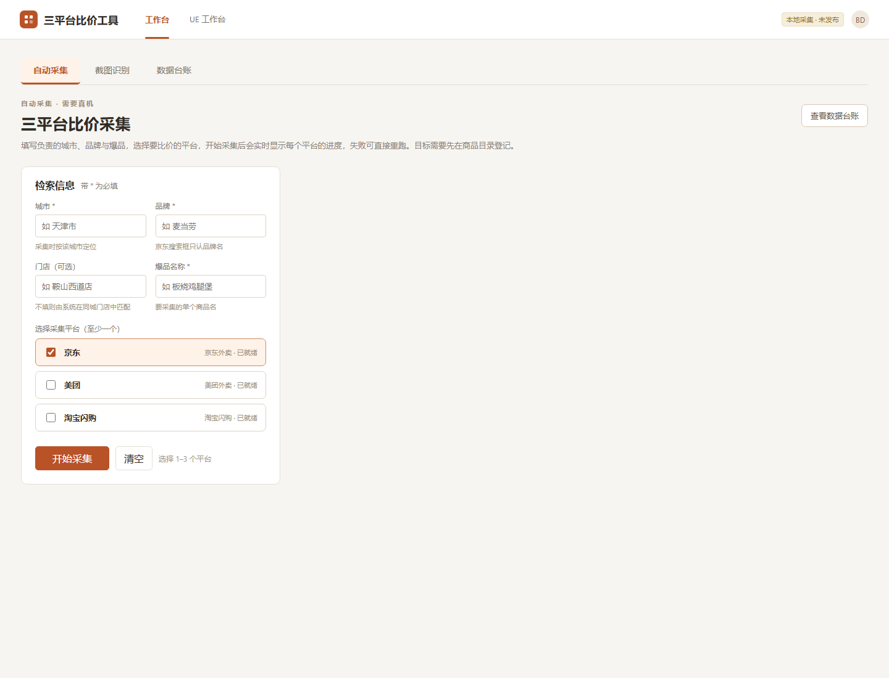
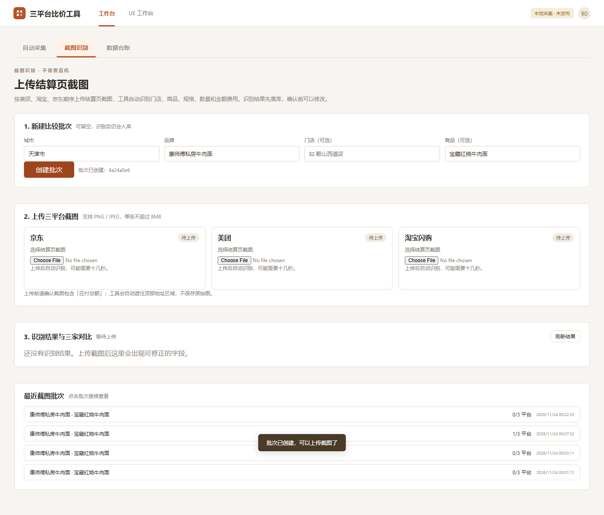
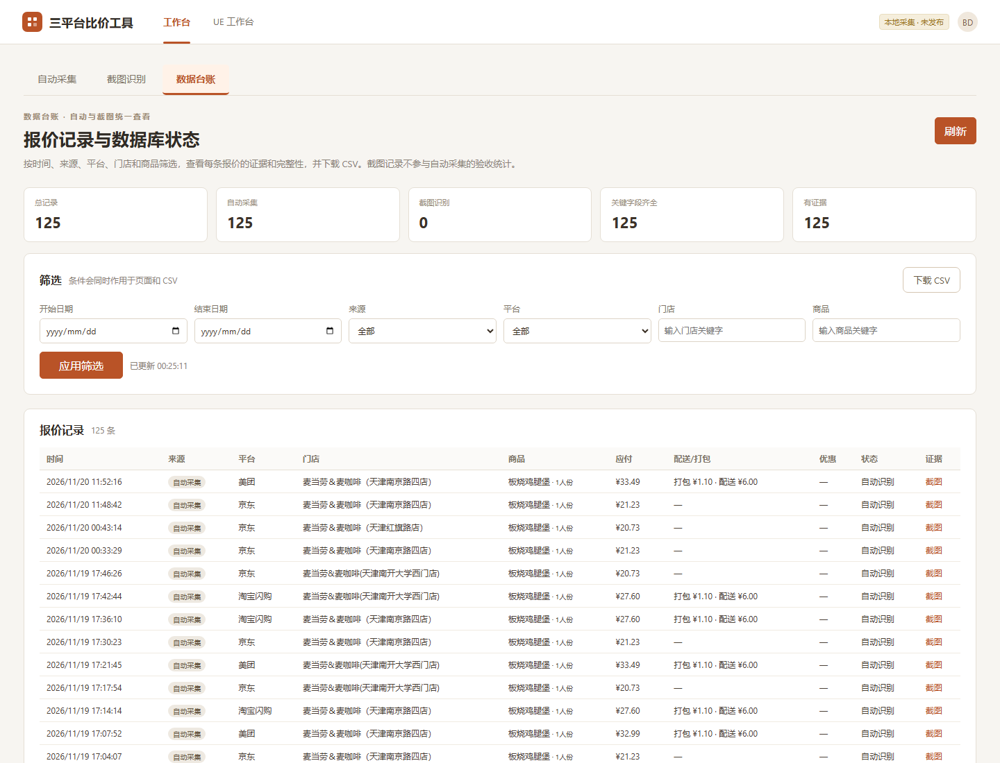
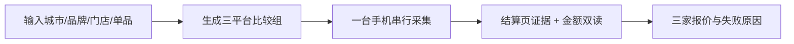

# 三平台外卖比价工具

三平台外卖比价工具是给连锁餐饮品牌和外卖代运营团队的价格情报工具。它的差异点是用一台手机串行采集京东、美团、淘宝闪购三家同店同品的外卖结算应付价，并为每一次报价留下可以复核的证据链。


## 为什么需要它

品牌在三个平台卖同一道菜，到手价却由商品价、打包费、配送费、满减和优惠券共同决定，只看标价会判断错。人工在三个 App 之间切换、核对结算页、记录证据，一组要二三十分钟，还容易漏看费用行。

这个工具把这件事做成可重复的流水线：输入城市、品牌、门店和单品，系统生成一个比较组，按京东、美团、淘宝闪购的顺序在一台手机上采价，输出三家结算应付价、费用明细、证据和失败原因。当前处于 alpha 阶段，内部验证为主。

## 能做什么

- **同一比较组拿三家结算价。** 三家平台串行执行，组内观察时间差记录下来；现有[基线](进度与实验记录/02_实验记录_基线A_2026-11-19.md)跑完 20 组，其中 8 组三家完全有效，其余失败原因逐条保留。
- **每次报价都有证据。** 保存结算页、门店、商品三类截图，结算页顶部隐私区域涂黑，金额做两次独立读取，一致才发布；证据和报价绑定，可逐份复核，数据流见[架构说明](ARCHITECTURE.md)。
- **购物车安全。** 开始前确认空车，只撤本次加购，恢复状态可验证；混合购物车不碰，恢复不了就停下来等人处理，恢复流程见[自愈闭环说明](进度与实验记录/07_自愈闭环说明.md)。
- **页面变化有兜底。** 京东 WebView 走节点链路，京东小程序门店走截图加视觉定位，美团结算页走整页截图读取，淘宝闪购走纯视觉链路；布局类型和策略登记在[布局签名表](前期调研/43_门店布局签名表.json)。
- **上传截图也能采数。** 不连手机时，BD 可以按美团、淘宝、京东顺序上传结算页截图，工具自动识别店名、商品、规格、数量和金额费用，结果落库并可人工修正；和自动采集是两个独立入口。
- **报价台账可查可导出。** 自动采集和截图识别的记录统一在数据台账里筛选，按批次看三家对比、完整性和证据，并一键下载 CSV；数据库状态也在一页里展示。
- **失败会进知识库。** 每次真机失败自动记录平台、错误码、清理状态和最近步骤，并匹配 16 条[失败模式](前期调研/42_失败模式注册表.json)；修复后标注验证运行编号，同一错误再次出现会被识别为回退风险。

## 从源码快速开始（内部）

这一节只给开发人员看。BD 直接看下面的「开箱即用 Windows 包」。

前置条件：Windows 10 或 11、Node.js 24.15 以上、一台开启 USB 调试的安卓手机。真机采价还需要 ADB 和本地视觉模型服务，仓库不携带模型文件和真机配置。

```powershell
npm install
npm run check        # 类型检查
npm test             # 140 项单元与回归测试
npm run build        # 构建 dist 和页面资源
npm start            # 启动服务，默认 http://127.0.0.1:4318
```

测试通过时输出 `tests 140 / pass 140 / fail 0`。没有手机和模型时，`npm test`、`npm run check`、`npm run build` 仍然可以跑通。

真机使用前，把 `android-sources.example.json` 复制为 `.runtime/android-sources.json`，填入设备序列号、应用版本和账号信息；真实配置只放在本地，`.runtime/` 已在 `.gitignore` 中排除。

## 开箱即用 Windows 包

BD 不再需要自己安装 Node、下载模型或编辑配置文件。我们这边生成一个内置运行环境、模型、ADB 和启动器的 Windows 包，BD 只需要下载、解压和双击。

### BD 的实际步骤

1. 打开 GitHub 仓库的 Releases 页面，下载 `TakeoutPriceMonitor-Setup-0.5.0.exe`，双击安装到 D 盘，建议路径 `D:\TakeoutPriceMonitor`。
2. 双击桌面上的「三平台比价工具」。第一次启动时，启动器会从同一个 GitHub Release 下载模型文件，界面上会显示下载进度；模型约 2.3GB，下载一次后以后不再下载。下载完成后自动启动工具服务并打开首次设置页面。
3. 第一次设置：
   - 只使用截图识别：选择「截图识别」，不需要连接手机，完成后直接上传结算截图。
   - 使用手机自动采集：连接安卓手机，按提示打开 USB 调试、允许授权、登录三个平台并确认配送地址。
4. 以后每天只需要双击同一个图标。关闭网页不会停止工具；右键托盘图标可以退出。

### 包里有什么

- `TakeoutPriceMonitor.exe`：启动器，负责下载模型、启动服务、打开页面和托盘退出。
- `dist`、`public`、`node_modules`：现有工具程序。
- `runtime\node.exe`：内置 Node 运行环境，不要求电脑安装 Node。
- `model`：第一次启动时从 GitHub Release 下载的本地视觉模型。
- `tools\adb`：手机连接工具。
- `data`：第一次启动后生成，保存数据库、证据、设置和日志；不要删除，升级时也要保留。

### GitHub Release 里有什么

GitHub 单个 Release 文件不能超过 2GB，所以不能把 2.57GB 的完整文件夹塞成一个文件。所有文件仍然全部放在同一个 GitHub Release 里，安装器第一次启动时自动下载和校验：

- `TakeoutPriceMonitor-Setup-0.5.0.exe`：安装器，约 66MB。
- `Qwen3-VL-2B-Instruct-Q8_0.gguf`：主模型，约 1.75GB。
- `mmproj-Qwen3-VL-2B-Instruct-Q8_0.gguf`：视觉投影模型，约 424MB。
- `llama-vulkan.zip`：模型运行程序，约 37MB。

启动器按上面的文件名从 `https://github.com/lny-cookiie/takeout-price-monitor/releases/latest/download/` 自动下载；不需要 BD 自己找网盘，也不需要手动合并文件。

### 当前边界

- **截图识别已经可以零配置使用**：不接手机、不导入商品目录，只要有 GitHub Release 里的模型就能用；模型在第一次启动时自动下载。
- **手机自动采集还需要平台页面配置**：不同平台 App 版本和配送地址会影响页面定位，当前安装包默认不携带真实账号和地址配置。自动采集前需要管理员把对应的 `android-sources.json` 放到 `data` 目录，或者使用后续版本的一键手机配置向导。
- 安装器已经生成，但还没有做代码签名，Windows 可能显示 SmartScreen 提示；需要在提示里选择「更多信息 → 仍要运行」。
- 自动更新尚未接入；升级方式是运行新版安装器覆盖安装，`data` 目录会保留。

### 构建这个包（我们内部使用）

构建机需要 Node.js 24.15、模型目录 `.runtime/local-model-lab`、ADB 和 Windows 自带的 C# 编译器。执行：

```powershell
powershell -ExecutionPolicy Bypass -File scripts/release/build-portable.ps1
```

生成目录是 `dist-release/TakeoutPriceMonitor`。加 `-SkipModel` 只生成约 300MB 的测试包，不能用于交付。脚本会复制程序、裁剪生产依赖、复制 Node、模型和 ADB，并编译启动器。

## 从源码开发（内部）

下面这些命令只给开发和维护人员使用，BD 不需要执行。

```powershell
npm ci
npm run check
npm test
npm run build
npm start
```

源码启动后的地址是 `http://127.0.0.1:4318/bd`。真正的模型和手机配置仍然只放在本地 `.runtime` 或绿色包的 `data` 目录，不提交到仓库。

## 界面操作

打开 `http://127.0.0.1:4318/bd`，页面顶部有三个入口：**自动采集**、**截图识别**、**数据台账**。下面的截图来自本地真实页面。

### 1. 自动采集：填写信息并开始



在「自动采集」里填写城市、品牌、门店（可选）和爆品名称，勾选要比较的平台。门店不填时系统会在同城门店中匹配。点「开始采集」后会出现每个平台的进度条和实时日志，能看出当前卡在搜索、进店、结算还是恢复阶段。

### 2. 看进度和结果

采集过程中页面会显示排队、搜索、结算、恢复等阶段。结束后结果卡片显示三家应付金额、实际分店、商品、观察时间、购物车状态和结算证据链接；没有取得有效报价的平台会写明失败原因。


### 3. 截图识别：上传结算页截图



点「截图识别」，直接按平台上传结算页截图即可，系统会自动创建批次；城市、品牌、商品可以留空。上传后自动识别门店、商品、规格、数量和金额费用；绿色表示置信度高，黄色表示有字段需要人工确认。确认或修正后点「保存修正并确认」，记录会落进数据库。三张齐全后页面会显示三家应付金额和差额。


### 4. 数据台账：筛选、看证据、下载 CSV



「数据台账」把自动采集和截图识别记录放在一张表里，可以按日期、来源、平台、门店和商品筛选。顶部是记录数、来源分布、字段齐全数和证据数；下面能看到每条报价的金额、费用、状态和证据截图。点「下载 CSV」会按当前筛选条件导出，中文用 UTF-8 BOM，Excel 打开不乱码。同一页下方是数据库状态，包括表行数、最近运行、暂停资源和证据体量。

## 一次比较组怎么跑



1. 系统在商品目录里匹配目标，确认城市、门店和商品在平台上可售。
2. 调度器按京东、美团、淘宝闪购顺序串行执行，避免三个 App 抢前台。
3. 每个平台完成搜索、进店、加购或立即购买、进入结算页，读取应付金额和费用行。
4. 结果写入状态库，截图写入证据库；失败的组保留错误码和现场截图，不删除、不改写。

更细的分层依赖和数据流见 [ARCHITECTURE.md](ARCHITECTURE.md)。

## 更多用法

跑一次验收批次：

```powershell
npm run acceptance -- --label=A --groups=20 --input=scripts/bd-batch.mcd.json
npx tsx scripts/bd-acceptance-report.ts --a=<A目录> --b=<B目录> --out=<报告路径>
```

冻结一次基线，记录代码提交、构建产物、配置哈希和数据库副本：

```powershell
npx tsx scripts/freeze-baseline.ts --label=A
```

检查失败知识库和布局策略：

```powershell
npx tsx scripts/knowledge-registry.ts check --days=7
npx tsx scripts/layout-registry.ts match --platform=jd --text=0
```

## 状态与边界

**成熟度：alpha。** 适合内部验证和小范围定制交付，不建议直接用于生产决策。当前验证版本为京东 16.1.0、美团 12.68.402、淘宝闪购 10.69.0；应用升级后需要重新验证。

| 项目 | 现状 |
| --- | --- |
| 三平台有效组率 | 40%（20 组基线中 8 组三家有效） |
| 有效组耗时 | 中位数约 648 秒，90 分位约 707 秒 |
| 自动化测试 | 140 项全部通过 |
| 设备规模 | 单手机、单账号、串行执行 |
| 平台版本 | 京东 16.1.0、美团 12.68.402、淘宝闪购 10.69.0 |

已知限制：

- 单台手机串行执行，日吞吐有限，没有多设备调度。
- 京东门店页存在 WebView 和小程序两种容器，视觉兜底已接入，正式真机验证尚未完成。
- 本地视觉模型偶发超时，已做降级重试，批量稳定性仍待验证。
- 平台改版、验证码和账号限制是长期维护成本。
- 本工具不收集遥测数据，也不把采集数据回传到第三方服务。

这个项目明确不做的事：不破解验证码、不伪造登录身份、不采集收件人姓名电话地址、不转售平台原始数据、不承诺任意门店商品百分之百成功。完整的合规边界见 [约束与合规](产品目标/04_约束与合规.md)，能力路线见 [任意组合自适应能力评估](产品目标/07_任意组合自适应能力评估与迭代路线.md)。

## 文档

- [产品目标](产品目标/README.md)：定位、护城河、市场 Benchmark、估值和任意组合路线。
- [进度与实验记录](进度与实验记录/README.md)：实施进度、逐组实验、验收汇总、阶段复盘和自愈闭环说明。
- [前期调研](前期调研/README.md)：v2 优化计划、失败与修复知识库、失败模式注册表和布局签名表。
- [数据治理表](数据治理/数据治理表.md)：字段、对象关系和来源状态。
- [架构说明](ARCHITECTURE.md)：分层依赖、一次比较组的数据流和自愈闭环。
- [贡献说明](CONTRIBUTING.md)：问题反馈和代码变更约定。

## License

本仓库公开用于展示与评估，未授予复制、分发或商业使用许可，详见 [LICENSE](LICENSE)。
