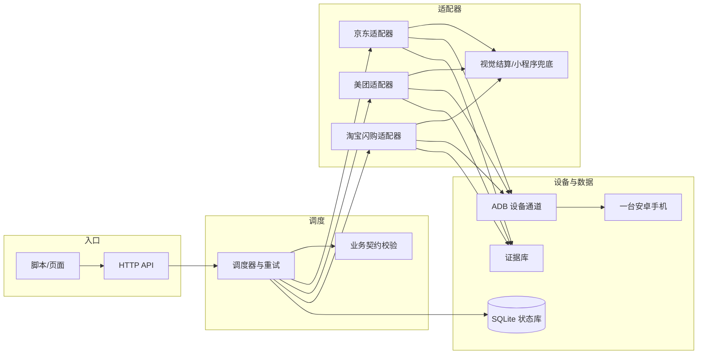

# 三平台外卖比价工具

> 在同一个比较组里，用一台手机串行采到京东、美团、淘宝闪购三家同店同品的结算应付价，并留下能对账的证据。

**一句话判断：路线是对的，价值取决于覆盖率。** 把「页面布局自适应、结算证据链、故障自愈」做成能力底座，而不是为某一家店写一套脚本，这个方向有差异化；但在跨布局覆盖率和单位成本被验证之前，它还是一个能力验证期的内部工具，不是可以批量销售的成熟产品。

## 现在能做什么

| 能力 | 现状 |
| --- | --- |
| 三平台串行采价 | 京东、美团、淘宝闪购同一台手机串行执行，避免抢前台 |
| 结算证据 | 结算页截图、门店截图、商品截图三件套，顶部隐私区涂黑，金额双读一致才发布 |
| 购物车安全 | 开始前确认空车，只撤本次加购，恢复状态可验证；混合购物车不碰 |
| 页面变化兜底 | 京东 WebView 节点链、京东小程序视觉链、美团结算截图、淘宝纯视觉链并存 |
| 失败自愈 | 失败自动记录并匹配失败模式注册表，自动找未登记问题和已修复回退风险 |
| 验收工具 | 基线冻结、20 组批次、P50/P90、证据复核、A/B 对比 |

## 当前进度（2026-11-20）

- 麦当劳基线 A 完成 20 组，其中 8 组三家有效（40%），有效组耗时中位数约 648 秒、90 分位约 707 秒；京东仍为部分成功，费用明细未补齐。
- 京东康师傅私房牛肉面门店已确认可售，门店页是 Manto 小程序容器，节点不可读；视觉探针已跑通「门店定位单品 → 商品详情立即购买 → 读取结算页」，采集器接线完成，待正式真机验证。
- 自动测试 133 项全部通过。
- 更细的过程数据见 [进度与实验记录](进度与实验记录/README.md)，产品判断见 [产品目标](产品目标/README.md)。

## 系统架构



依赖方向是单向的：入口调用应用层，应用层依赖领域契约，适配器和基础设施实现领域接口。领域层不引用设备、模型和数据库，页面定位不写进调度器。详细分层规则见 [ARCHITECTURE.md](ARCHITECTURE.md)。

### 目录结构

```text
app/
├── src/
│   ├── domain/        业务契约、报价校验、布局签名
│   ├── application/   调度、重试、映射与结果校验
│   ├── adapters/      京东/美团/淘宝页面操作与视觉兜底
│   ├── infra/         SQLite、证据、模型调用、ADB 传输
│   ├── http/          HTTP 接口
│   └── ui/            比价页面
├── scripts/           验收、基线冻结、证据复核、知识库与布局命令
├── tests/             单元与回归测试
├── public/            页面静态资源
├── 产品目标/          当前有效的产品判断与路线
├── 进度与实验记录/    实施进度、实验记录、验收汇总、复盘
├── 前期调研/          当前方案、失败知识库、失败模式注册表、布局签名表
├── 数据治理/          字段、对象与来源定义
├── ARCHITECTURE.md    分层与数据流说明
└── README.md
```

本地运行数据、采集证据、基线冻结包放在 `.runtime/` 和 `artifacts/`，不进入版本库。

## 快速开始

环境要求：Windows、Node.js 24.15 以上、一台已开启 USB 调试的安卓手机、ADB 工具链；本地视觉模型服务可选，没有模型时只能跑合成数据和单元测试。

```powershell
npm install
npm run check        # 类型检查
npm test             # 133 项测试
npm run build        # 构建 dist 与页面资源
npm start            # 启动应用，默认 http://127.0.0.1:4318
```

真机采集前需要准备：

1. 把 `android-sources.example.json` 复制为 `.runtime/android-sources.json`，填入设备序列号、应用版本、账号和页面定位配置；真实配置不入库。
2. 启动 ADB 与本地模型服务；仓库不携带模型文件，也不携带真机配置。
3. 在商品目录里登记目标和配送条件，再通过 `/api/bd/runs` 或验收脚本发起任务。

常用命令：

```powershell
npm run acceptance -- --label=A --groups=20 --input=scripts/bd-batch.mcd.json
npx tsx scripts/freeze-baseline.ts --label=A
npx tsx scripts/bd-acceptance-report.ts --a=<A目录> --b=<B目录> --out=<报告路径>
npx tsx scripts/knowledge-registry.ts check --days=7
npx tsx scripts/layout-registry.ts match --platform=jd --text=0
```

## 验收口径

- 一组有效：三家报价全部有效、购物车清理状态为未改动或已恢复、证据齐全、组内观察时间差不超过 15 分钟。
- 完整成功：三家都是 success 且费用明细完整；京东目前还达不到。
- 耗时只看有效组的端到端时间，失败组不参与分位数。
- 验收数据不删失败、不改口径凑成功率。

## 产品路线

| 阶段 | 目标 | 当前状态 |
| --- | --- | --- |
| L1 固定目标 | 单店单品的节点链路稳定 | 部分达到，基线有效率 40% |
| L2 同布局族换店 | 同平台不同门店改配置即可跑 | 美团/淘宝部分达到，京东受试点绑定 |
| L3 跨布局自适应 | WebView、小程序、自绘页自动识别并选策略 | 京东视觉探针跑通，接线完成待验证 |
| L4 任意输入 | 用户输入门店商品，自动预检、探测、采集 | 未达到，缺输入入口与覆盖矩阵 |
| L5 自动探索 | 新布局自动生成并验证策略 | 未达到，目前只有半自动记录与归纳 |

详细的能力缺口、五层能力和覆盖矩阵验收方法见 [任意组合自适应能力评估](产品目标/07_任意组合自适应能力评估与迭代路线.md)。

## 合规边界

这个项目涉及对第三方平台的自动化访问，必须遵守以下红线：

- 不破解或自动点击验证码，遇到验证码停止并等人工处理。
- 不伪造登录身份、不切换设备指纹绕过风控、不批量抓取转售平台数据。
- 只采集价格、门店、商品和费用等必要字段，不保存收件人姓名、电话、地址。
- 不把平台原始数据或证据截图对外分发。
- 对外交付前需要律师书面意见、客户授权和数据处理协议，具体约束见 [约束与合规](产品目标/04_约束与合规.md)。

## 文档地图

- [产品目标](产品目标/README.md)：定位、护城河、市场 Benchmark、合规、估值、任意组合路线。
- [进度与实验记录](进度与实验记录/README.md)：实施进度、逐组实验、验收汇总、阶段复盘、自愈闭环说明。
- [当前方案与知识库](前期调研/README.md)：v2 优化计划、交接说明、失败与修复知识库、失败模式注册表、布局签名表。
- [数据治理表](数据治理/数据治理表.md)：字段、对象关系和来源状态。
- [架构说明](ARCHITECTURE.md)：分层、依赖规则、一次比较组的数据流。

## 已知限制

- 单台手机、单账号，串行执行限制了日吞吐；没有多设备调度。
- 京东门店页存在 WebView 和 Manto 小程序两种容器，视觉兜底刚接入，正式采集还没验证。
- 京东费用明细仍未补齐，所以完整成功组为 0。
- 本地视觉模型会偶发超时，已做降级重试，但批量稳定性还要验证。
- 平台改版、验证码和账号限制是长期成本，不是一次性工程问题。

## License

内部项目，未声明开源许可证；未经授权不得复制、分发或商用。
