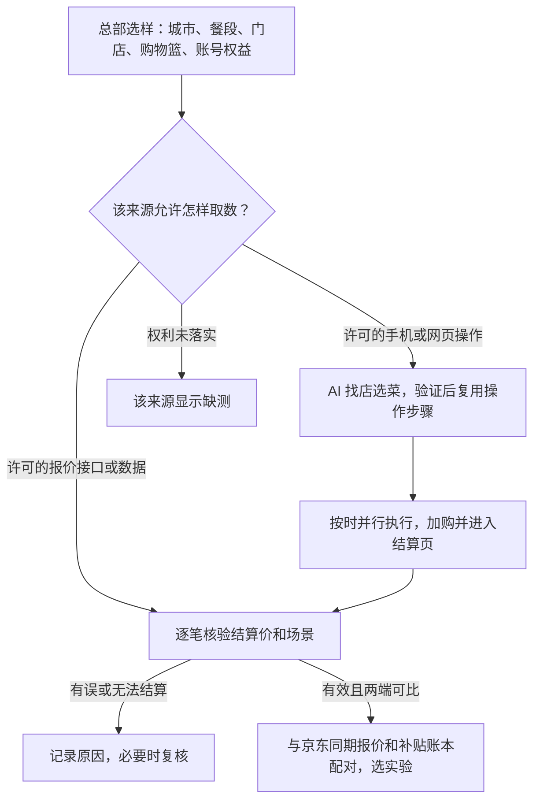

# 平台运营怎样用 AI 自动采集外卖结算价

> 2026-11-04 归档提示。本篇保留历史研究及其当时的假设。当前范围与开发约束以 [项目规范](../agent.md)、[数据治理表](../数据治理/数据治理表.md) 和 [当前采集路线](11_零外部资源下的数据采集路线_2026-11-04.md) 为准。

研究日期为 2026 年 11 月 3 日。适用于京东等平台运营团队，希望判断哪些城市、时段和门店值得调整**平台出资的补贴**。

## 一页读懂

**值得验证自动采价引擎。要把美团和淘宝闪购同时列为可交付的数据源，必须先落实两方各自的访问和商业使用许可。** 已有项目演示了手机端选店、选菜、加购、进入结算并取数。检索到的公开资料里，还没有一例同时披露了在这两个平台为竞争方长期采集的授权范围、连续运行表现、逐笔核价结果和完整成本。

| 产品负责人关心什么 | 建议 |
|---|---|
| 谁用、如何用 | 总部定义购物篮、用户分层和采样预算，城市运营每天查看有新证据的价差，并看到哪些场景采不到。京东用自己的成本和订单验证补贴调整。 |
| 哪些工作交给 AI | AI 识别页面、选择匹配的门店和规格、定位按钮、生成并修订操作步骤。已核验的步骤由程序重复执行。结算价每次重新读取。 |
| 第一版交付什么 | 一个限额任务队列、两个独立授权的来源适配器、逐笔价格证据和失败原因。真人主要参与复核、校准和授权登录。缺少某一路许可，该路显示缺测。 |
| 哪些数字决定是否值得扩容 | 正确的无人工操作完成率、同场景成对可比率、人工逐分核对的价格一致率、每条有效报价成本，以及已覆盖场景占京东补贴金额的比例。 |
| 已做到哪一步 | 已查阅产品、公开代码、平台条款和云资源价格，并复算以下成本。真实账号和入口、项目许可、跨端价格一致性、持续运行和补贴效果仍待验证。 |

## 有哪些先例可以借用

| 先例 | 公开资料能核实什么 | 对本项目的意义 |
|---|---|---|
| UCloud OrderWise | 基于 AutoGLM，按平台在不同 Android 设备并行操作。示例用美团 App、京东外卖 App 和淘宝闪购手机网页。作者公布 5 项任务全部成功，平均耗时 65.25 秒，原框架为 151.38 秒。 | 最适合参考手机操作流程和任务队列。测试样本很小，且包含不同平台数的任务，耗时不能直接用于估算每条真实报价。[项目与测试](https://github.com/ucloud/orderwise-agent) · [三端操作配置](https://github.com/ucloud/orderwise-agent/blob/main/examples/apps_config.json) |
| ShopVision × Browserbase | 面向零售企业的竞争监测。浏览器 Agent 探索页面，根据操作过程生成脚本，核对截图再运行。案例披露发表前 30 天运行逾 130 万次浏览器会话，新站点采集流程从 13 小时缩至 3 小时。 | 可借用生成、验证、复用脚本的做法。数字由合作方披露，覆盖多种网页情报。一段会话可能有多次操作，不能折算为一条中国外卖结算价。[客户案例](https://www.browserbase.com/blog/case-study-shopvision) |
| Burger Index | 在伦敦以同一老客、地点和购物篮比较 Uber Eats 与 Just Eat，公开展示 Popeye’s 和 Waitrose 两组结果。厂商称产品覆盖数千地点，最快每日更新三次。 | 最接近平台运营需要的比较单位。公开材料能核对案例口径，尚不能核实每次结算都是 AI 自动完成或国内采集权利。[原始分析](https://www.burgerindex.com/insights/just-eat-vs-uber-eats-who-wins-on-affordability) |
| 国内可用的执行工具 | 智谱官方文档列有在淘宝闪购搜索指定咖啡及在美团点外卖的任务。阿里云无影支持云端 Android 执行，腾讯云也开放了读取界面、点击、输入和人工接管的工具。 | 原型无需自研能看屏幕的基础模型。可先在客户认可的境内环境选一种执行器。云厂商提供设备，目标平台决定该采集用途能否接入。[智谱](https://docs.bigmodel.cn/cn/guide/models/vlm/autoglm-phone) · [阿里云](https://help.aliyun.com/zh/ecp/what-is-cloud-phone-mobile-use-agent) · [腾讯云](https://cloud.tencent.cn/document/product/1801/139886) |

**为什么不能直接把 OrderWise 当成企业产品。** 它的示例允许使用默认地址、多家店里的同品牌商品和默认规格，还会在美团选择可用红包。源码对未达到起送条件的情况可返回总价 0，部分缺失的费用也会转为 0。平台业务需要分别记录“无法结算”“费用未知”和“明确免配送费”。[操作模板](https://github.com/ucloud/orderwise-agent/blob/main/examples/apps_config.json) · [金额解析](https://github.com/ucloud/orderwise-agent/blob/main/phone_agent/utils/price_extractor.py)

更关键的是，其公开评测函数在成功任务中检查所需金额字段是否存在、类型和取值范围是否合理。即使把页面上的 29.90 元错读成 19.90 元，只要其他字段满足条件，这个函数也可能判为通过。这里的例子是对代码的解释，尚未在项目中执行。企业验收要以独立复核的同一张结算证据为真值。[评测源码](https://github.com/ucloud/orderwise-agent/blob/main/benchmark/core/metrics.py#L50-L127)

## 采集系统怎样工作

| 步骤 | 自动执行什么 | 哪种情况退出 |
|---|---|---|
| 1. 分派任务 | 程序按城市、商圈、餐段、品牌、预算分层。AI 提议增加波动或高投入场景的样本，保留固定样本及随机抽样供校准。每条任务有授权编号、入口、门店、篮子、配送点、权益、时间窗和限额。 | 来源许可过期或达到额度时不派发。单次选择概率和加采原因分别记录，异常加采只用于定位问题。 |
| 2. 进入店铺 | 从授权的入口开始，AI 对照门店地址、名称和已确认的门店映射，程序核对配送点。优先使用授权的专用账号，登录由指定人员完成。 | 同品牌多门店无法区分、地址变动、验证拦截时停止。人工按合作约定处理账号问题。 |
| 3. 选菜和加购 | AI 处理规格弹窗，识别套餐子项、冷热、杯型、加料、数量。程序在加购后对照整篮。只操作专用空篮，按任务配置读取已生效券。 | 缺货、低于起送价、车内有其他商品、只能自取或要额外购买会员时，分别记录状态。保留原始计划样本，不用另一个门店来填补它。 |
| 4. 进入结算并采价 | 确认是配送订单的提交前页面，等金额稳定，读取应付金额、配送费、包装费、已用权益及采价时刻。提取保留最小脱敏证据。 | 提交订单、付款和领新券等动作在执行器中禁用。无法确认操作目标时不点击。限截屏页面按授权约定处理，不突破保护。 |
| 5. 校验与修订 | 可读控件和独立图像读取结果交叉核验，明细完整时按分核算。新版本先跑少量固定任务。AI 给出步骤修改草案，通过回归样本及人员审核后替换。 | 同屏金额冲突、证据缺失、支付方式变化或出现新的收费语义时隔离该批次。不得把昨天的价格当作今天采到的价格。 |

**选手机还是浏览器取决于要交付哪个入口的价格。** 用户主要在淘宝 App 内闪购下单，就采那个入口。若许可覆盖手机网页，可以用 Playwright 配合 AI 定位元素。要把网页当作 App 的替代来源，须在相同账号、地址、篮子、时段对照，分别核对优惠与总价，保留差异记录。只要存在未解释的系统性差异，就分别报告。固定步骤可按 App 版本复用，原生手机界面不能直接套用网页的元素定位缓存。[Midscene Android](https://www.midscenejs.com/sdk/android) · [缓存适用范围](https://www.midscenejs.com/caching)

对集团而言，覆盖率用京东自己的补贴金额加权。分子是有新鲜、可比报价的场景对应的京东补贴支出，分母是同周期目标场景全部京东补贴支出，先按唯一场景去重。标准账号提供基准价。新客、会员和专享券要靠来源认可的真实权益或受托报价服务验证。机器长期反复看同一批门店还可能改变账号看到的推荐或优惠，需要用有权取得的独立样本校准。各竞对的市场份额、平台出资和用户对补贴的反应不能从这些样本直接推出。

## 授权要具体到哪些权利

1. **淘宝闪购**。2026 年 10 月 15 日生效的声明已明确，第三方智能体或自动化程序访问相关产品服务前须获得服务提供者及／或关联方的明确书面许可，并完成必要的安全与合规评估。搜索、浏览、获取商品信息均在范围内。在真实个人手机上运行、只到结算页、由个人启动任务，都不能替代该要求。[淘宝闪购法律声明](https://terms.alicdn.com/legal-agreement/terms/c_platform_service_agreement/20261008175730962/20261008175730962.html)
2. **美团**。美团规则中心的《美团用户服务协议》约束用未经认可的程序或非正常浏览等方式获取内容，且个人使用默认受非商业用途约束。由拟使用入口对应的业务主体确认实际签署版本，向平台取得能覆盖自动采价及对京东使用的书面依据。面向商户开放的店铺商品查询依赖逐店绑定和权限开通，字段与用途均须单独核对。[用户协议第四部分](https://rules-center.meituan.com/m/detail/4) · [业务接入和权限](https://developer.waimai.meituan.com/home/guide/46)
3. **京东、服务商与账号持有人**。京东确认用途和接收范围，提供同期报价、补贴成本及供实验使用的经营数据。若用个人账号，须落实个人信息处理依据，明确账号权益信息、设备操作、接收方、留存与撤回方式。账号持有人应控制登录。优先使用固定公共配送点与专用设备，敏感字段须在送模型前遮蔽。京东、SaaS 和云模型服务商确认委托范围、地域、访问者、删除和分包条件。[个人信息保护法](https://www.cac.gov.cn/2021-08/20/c_1631050028355286.htm)
4. **直接采购的情况**。由京东采购及法务向供方索取来源链、自动访问与再提供权利、具体接收方和用途、更新频率、配额、样本、价格及撤销条件。国内服务商确实公开列出美团和饿了么的 O2O 价格监测。其公开页列出价格与优惠信息，尚缺本项目所需结算口径、合法来源证明和允许给竞争平台使用的文件。[鼎点产品页](https://www.dingdiankj.cn/channels/34.html)

**申请可以写到一段话里。** 请确认是否允许指定服务商在列明的城市、入口、账号和日配额内自动查找约定门店，选定固定篮子，到提交前保存应付金额及必要脱敏凭证，并供京东平台运营内部评估自身补贴。请列明允许的交付粒度、保存期限、价格、安全评估、停止及删除机制。如能提供同口径报价接口或数据文件，优先评估该方式。该申请是待发草案，是否有合作意愿尚未知。

书面许可也需要竞争合规审查。合作范围限定到允许观察的已展示报价，京东和竞对各自保留未来补贴、预算、成本和客户数据。不得通过 SaaS 交换非公开策略、协调定价或规避访问控制。具体行为是否违法要结合手段和影响判断。[反不正当竞争法第十三条](https://www.cnipa.gov.cn/art/2026/5/20/art_104_206437.html) · [互联网平台反垄断合规指引第六条](https://www.samr.gov.cn/zw/zfxxgk/fdzdgknr/fldzfys/art/2026/art_ad10c5301fcb426cb839153ca9f5a274.html)

## 两档规模的长期成本

下表为**获准使用标准云手机，且云端入口实测适用时**的采集运行预算。币种为人民币。每家店按每平台一个指定账号权益条件、一个配送点、2 个篮子、3 个餐段、2 个竞对、每月 30 天排期。京东自供数据。每条是单个竞对的一次结算观察，三端都齐才形成完整比较。新客或会员需要另设样本。

| 月度项目 | 100 家监测店 | 1,000 家监测店 |
|---|---:|---:|
| 计划采价次数 | 36,000 | 360,000 |
| 含额外 10% 技术重试的执行次数 | 39,600 | 396,000 |
| 假设最终有 85% 计划取得有效报价 | 30,600 | 306,000 |
| 餐段所需并行节点 | 13 | 123 |
| 节点月租 | 1,547 | 14,637 |
| 超出套餐的模型积分 | 2,150 | 21,600 |
| 人工处理异常与独立抽查 | 1,890 | 18,900 |
| 工程维护、适配入口变更 | 6,000–25,000 | 15,000–50,000 |
| 调度、带宽、证据存储和基础监控 | 800–2,000 | 2,000–6,000 |
| **每月运行小计** | **12,387–32,587** | **72,137–111,137** |
| **每条有效报价运行成本** | **0.40–1.06** | **0.24–0.36** |

**可核实的单价。** 阿里云无影 Agentic Mobile 华东标准应用套餐目录价为每节点每月 119 元，含 1,000 积分，增购为每积分 0.05 元。本文用这一种已公示的国内方案定量，京东具体能采用哪家云、云端账号是否显示同等权益、能否获批所需并发，仍要分别核实。自建真机或更换模型须另算硬件折旧、运维和推理账单。[官方价目表](https://help.aliyun.com/zh/ecp/jvs-mobile-billing-instructions)

**需要用试点替换的参数。**

- 每次尝试平均占设备 2 分钟，含失败与复位。每天三个餐段共 6 小时可用，考虑错峰、等待和任务分配后，有效利用率取 60%。一个节点一天可执行 108 次。按三餐均匀分布向上取整，得到 13 和 123 个节点。实际排期还受账号授权、餐段峰值、地域、按分钟限额和同窗配对约束。
- 预算按每次尝试合计 1 万个规划 token、10 万个界面操作 token 估算。token 是模型处理文字和图像的计量单位。按上述产品分别每百万 token 消耗 40 和 10 积分，合计每次 1.4 积分，扣除套餐内积分后按 1,000 积分档向上取整。实际账单取决于操作步数、图像和路径复用率。模型免费体验价不能用于长期推算。
- 人工按 60 元/小时。假设 2% 的尝试需要 2 分钟异常处理，另外对 1% 的有效报价抽查 1 分钟。异常处理限于获准的诊断或接管。售罄和未达起送直接记缺测，只有获准的瞬时技术失败才允许有限重试。85% 的分母是原计划，不是含重试的执行次数。
- 两档分别用 0.2–0.5、0.5–1 个工程师全职当量，按每人每月 3 万–5 万元的内部完全成本估算。实际有夜宵值守、多城市交付或经常改版时，以排班和故障记录调整。1,000 店档还约需每月 264 小时处理异常、51 小时抽查，这些工时已单独计入。

**完整预算仍有未知项。** 月度小计应再加数据权利或许可费、账号与会员样本维护、隐私合规和企业安全支持、一次性研发与接入的月摊销、京东内部配合成本及税费。小计不含补贴实验资金。举例说，若授权合同按每条有效报价另收 0.50 元，1,000 店档一个月会再增 15.3 万元。若供方是整包交付，应当以采购费**替换**自建采集相关费用，只保留本方验收成本。两项测算都不是厂商报价。

**什么时候会失去成本优势。** 1,000 店档的人工异常处理率从 2% 升至 10%，仅此一项每月多 63,360 元。三个餐段压得更窄，所需同时在线的设备会增加。四种真实权益并行观察，在其他条件不变时，任务量约变为四倍。长期每条有效报价的成本取决于这些约束，不能仅用云手机月租相除。

## 用两周决定值不值得继续

| 阶段 | 谁做、怎样做 | 决定什么 |
|---|---|---|
| 先行验证，可立即准备 | 京东业务确定 1 城、公共配送点、2 个标准篮子及可承受的每条价格。工程在自建模拟结算页或京东授权测试环境验证完整操作链。京东法务和采购同时核对两个竞对或供方的权利与用途。 | 模拟页必须能拦住错店、缺规格、购物车污染、券条件变化、缺货和误提交。记录开发耗时。能通过说明程序可测试，跨平台线上能力仍需实测。 |
| 获得对应来源许可后 | 1 名自动化工程师、1 名兼职数据质量人员、1 名京东运营联络人。用 4 个获准执行节点，20 家配送可达的店 × 2 个篮子 × 午晚餐 × 2 个竞对 × 7 天，形成 1,120 个计划观察。每个平台分配 560 次，京东提供同期匹配报价。 | 在相同的任务层中交替分配“纯脚本”与“脚本加 AI 处理页面变化”，比较有效报价、错误接受率、人时和每条成本。在自建环境重放同一批页面变化，补足真实界面一周未改版的情况。 |
| 判断能否扩容 | 每条候选报价都对照留存的同屏证据核对到分。独立抽取配对任务，按授权人工重走完整路径核门店、篮子、地址、权益与渠道。两次价格可能变化，同屏真值与重走结果分开。 | 暂定要求为自动正确完成率 ≥90%（含正确判为售罄等），真实报价产出率 ≥85%，入库金额一致率 ≥99%，严重误提交为 0。列明分母、各入口和各餐段的结果。成对覆盖不足、关键权益缺失时，不把单边报价当作完整样本。 |

首轮工程费以 10 个开发人日加 4 个质量人日、每人日 1,500–2,500 元估算。另留约 1,000–1,700 元给测试资源，合计约 **2.2 万–3.7 万元**，不含许可、法律评估和客户工时。两周从测试条件齐备后算，取得许可的时间未知。首次能进入结算页只验一条流程。规模化前还要跨至少一次实际改版及一个促销周期观察异常率和恢复时间，建议连续运行至少四周。若获取的只是测试沙箱报价，结果仅标为测试。

售前合约宜分别约定授权入口的时段可用率、在有效期内完整成对的比例、金额错误处理和单条价格上限。运营端应同时展示“本次单边有价”“三端按时且可比”“未覆盖”。采集的商业价值最终按京东的增量贡献和补贴实验评估。若两个竞对均不许可，且没有可审计且允许对京东交付的同口径数据源，就不应承诺这项三平台自动结算报价服务。获准的商家历史成交数据可以支持另一种分析，但只能比较实际发生的订单，无法补出某时刻另一平台的未成交报价。
