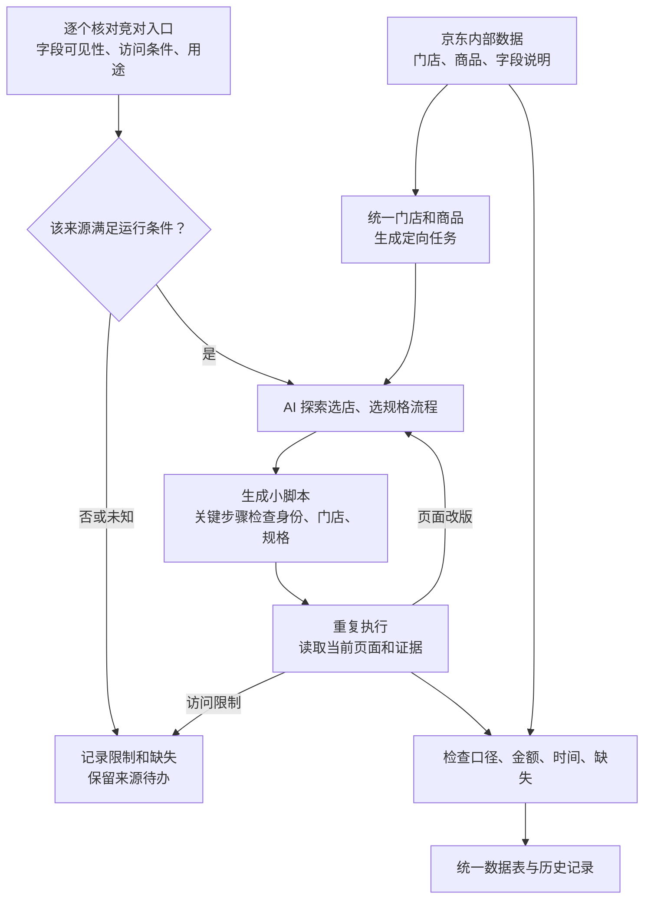

# 只有 AI 和京东内部数据时，怎样推进竞对采集

更新日期 `2026-11-04`。当前工作依据 [项目规范](../agent.md) 和 [数据治理表](../数据治理/数据治理表.md)。本文是路线判断与验证设计，未运行真实竞对采集。

## 一页读懂

**你的理解基本正确。先定义数据，再自建采集器读取竞对前端，是直接的技术路线。** 但决定它能否长期运行的条件有四个。页面能否访问，页面有没有所需字段，采到的数据是否代表目标场景，以及取得和使用方式是否满足条件。AI 可以改善页面理解、操作和维护，不能凭空得到隐藏字段或真实用户资格。

项目的使用者仍是平台运营团队。本阶段交付三平台统一字段、京东导入路径、竞对来源可用性记录和可追溯数据，不推进补贴策略。当前只有京东内部来源得到用户确认，尚未接入样本。

**我的建议是做“京东数据引导的定向采集”，先验证菜单和展示价格，再决定是否进入结算。** 用京东已有门店和商品缩小任务范围，AI 探索具体入口并生成可复用流程，固定程序执行已验证步骤，保留证据和失败原因。直接开发全国、多账号、全时段采集系统缺少依据。

有一个条件目前不能满足。淘宝闪购现行声明把第三方 AI 搜索、浏览、获取信息和模拟操作纳入事先书面许可要求。按竞对不授权的前提，当前无法把该入口称为已经具备合规条件的持续来源。美团也有程序采集限制。不能用“真机”“像人点击”或“内部研究”替代核查。[淘宝闪购声明](https://terms.alicdn.com/legal-agreement/terms/c_platform_service_agreement/20261008175730962/20261008175730962.html) · [美团用户协议](https://rules-center.meituan.com/m/detail/4)

**如果“没有其他来源、不获许可、必须持续取得两家登录后个性化结算价、合规必须有保证”这几个条件都固定，目前没有查到被证实可行的方案。** 可以继续做采集器和京东数据接入，但竞对生产数据的可用性仍然是未解决项。

## 1. 先拆清三个问题

| 问题 | 第一性原理判断 | 对我们意味着什么 |
|---|---|---|
| 数据是否存在于目标页面 | 展示价、某个账号的应付价和平台实际出资不是同一个字段 | 采集页面只能得到当时实际暴露的数据 |
| 一个价格代表谁 | 应付价取决于门店、篮子、地址、时间、资格、入口及临时状态 | 一个账号的价格不能代表新客、老客、会员和整个平台 |
| 扩大执行量能否解决问题 | 更多设备可以增加尝试次数，但不会新增访问权或不可见字段 | 扩容前必须证明来源、口径和有效产出 |

概念上可以把报价写为 `P = f(平台、门店、篮子、地址、时间、用户资格、入口、当前状态)`。我们观察的是函数在某组条件下的输出，无法仅靠京东数据还原竞对的整套函数。

治理表解决字段含义和关系。采集器解决获取动作。两者还需要共同解决证据、缺失和运行条件，不能把一张完整表当成所有字段都可取得。

## 2. 从前端具体采什么

| 层次 | 可尝试的内容 | 难度来源 | 第一阶段处理 |
|---|---|---|---|
| 门店和菜单 | 店名、地址、商品名、规格、页面售价、营业与可售状态 | 搜索定位、同名店、菜单分页、页面可能仍要求登录 | 优先验证，来源条件先核对 |
| 公开活动 | 门槛、活动时间、价格条件、可见优惠文案 | 文案可能省略资格、叠加和库存条件 | 保存原文，不补全隐藏规则 |
| 具体结算 | 当前购物篮应付、配送和包装等可见明细 | 登录、账号资格、地址、最小起送、券及风控 | 单独验证，不能由菜单价推算成实测价 |
| 全部用户实际体验 | 各分层真正可获得的价格分布 | 需要真实、有代表性的用户资格 | 只有 AI 的条件下无法声称完整覆盖 |
| 竞对资金承担 | 平台、商家和支付机构各出多少钱 | 通常不由消费前端完整披露 | 当前不采，不从优惠标签反推 |

第一阶段可以把用户分层标为 unknown。这样得到的数据能够描述已观察到的场景，但不能用于声称某个人群的普遍价格。

## 3. 值得采用的行业做法

| 证据 | 已看到什么 | 本项目可借用什么 | 证据不能证明什么 |
|---|---|---|---|
| ShopVision 与 Browserbase 企业案例 | 厂商披露前 30 天运行超过 130 万次浏览器会话。Agent 探索页面并截图，代码 Agent 生成 Playwright 脚本，再核验和修正 | 让 AI 负责建立及维护采集流程，稳定流程重复执行 | 北美网页案例不能证明中国外卖入口的许可、账号稳定性或结算覆盖。[来源](https://www.browserbase.com/blog/case-study-shopvision) |
| UCloud OrderWise 开源项目 | 有三平台选店选品及报价操作流程，作者展示 5 个任务成功 | 参考手机执行器、任务记录和价格提取接口 | 小样本演示不代表长期服务。其“价格准确率”代码主要检查字段和数值范围，未对同屏真实金额独立核验。[项目](https://github.com/ucloud/orderwise-agent) · [评测代码](https://github.com/ucloud/orderwise-agent/blob/main/benchmark/core/metrics.py) |
| ReUseIt 研究 | 从成功和失败尝试生成可复用流程，并增加步骤执行条件 | 在进入门店、选规格、到达结算等关键节点检查状态 | 论文任务成功率不能移植为本项目的成功率，也不解决访问权。[论文](https://arxiv.org/abs/2510.14308) |
| Midscene 官方能力 | 支持 Android 的 ADB 控制，也支持缓存 AI 计划，网页可以缓存 DOM 定位 | 统一界面操作能力，减少重复模型调用 | DOM 定位缓存仅适用于网页。缓存操作步骤不等于可以复用旧价格。[Android](https://www.midscenejs.com/sdk/android) · [缓存说明](https://www.midscenejs.com/caching) |

这些证据支持“AI 加速建立和维护采集器”的工程路线。本次没有发现经过公开独立核验、同时满足两家竞对拒绝授权、长期大规模结算采价和合规保证的案例。本机 AI 方法库也未提供这种项目验证证据。

## 4. 建议的最小技术路线



### 4.1 用京东数据生成任务

先拿一小份京东门店和商品导出。优先需要店名、营业地址、内部店铺 ID、商品名、规格和渠道价格。检查字段含义后选择 10 家店，每店 3 个明确规格的商品。

AI 依据这些种子寻找竞对候选店和商品。地址、门店和规格不一致时保留候选，不能为了提高匹配率接受同品牌其他门店。京东主数据只帮助定位，不提供竞对价格真值。

### 4.2 每个平台只验证一个入口

先核对是否存在满足使用条件的网页入口及所需字段。网页若可用，读取页面结构并用脚本操作。若目标数据只有 App 展示，再评估 Android 界面控制。不能假定手机 H5、淘宝主 App 闪购入口和独立闪购 App 价格相同。

输入是指定门店、规格、请求字段和动作预算。输出是观测记录或明确的限制原因。搜索不到、要求登录、遇到验证码、商品售罄和解析失败分别记录。

目前这一步的竞对在线运行条件尚未满足。可以先用京东获准环境、明确允许处理的现有样本或标注为模拟的本地页面验证程序，不将离线通过说成竞对采集通过。

### 4.3 AI 参与全部关键环节

| 环节 | AI 做什么 | 固定程序保证什么 |
|---|---|---|
| 找店和选品 | 理解名称、地址和规格，提出候选映射 | 限定搜索目标，保留未确认状态 |
| 探索操作流程 | 找到菜单、规格选择和报价位置 | 限定动作，不下单，不主动领取或购买权益 |
| 生成执行脚本 | 把验证过的步骤变成重复操作 | 预算、超时、版本和步骤检查 |
| 读取页面 | 解析语义、价格条件和金额位置 | 金额转分、类型检查、原始证据关联 |
| 处理改版 | 识别布局变化并提出修复 | 通过已留存样例和小范围复验后启用 |
| 安排任务 | 提议优先检查变化大或证据过期的对象 | 实际频率不超过来源条件和任务预算 |

若页面变化或字段冲突，AI 可以重建流程。若遇到访问限制，就停止该任务并记录。两类问题不能使用同一个“自动重试”策略。

### 4.4 通过减少重复工作降低成本

一张菜单可以读取多个商品，先按店收集，再按商品拆记录。店铺和规格映射在没有变化证据时复用。价格仍要按计划重新观察。

对于已经可用的来源，先完整获取一个小范围，再按字段变化和业务需要安排复采。跨来源未观察到的变化不会自动发通知，因此“按变化采集”仍需周期检查或来源正式提供的变更事件，不能宣称零轮询。

仅对少量有实际需求的篮子读取结算价。菜单变化不能覆盖所有配送费、个性化券和账号变化，结算价必须保留独立的复采规则。抽样结果不能直接代表全国市场。

## 5. 最小验证及停止条件

以下是待执行计划，当前未承诺完成时长或成功率。

| 步骤 | 工作 | 产物及验收 |
|---|---|---|
| 1 | 对京东 10 店、每店 3 品的内部样本做字段映射 | 30 个标准商品目标，明确价型、规格和缺失 |
| 2 | 逐个核对两个竞对的实际入口、访问规则、可见字段与用途 | 两份来源能力记录。条件不满足就记录停止，不进入在线采集 |
| 3 | 在满足运行条件的来源上，每家店读取一次菜单，重复 3 轮 | 每平台最多 30 次菜单访问，理论上最多 90 条商品观测。所有失败保留 |
| 4 | 如结算条件另行满足，再取 2 店、每店 1 篮、每平台重复 3 轮 | 最多 12 次竞对结算任务，明确账号和地址条件。未满足则不执行 |
| 5 | 核对同屏原始证据和输出，统计运行成本及人工介入 | 判断哪类数据可稳定产出，避免只报告成功示例 |

建议小试验中逐条核对门店、规格、价型和金额。任何未经说明的错店、错规格、用旧价格顶替当前价格，均需修复再继续。不能用几十次通过证明长期 99% 可用。

如果两家竞对入口都不满足使用条件或所需字段不可见，验收结果就是“当前约束下暂无可用的竞对持续来源”。京东治理、字段契约和离线执行器仍可复用，但不应再投入设备扩容。若用户仍要求持续结算数据，就需要重新决定数据来源、覆盖要求或可接受的业务风险，不能让 AI 替用户做这个决定。

## 6. 成本怎样评估

先在试验中记录实际费用，暂不购买云手机或部署重型模型。已有电脑和设备能否使用，需要现场环境确认。模型接口、必要设备、样本核验和长期修复都会产生真实成本，AI 编程不会消除这些成本。

```text
每条有效数据成本
  = 全部尝试的模型费用、设备费用、核验和维护费用之和
    ÷ 通过口径和证据检查的有效记录数
```

仅作为容量算例，假设每次尝试最终产生一条记录，有效率 85%，每次 2 分钟，月目标 1 万条有效记录。需要约 11,765 次尝试、392 个设备小时。若每台设备每天安排 6 小时，实际利用率 60%，每月 30 天，单台可提供 108 个有效设备小时，需要至少 4 台。峰值并发、来源限额和人工接管可能进一步限制产量。这些都是假设，不是本项目测得的能力或采购报价。

因此，菜单批量读取和流程复用值得优先验证。结算动作的账号状态、现场异常和维护往往会使成本上升，不能只计算单次模型 token 费。

## 7. 合规判断需要保持的两个区别

**平台拒绝合作，不意味着它能禁止所有独立合法取得的公开价格事实。** 最高法指导性案例 264 号支持在该案条件下，对公开市场数据合法采集、合理加工和使用。该案来源和用途与登录后的个性化外卖报价不同，不能直接套用为自动采集许可。[最高法案例](https://www.court.gov.cn/zixun/xiangqing/474471.html)

**平台协议限制与法律违法认定也不同。** 是否构成违约或不正当竞争需要具体事实。现行反不正当竞争法第十三条约束通过欺诈、避开或破坏技术管理措施等不正当方式获取使用数据并损害相关权益的行为。当前项目不能以低频或不下单就声明合规。[法律正文](https://www.cnipa.gov.cn/art/2026/5/20/art_104_206437.html)

搜索引擎摘要、历史截图和品牌宣传可以帮助发现店铺或价格线索，时效、用途和价格范围要单独记录。它们不能替代当前指定账号的结算报价。把采集外包或换成用户个人账号，也不会自动补齐全部条件。

## 8. 本次完成与未完成

已完成当前路线的第一性原理拆解、官方规则及技术案例核查、项目规范、治理表和文档归档。已知美团协议页面本次直接读取多次超时，搜索索引仍可核对公开版本，后续具体入口启用前需再查实际适用条款。

未获取京东真实样本，未登录竞对账号，未执行竞对自动采集，未采购服务，未验证长期成功率或费用。本文件不把工程建议写成已经跑通的系统。
