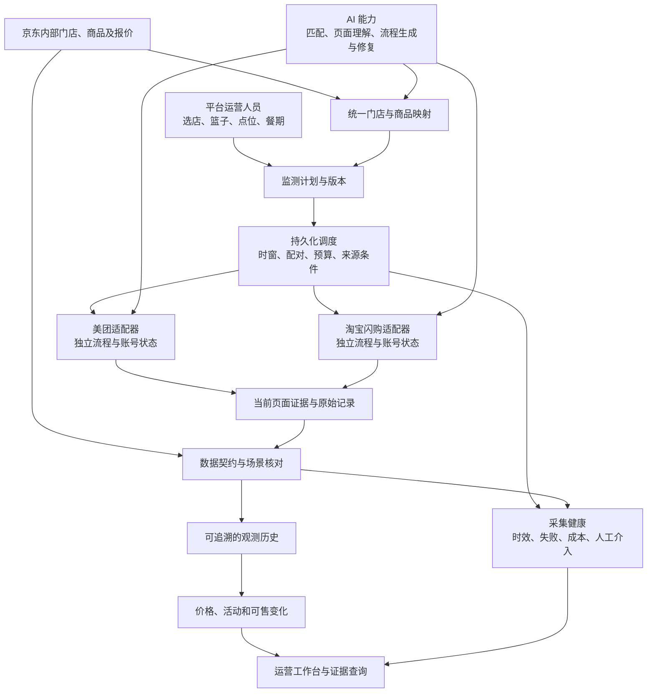

# MVP 产品方案与整体架构

> 2026-11-05 实施更新：已开发本地模拟研发样机，当前状态以 [开发与验证说明](14_MVP开发与验证说明_2026-11-05.md)和[运行入口](../README.md)为准。下文保留开发前的产品设计与真实上线验收目标。

版本 `0.1.0`，2026-11-04 起草，2026-11-05 完成复核。面向平台运营团队。配套 [自动定时采集技术方案](13_两平台自动定时采集技术方案_2026-11-04.md)、[项目规范](../agent.md)、[数据治理表](../数据治理/数据治理表.md)。

## 一页读懂

**产品定义**。第一版做“固定场景的三平台价格与供给监测工作台”。运营人员设定店铺、商品篮子、收货点位和餐期，系统定时观察，交付价格、可售状态、变化证据与缺失原因。

**要攻坚的核心**。为美团和淘宝闪购分别设计采集适配器，覆盖选店、选规格、核对购物篮、进入结算、取得证据，以及异常识别和页面改版后的修复。结算采集列入 MVP 核心验证，不能只做截图 OCR 或菜单演示后宣布完成。

**第一版范围**。设计目标为 1 城、1 商圈、10 家实体店，每店 2 个固定篮子，午市、晚市、夜宵各观察一次，连续 14 天。先用 3 家店验证执行通道，再扩展。只描述指定观察账号的价格，不承诺覆盖全国或全部用户分层。

**主要使用过程**。导入京东门店和商品，确认竞对匹配，建立监测计划，查看数据及变化，点开原始证据，处理少量异常。AI 提议匹配、生成和修复采集流程、解释已取得的数据。重复任务由固定程序执行。

**第一版交付**。门店及商品映射、菜单观测、固定篮子结算观测、历史变化、证据回看、定时任务和采集健康监控。补贴优化、自动跟价和资金操作留到后续。

**完成标准**。美团和淘宝闪购分别完成真实连续运行验收。京东还需提供同口径报价，才能形成三平台结算对照。离线模拟通过只能说明研发样机完成。

**当前状态**。本轮完成方案及证据审查，没有接入京东样本、运行竞对采集、购买设备或上线系统。两家竞对的来源条件仍未解决。当前设计可以进入研发准备，尚不能宣布完整竞对数据服务已可交付。

## 1. 一张图看整体 AI 数据产品

图中的竞对任务只在具体来源条件满足时在线运行。条件不足也要生成计划状态和原因，不能隐藏为“暂无变化”。AI 与采集执行器之间有动作限制和字段契约，模型不能自行改变门店、规格或下单。

## 2. 第一性原理审查后的关键调整

| 以前容易采用的想法 | 审查结果 | 本版设计 |
|---|---|---|
| 把全部想要的字段列出来，再想办法抓齐 | 一部分字段不向前端暴露，一部分依赖真实资格 | 必需、可选和当前不可得字段分开，缺失有原因 |
| 一个爬虫每天跑几次即可 | 结算是有登录、购物车和地址状态的业务流程 | 两个平台分别维护有步骤检查的适配器 |
| 开多个浏览器即可并发 | 本地 Cookie 隔离不能排除同一账号的服务端购物车冲突 | 账号和设备独占，同账号任务串行 |
| 到手价采到就能比较 | 错店、错规格、不同入口和不同费用口径都可能制造假价差 | 金额检查与可比性检查分开 |
| 京东有内部数据就能作为当前报价 | 历史成交价、商家设置价与当前结算报价不同 | 京东也按相同篮子和价型验收 |
| 菜单变化才触发结算采集 | 运费和个性化优惠可独立变化 | 菜单与结算分别有固定复采计划 |
| 任务错过后补跑可以提高完整率 | 新报价无法重建错过时刻的事实 | 保留错过记录，新观察使用新时间 |
| AI 能自动修复任何失败 | 页面改版与访问限制原因不同 | 只对可处理的界面变化生成修复候选 |
| 跑通两次就能宣布长期可用 | 账号状态、餐期、大促和 App 更新会改变结果 | 两平台分别连续验证，保留全部失败分母 |

**最重要的产品判断**。运营团队需要能够解释和复核的持续观测。数据量大但不知道身份、规格或来源，不能成为可靠的数据产品。取得不到的字段不会因为产品界面漂亮而变得可用。

## 3. 市场调研对本项目的实际启发

以下来自2026-11-04 至 11-05 核查的一手材料。商业数字均为产品方或合作方披露，不是本项目成绩。

| 产品或研究 | 已确认的相关能力 | 本项目采用的做法 | 不能据此承诺 |
|---|---|---|---|
| Burger Index | 面向配送平台等客户监测门店和商品、价格、促销、配送费、配送时间及可售状态 | 把价格与供给状态一起交付，按门店和篮子组织数据 | 中国两家竞对覆盖、数据权限或本项目成功率。[产品](https://www.burgerindex.com/intelligence-platform) |
| Competera Competitive Data | 支持匹配纠正、购物篮价格、数据交付和多种质量指标。匹配 SLA 要求 GTIN 等商品标识，无标识商品不在该保证范围 | 区分匹配质量、采集准确、按时交付和覆盖，保留人工纠错 | 把标准零售商品的匹配保证直接移植到现制外卖。[官方套餐与 FAQ](https://competera.ai/products/competitive-data/pricing) |
| Profitero | 监测价格、可售状态和内容变化，并提供门店粒度分析与数据交付 | 运营视图、变化提醒、下钻证据和可导出数据 | 日级数字货架能力等于餐期内的个性化结算采集。[数字货架](https://www.profitero.com/product/digital-shelf) · [门店分析](https://www.profitero.com/product/store-based-analytics) |
| ShopVision 与 Browserbase | Agent 探索页面并生成脚本，核验后重复执行。合作方披露前 30 天超过 130 万次浏览器会话 | 用 AI 降低新流程建立和维护成本 | 会话数等于有效报价数，或其访问方式可以直接移植。[案例](https://www.browserbase.com/blog/case-study-shopvision) |
| UCloud OrderWise | 有三平台手机和网页采价流程及小样本演示 | 参考动作编排和输出接口 | 直接作为生产底座。默认地址、选券、缺项补零和评测方式需要修正。[项目](https://github.com/ucloud/orderwise-agent) · [操作配置](https://raw.githubusercontent.com/ucloud/orderwise-agent/main/examples/apps_config.json) |
| ReUseIt | 研究从尝试记录中形成带步骤条件的可复用流程 | 流程复用、关键步骤检查和可解释失败 | 基准任务成功率等于外卖真实成功率。[论文](https://arxiv.org/abs/2510.14308) |

**市场判断**。价格数据产品和外卖竞争情报已有真实商业供给。我们的候选差异在于中国外卖的固定篮子、餐期时效、账号状态、证据追踪与采集健康。是否有付费需求、客户愿意承担多少成本、竞对数据能否长期取得，本轮没有客户访谈或真实运行证据，不能写成已验证市场机会。

如何检验技术是否值得投入：在同一批未参与开发的页面样例上，对比「固定脚本」「每步都由 AI 决定」「AI 建流程、固定程序重复执行」三种方法。使用相同设备、动作边界和时间预算，分别报告每个平台的错价数、有效报价成本、改版后恢复时间和人工分钟；有获准入口后再做现场测试。若混合方式没有减少维护或反而增加错价，就保留更可靠的固定步骤。“国际领先”是待证明的目标，本轮不作排名。

## 4. MVP 观察范围与外卖口径

| 维度 | 首版设计 | 选择原因 |
|---|---|---|
| 地域 | 1 城、1 商圈 | 先减少地址和履约差异，仍保留扩城的数据结构 |
| 店铺 | 10 家实体店，三平台映射分别确认 | 连锁同名店不能代替同一门店 |
| 商品 | 每店 2 个固定篮子，覆盖至少一种明确规格单品和一种套餐或多件组合 | 同时测试规格、数量、套餐和起送约束 |
| 点位 | 1 个有使用依据的固定收货点位 | 账号和距离条件更容易复核，不伪造位置 |
| 身份 | 每平台使用已确认可用于该任务的观察账号，记录真实资格 | 不通过养号或伪造新客制造分层 |
| 优惠 | 使用账号当前已有权益及平台自动选择结果，不主动领取、购买或穷举新权益 | 观察固定政策下报价，不声称理论最低价 |
| 餐期 | 午市、晚市、夜宵各一个观察窗口 | 验证营业、库存和时间价格变化 |
| 入口 | 每个竞对只固定一种已评估入口，入口改变产生新场景版本 | App、H5 和小程序不能无声互换 |
| 连续验证 | 14 天 | 作为是否继续投入的试验，不直接承诺全年服务水平 |

建议观察窗口为 11:30—12:30、17:30—18:30、21:30—22:30，使用 `Asia/Shanghai`，每组跨平台完成时差建议不超过 5 分钟。它们是工程试验参数，需要按店铺营业和任务实测调整。调整只影响未来计划，不能删除已有失败记录。

每个篮子预先明确商品、选项和数量。未达起送门槛时，记录业务无报价。需要观察加购后的价格，应在计划中建立另一个篮子。系统不得自行加商品凑单。

同一店、同一篮子绑定稳定的三平台观察账号组合与点位，不要求三端是同一自然人。换账号或关键资格变化就开启新场景版本。未核实的新客、会员等分层显示未覆盖，不能直接与旧钱包的报价计算变价。

商品列表没看到某件商品，不足以断定下架。只有目录范围和加载情况可核实，或来源明确显示不可售时，才形成对应业务事件。

## 5. 四个页面完成主要工作

| 页面 | 用户操作 | 系统交付 | 必须显示的状态 |
|---|---|---|---|
| 监测计划 | 导入京东目标，选篮子、点位、入口、餐期和所需字段 | 版本化计划、预计任务量、资源需求与来源状态 | 草稿、待条件满足、运行、暂停 |
| 匹配确认 | 核对候选店铺、规格、套餐组成和证据 | 可复用映射及其版本 | 精确、相似候选、未确认、不匹配 |
| 观测工作台 | 查看菜单或结算记录，筛选变化，点开价格 | 当前观测、历史、费用明细、原始证据 | 新鲜、过期、部分字段缺失、不可比 |
| 采集健康 | 查看两平台结果、异常和处理进度 | 计划量、按时交付、业务无报价、失败、成本、人工分钟 | 来源受限、登录失效、页面改版、设备故障等 |

页面默认不展示实现术语。用户点击某个价格时，能看到店铺、规格、篮子、入口、账号资格摘要、采集时间和证据。

举个虚构例子：同店、同篮、同点位，京东 11:42 报 23.80 元，美团 11:43 报 21.80 元。资格和价型核对通过后，页面可显示这两次报价相差 2 元。淘宝闪购若明示未达起送，则显示“未达起送，本次无报价”，不能填 0 元，三平台完整比较组也不加一。若京东提供的是商家设置价，连前面的 2 元价差也不计算。

AI 问答作为可选的数据查询入口。回答必须附观测记录和时间。没有数据时说明缺失，不生成一个貌似合理的价格。MVP 不依赖聊天窗口完成日常监测。

## 6. 两类采集和两类监控

**菜单采集**以店铺为单位。获取任务指定商品的名称、规格、展示价格、活动原文及可售状态。每次记录观察范围，不能将指定商品子集标成全店菜单。每天营业前做一次基础检查，餐期任务进入门店时顺便检查目标商品。

**结算采集**以固定篮子为单位。两平台尽量成对执行，重新核对账号、地址、店铺、规格、数量和实际选中的优惠。取应付总额及可见费用，停在提交订单前。总额取得但费用部分不可见时，保留总额并注明部分字段缺失。

| 监控类型 | 事件例子 | 判定方式 |
|---|---|---|
| 业务变化 | 展示价或整篮应付变化、可售状态变化、套餐内容变化、活动条件变化 | 对照相同场景及口径的前后证据 |
| 采集变化 | 登录失效、空截图、字段消失、超时、账号冲突、成本突增 | 任务、设备、解析和版本日志 |

金额变化记录为分，证据完整后形成变化事件。通知门槛可设为绝对变化至少 1 元，或相对变化至少 5%，这些仅是初始产品参数。参考价为零时不计算相对变化。默认只显示站内事件，发邮件或即时通讯消息需要用户另外配置和授权。

变更若伴随解析器版本切换或身份变化，先标为待核验。不得用前后两条不同口径的数据制造价格波动。采集失败时显示“本次未知”，不沿用旧价格制造“未变化”。

## 7. AI 数据产品的内部能力

| 能力 | 输入 | 输出 | 负责约束的部分 |
|---|---|---|---|
| 门店和商品匹配 | 京东目标、竞对证据、历史映射 | 候选匹配及依据 | 固定规则检查地址、规格、套餐和版本 |
| 流程建立 | 目标入口、可用动作、任务样例 | 可重复的选店、选品和读价步骤 | 动作范围、状态检查与任务预算 |
| 页面理解 | 当前脱敏页面及任务字段 | 字段值、位置和条件 | 价型、单位、证据和空值校验 |
| 改版修复 | 失败步骤、前后页面、已验证样例 | 新流程候选 | 回放、小范围验证和版本回退 |
| 事件解释 | 已发布观测及业务规则 | 有引用的变化说明 | 不推断竞对出资或补贴收益 |

首版不训练自有大模型，不引入知识图谱数据库或多 Agent 服务集群。使用统一的数据关系和确定执行的流程，保留替换模型和适配器的接口。

## 8. 数据交付和验收

一个计划槽位指“某个平台、某店、某篮子、某场景、某个预定观察窗口的一次交付要求”。重试属于同一槽位。

10 店 × 2 篮 × 2 竞对 × 3 个餐期 × 14 天，共 **1,680 个竞对结算槽位**。每平台 840 个。对应 **840 个三平台比较组**，京东需要同数量、同口径的报价记录。菜单采集另计，不混进结算交付率。

下面的指标为本项目提出的继续投入目标，均未测得，不能称为 SLA。 草稿不计。试验范围一旦冻结，即使来源受限也生成槽位，记录原因，外部请求为零。调整范围单列新试验，保留旧试验基线；每个槽位在每个指标中至多计一次。

| 指标 | 分母与含义 | 初始目标或要求 |
|---|---|---|
| 计划留痕 | 全部计划槽位，包括来源未满足、过期和未执行 | 每个都有终态或仍在时窗内的状态 |
| 有效报价覆盖率 | 在指定子窗口取证且金额及证据通过的唯一报价槽位 / 全部计划槽位；明细不全但总额有效可计一次 | 每平台建议至少 80%。另报完整明细覆盖率 |
| 确定结果率 | 有效报价或有明确证据的业务无报价 / 全部计划槽位 | 每平台建议至少 95% |
| 三平台可比覆盖率 | 同组有三条有效实测整篮应付，门店、篮子、点位、约定资格条件和时差均通过的组 / 全部计划比较组 | 建议至少 70%。资格未知、京东只有菜单价或任一侧缺失都不进入分子 |
| 金额与场景正确 | 每个平台按餐期、门店及页面版本分层随机抽查，以独立同屏证据核对。另抽查被拒绝的记录 | 每平台≥300 条有效报价，金额逐分及价型均正确的比例≥99%；严重错店、错规格、错篮子为零。未达标暂停受影响版本并复核 |
| 发布时效 | 窗内取证且取证后 5 分钟内发布的有效报价 / 窗内取证的全部有效报价 | 每平台建议至少 95%；报延迟中位数和 P95。没有报价仍计入报价覆盖率分母 |
| 自动完成比例 | 无人工接管而得到有效报价或确定业务无报价的槽位 / 全部计划槽位 | 建议至少 90%，不包括事后人工质量抽查 |
| 副作用 | 提交订单、支付、未经约定改动身份或用户原有购物车 | 必须为零 |
| 可维护性 | 改版演练、进程崩溃和重启后是否按契约恢复 | 不能丢失失败记录或发布过期报价 |
| 成本 | 全部尝试、设备、模型、核验和维护成本 / 有效报价 | 实测后决定，不能只计算模型费用 |

样本不独立、来自同一套页面时，300 条正确也不能充分代表所有页面和全年稳定性。两平台分别过关。若业务真实不可售比例过高，可以对未来计划调整样本，但需保留旧计划及原因，不通过删分母美化结果。

**真实 MVP 完成需要两层条件同时满足**。第一层是接口、状态机、调度和离线验证通过。第二层是来源条件成立且两家竞对都完成上述真实连续运行。只有第一层时，交付名称为研发样机。

## 9. 工作顺序和必要投入

| 阶段 | 主要工作 | 完成依据 |
|---|---|---|
| A，契约与来源能力 | 接京东脱敏样本，明确两个入口、字段和动作条件，建立业务测试样例 | 可执行的字段契约及两份能力记录 |
| B，两个适配器 | 分别实现完整结算流程及异常分类，先从 3 店开始 | 两平台各自的真实或明确标记的离线测试结果 |
| C，调度与监控 | 配对采集、独占执行、时窗、失败留痕、数据发布和四个页面 | 断网、重启、错过窗口和改版测试通过 |
| D，连续试运行 | 扩到 10 店，连续 14 天，独立核验价格与场景 | 两平台分别的指标、人工时间和成本报告 |

建议先用 1—2 个工作日做阶段 A 的可行性判断：京东数据负责人给一份脱敏报价样例；项目负责人为两家入口分别登记用途、动作和字段的可用依据。拿不到依据就记录“不可启用”，无需等两天结束。若两端均不可用，只验证京东样本和离线回放，不采购设备或启动持续采集。

阶段 A—C 工程量初估 4—6 周，阶段 D 另需连续 14 天；等待来源的时间另计。前提是一名能处理设备、账号和部署的开发负责人配合 AI。这是规划假设；真实登录、独立核验和必要运维均有人力成本。

完整 10 店方案按技术文档的容量假设，需要每平台 2 条可独占的账号设备通道，共 4 条。只有每平台 1 条时，先做 3 店，或明确调整未来窗口和范围。买设备不会自动增加合法可用的账号和访问条件。

## 10. 当前无法消除的来源限制

本轮重新核查了淘宝闪购 2026-10-15 生效声明，其对第三方智能体和自动化访问提出事先书面许可要求。美团公开用户协议也限制未经认可的程序抓取，具体入口的专门规则仍需核对。因此，按竞对不愿授权的当前假设，不能把两家持续商业采集登记为已经满足条件。[淘宝闪购声明](https://terms.alicdn.com/legal-agreement/terms/c_platform_service_agreement/20261008175730962/20261008175730962.html) · [美团协议](https://rules-center.meituan.com/m/detail/4)

平台条款不等同于对所有公开数据采集的法律判定，具体方式和用途仍需分析。现行反不正当竞争法第十三条对不正当获取使用数据作出约束，最高法指导性案例 264 号也说明独立合法取得公开市场数据存在可用空间。该案例不能直接证明登录后个性化结算监测获准。[现行法](https://www.cnipa.gov.cn/art/2026/5/20/art_104_206437.html) · [指导性案例](https://www.court.gov.cn/zixun/xiangqing/474471.html)

**发现一个无需线下访谈即可核查的活动线索。** `source.meituan.com` 的活动汇总页列出活动日期、覆盖范围和条件。11 月 5 日查阅时，“吃动平衡”活动标注到 10 月 31 日结束，状态仍显示进行中。适合发现待核实的活动，不代表该店仍有优惠，更不能当结算应付。未核实该来源允许为京东自动监测及再交付，保持待评估。[活动汇总页](https://source.meituan.com/activities)

淘宝闪购的连锁商户协议也区分不同活动及门店参与条件。因此不能从全平台宣传面额推出某家店、某个账号的应付。未找到本项目可以直接使用、且能查询任意店铺用户结算价的官方接口。[商户协议第 7.8 节](https://terms.alicdn.com/legal-agreement/terms/suit_bu1_other/suit_bu1_other202111251946_14275.html)

本方案具体设计两平台的复杂采集能力，但不把验证码破解、封禁规避、伪造账号资格或隐蔽接口访问作为实现办法。如果所有相关入口的条件持续不满足，则完整真实数据 MVP 不能宣布完成，也不应进入付费规模化扩容。

## 11. 本次交付状态

已完成产品方案、整体架构、两个适配器的技术设计、定时调度和验收口径，以及国际产品和开源实现的复审。未实现应用或采集器，未连接账号，未获取真实报价，未验证成本与成功率。项目规范和治理表同步记录本轮设计，来源状态继续保留待验证。

