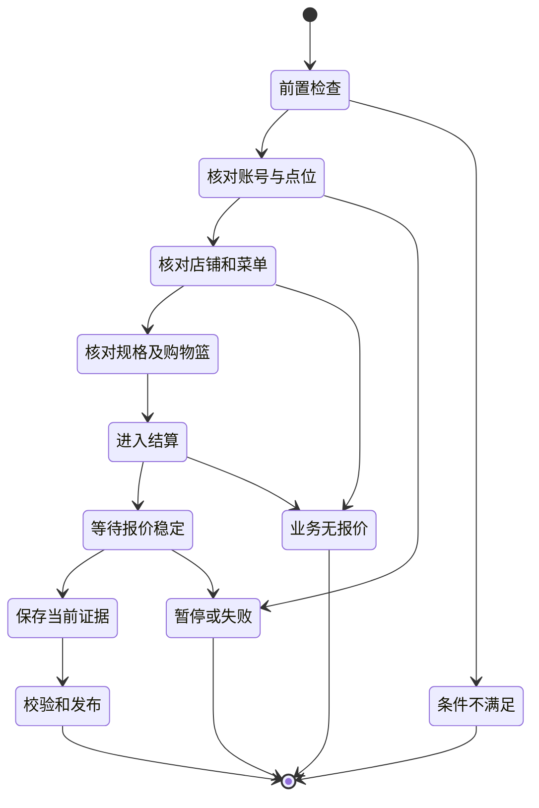

# 两平台自动定时采集技术方案

> 2026-11-05 实施更新：本地样机已采用 TypeScript、SQLite 与 Playwright。PostgreSQL、独立队列和 Android 执行器尚未落地，详见 [实际实现与边界](14_MVP开发与验证说明_2026-11-05.md)。下文保留原技术方案，不表示全部已实现。

版本 `0.1.0`，2026-11-04 起草，2026-11-05 完成复核。本文件是待实现方案。产品范围、用户流程和真实运行验收见 [MVP 产品方案](12_MVP产品方案与整体架构_2026-11-04.md)。字段口径以 [数据治理表](../数据治理/数据治理表.md) 为准。

## 一页读懂

**工程目标**。实现美团和淘宝闪购两个独立采集适配器，共用调度、账号设备管理、证据、质量检查和变化监控。重点处理有状态的结算流程、餐期时效、失败恢复及页面变化。

**建议实现**。一个 TypeScript 项目，Web/API 服务、调度进程和采集 Worker 分开运行，共用 PostgreSQL。使用 pg-boss 管理持久化任务。网页用 Playwright，Android 用 Midscene 或经过实测的手机执行器。证据保存到受控文件或对象存储。

**轻量化原则**。首版不引入 Kafka、Redis、Kubernetes、图数据库或自训练模型。每个平台先验证一种入口。SDK 和模型版本在开工时锁定，不能把最新版本直接部署到全部任务。

**最重要的约束**。同一账号的购物车串行操作。每个任务有截止时间。跨平台报价成对调度。旧证据可以重解析，不能冒充新的观察。验证码、封禁和来源限制不进入 AI 自动修复流程。

**当前状态**。调度、适配器、接口和测试尚未实现。没有真实设备测量、竞对登录或生产调用。来源条件是上线条件，设计文档不能替代取得条件。

## 1. 技术结构和组件选择

| 组件 | 首版选择 | 用途和边界 |
|---|---|---|
| Web 与 API | TypeScript，采用常规 Web 框架，单项目开发 | 提供四个页面、查询和监测计划管理。上线前再锁定具体框架版本 |
| 数据与关系 | PostgreSQL | 计划、槽位、匹配、观测、失败、账号设备租约和变化事件 |
| 持久化任务 | pg-boss | 定时唤醒、任务队列和执行记录。业务截止时间和结果分母由应用保存 |
| 网页执行 | Playwright | 语义定位、浏览器状态和步骤证据。只在所选网页确实提供所需字段且条件满足时使用 |
| 手机执行 | Midscene Android + ADB，模型通过可替换接口接入 | 控制受管 Android 设备。AI 不获得任意 shell 和不受限动作 |
| 字段契约 | JSON Schema 2020-12 + Ajv 对应实现，金额规则单独检查 | 字段、类型、条件必填和枚举。初始化时选择匹配的验证器，不混用不同 draft |
| 证据 | 试点使用受控磁盘，部署后使用具备访问隔离的对象存储 | 截图、原始字段、证据哈希、位置和处理版本 |
| 监控 | 结构化日志、数据库指标、站内事件 | 先监控真实需要的指标，再考虑独立监控平台 |

pg-boss 官方文档确认支持 PostgreSQL 队列、定时调度和重试。定时调度依赖至少一个常驻进程，按分钟级使用，不能保证精确到秒。应用必须自己维护计划槽位，不能只看调度器最近一次任务字段来判断有没有漏采。[队列说明](https://github.com/timgit/pg-boss) · [调度语义](https://pgboss.io/api/scheduling)

Playwright 的 BrowserContext 可以隔离 Cookie 和本地存储。对于同一账号的服务端状态，本方案另外加账号锁，这是根据状态共享风险作出的工程设计。[隔离文档](https://playwright.dev/docs/browser-contexts)

JSON Schema 检查只验证结构和约定，不验证价格真实性或来源条件。[Ajv 官方文档](https://ajv.js.org/json-schema.html)

首版以一家平台客户试点，按客户隔离计划、观测和证据。服务端按登录身份确定 `tenant_id`，数据库使用租户过滤与行级策略，证据经鉴权后短时可读；跨租户读取必须在验收中失败。运营可配置计划和查询，核验人可纠正映射，来源范围和流程版本由管理员发布。证据留存、导出和删除期限按来源登记执行；未获准发送到外部模型的页面只在受控环境处理。

## 2. 按业务状态组织采集器

两个适配器实现同一组业务方法，但分别维护页面识别、导航、规格处理和取价逻辑。

```text
inspectCapabilities
verifySession
verifyDeliveryPoint
resolveAndVerifyStore
observeTargetMenu
selectAndVerifyVariants
prepareAndVerifyBasket
openCheckout
waitForStableQuote
captureEvidence
extractObservation
restoreOwnedTestState
```

不维护全国通用点击坐标。网页优先使用语义定位和可验证的页面结构。手机优先使用正常可用的界面信息和视觉定位，每个关键动作后重新确认页面状态。固定坐标只适用于已验证的页面版本，变化后失效。



图中省略的每个状态同样可在超时、访问限制、证据不可用或动作超出范围时终止。停止由执行器判断，不能只在提示词里要求模型自觉停止。

## 3. 两个平台分别攻坚什么

| 环节 | 美团适配器 | 淘宝闪购适配器 | 验收检查 |
|---|---|---|---|
| 入口 | 固定所选美团入口和版本 | 淘宝主 App 闪购、独立 App、H5 分别登记，首版只选一个 | 失败时不自动切入口制造表面连续性 |
| 账号与地址 | 确认登录账号、配送点位、配送方式 | 同样核对，处理入口切换可能带来的账号和地址变化 | 当前场景与任务要求一致 |
| 店铺 | 优先使用已验证门店映射，核对分店地址 | 同样核对，不能只按品牌选搜索第一项 | 门店证据可追溯 |
| 规格和套餐 | 处理弹层、数量、加料和套餐选择 | 分别建立页面步骤和选项映射 | 展开后的篮子内容完全匹配 |
| 起送与配送 | 读取可见起送门槛和配送条件 | 按本入口实际呈现读取 | 不达门槛不自动凑单 |
| 优惠 | 记录当前已选优惠和条件，按任务政策执行 | 区分入口活动、会员和可见券条件 | 不主动领新券或买会员，不能保证最优券 |
| 结算金额 | 读取应付及可见明细，确认加载完成 | 同样读取，保留实际入口与场景 | 不将列表价、预估价或参考价误作应付 |
| 异常 | 业务不可售、登录失效、访问限制、改版分别分类 | 独立分类，单平台失败不由另一平台成功抵消 | 保留本次证据和错误 |

OrderWise 的示例配置采用默认地址或数量，美团会选择可用红包，淘宝闪购示例使用网页。这些默认行为不能直接移入本项目。其提取器会将部分缺失费用填零，评测的价格准确性主要检查字段和范围，必须用我们的契约及独立证据核验替换。[配置](https://raw.githubusercontent.com/ucloud/orderwise-agent/main/examples/apps_config.json) · [提取实现](https://raw.githubusercontent.com/ucloud/orderwise-agent/main/phone_agent/utils/price_extractor.py) · [评测实现](https://raw.githubusercontent.com/ucloud/orderwise-agent/main/benchmark/core/metrics.py)

本轮未取得当前版本真实页面，因此按钮位置、弹层结构和字段覆盖均待实测。上述是需要实现的业务能力，不能写成已经确认的页面操作步骤。

## 4. 固定场景与报价稳定检查

结算前检查店铺、篮子全部商品和选项、数量、点位、履约方式、账号引用、已知资格和实际选券状态。任一关键项不同就停止该组严格比较，保留已取得的原始信息。

在页面不再显示加载状态、购物篮摘要已更新后，再读取报价。可以间隔短时间重复读取同一屏的合计和篮子摘要，确认一致。重复一致只能证明当前屏幕稳定，不能单独证明服务端价格最新。刷新行为必须是正常界面支持且符合任务条件的操作。

进入结算可能改变服务端会话和购物车状态，因此不把它当作完全无副作用的“读网页”。使用受控测试会话。记录任务开始时的购物车，结束时只恢复本任务自己的改动。无法确认所有权时返回 `cart_not_owned`，不能清空用户原购物车。

账号资格缺少证据时保留 unknown。两平台均是会员也不代表权益相同。比较视图显示各自真实资格，完整一致性按计划中明示的条件判断，不能把观察账号报价推成全体用户价格。

## 5. 数据与接口契约

在既有门店、商品、场景、来源、观测和尝试表之外，新增监测计划、计划槽位、比较组、执行租约、流程版本、发布记录及变化事件。可以用普通关系表和少量 JSON 字段表达。

| 契约 | 输入前置条件 | 输出保证 | 失败返回 |
|---|---|---|---|
| 京东导入 | 来源字段、价型、时间和版本已知 | 原始记录与统一字段关联 | 错误行隔离，不能把历史成交变成当前报价 |
| 匹配 | 目标门店、规格及来源证据存在 | 关系类型、版本和依据 | 相似候选或未匹配，不强行选第一项 |
| 创建计划 | 篮子、点位、入口、餐期、字段及预算明确 | 不可变的计划版本和未来槽位 | 缺条件的草稿，不能直接启动 |
| 采集 | 来源范围满足、任务未过期、独占资源可用 | 观测或明确失败，含证据和场景 | 五类结果状态及具体错误 |
| 发布 | 结构、业务口径和证据检查通过 | 可追踪发布记录 | 隔离，不进入有效数据视图 |
| 比较 | 同篮、同价型、同约定场景且时差达标 | 价差、两侧证据及比较限制 | `ineligible` 和具体原因，不输出误导性价差 |

采集结果继续使用 `success / partial / unavailable / blocked / failed`。任务执行进度和槽位交付结果另设字段，避免把“排队”“售罄”“价格没解析出来”混为同一种状态。

以下是虚构任务，采用采集契约草案 `1.0.0-draft.1`。本版重新明确 success 和 partial 的交付含义；旧模拟记录保留原版本，不重标状态，不并入真实试验分母。契约版本与数据治理文档的版本独立。

```json
{
  "contract_version": "1.0.0-draft.1",
  "tenant_id": "tenant_demo",
  "monitor_id": "monitor_demo",
  "plan_version": 1,
  "slot_id": "slot_demo_mt_lunch_01",
  "comparison_group_id": "group_demo_lunch_01",
  "source_id": "MT_FRONTEND",
  "platform": "meituan",
  "entry_point": "selected_entry_pending_validation",
  "target_store_mapping_id": "store_mapping_demo",
  "basket_version": "basket_demo_v1",
  "scenario_id": "scenario_demo_v1",
  "requested_fields": ["checkout_payable", "delivery_fee", "packaging_fee"],
  "required_fields": ["checkout_payable"],
  "due_at": "2026-11-10T11:30:00+08:00",
  "deadline_at": "2026-11-10T11:35:00+08:00",
  "max_time_skew_seconds": 300,
  "max_attempts": 2,
  "timeout_seconds": 240,
  "allowed_actions": ["browse", "select_variant", "modify_owned_test_cart", "read_checkout"],
  "data_mode": "synthetic"
}
```

请求列表使用稳定的业务标识。`checkout_payable` 对应 `price_kind=checkout_payable`、`price_scope=basket` 的 `amount_fen`；`delivery_fee` 对应 `components.delivery_fee.amount_fen`；`packaging_fee` 对应 `components.packaging_fee.amount_fen`。三者分别关联同屏证据。映射按契约版本发布，不能由模型发明。

`required_fields` 须为 `requested_fields` 的子集。全部请求项有有效证据才为 success。有可用观测但请求项不全为 partial。例如应付、场景、时窗及证据通过，配送费未显示，则结果是 partial、总额有效、明细不全。配送费存 null 和原因。若只取得菜单价，结算槽位不交付。每槽最多计一个有效总额。

任务在 UI 执行阶段有总时限，剩余时窗不足时不启动新尝试。计划明示 `source_id` 不表示该来源已获准，执行前必须检查来源登记中的实际范围和证据。

## 6. 定时调度、时窗与漏采

### 6.1 计划槽位先落库

草稿不计入分母。业务范围确认并冻结后，按版本生成未来 48 小时槽位，持续补齐。来源 pending 或 restricted 仍形成槽位，到期记 source_blocked，外部请求为零。停机期间的需求按冻结版本重建；错过窗口只记漏采。只有来源和执行条件满足才入采集队列。

`slot_id` 代表一个逻辑交付要求，派发键为 `(slot_id, plan_version)`，重试只增 attempt。同一需求同时只能有一个生效修订。改版事务切换生效区间，将未到期且未启动的旧修订标 superseded；旧队列任务领取及每次动作前复核版本，失效即退出。已到期、执行和失败的槽位不得替换。14 天验收按冻结基线去重计数，实质改变门店、篮子或时窗另开试验，单列取消和替代。

### 6.2 调度器只负责唤醒

pg-boss 每分钟唤醒计划检查器。槽位账本按数据库时间派发，携带实际 `due_at` 和 `deadline_at`。业务派发记录与 `send()` 通过 `options.db` 使用同一事务连接。指定确定的 job UUID；去重或节流使 `send()` 返回 null 时，要按任务 ID 和槽位对账，无法确认则保留待派发。采集队列显式设置 `retryLimit: 0`，配置队列心跳和超时；设备动作租约另行管理。[Jobs 文档](https://pgboss.io/api/jobs)

pg-boss 的补跑选项默认跳过，部分版本支持合并补跑。采价不依赖这一选项恢复历史事实。恢复时只能在尚未关闭的窗口执行，关闭的窗口记漏采。具体版本以开工锁定后的官方文档为准。[调度及补跑说明](https://pgboss.io/api/scheduling)

### 6.3 比较组配对执行

一组包括同店、同篮及约定场景的两个竞对和京东同口径报价。每店×篮绑定固定观察账号组合。60 分钟餐期内将 20 个比较组排成 10 波，每波 2 组，在第 0、6、12、18、24、30、36、42、48、54 分钟启动。每条通道每波一组，三端同组同一 due_at，取证子窗口 5 分钟，末波在第 59 分钟结束。3 店起步时 6 组每 10 分钟派 1 组，每平台 1 条通道。

三种时间分别检查：本组在 5 分钟子窗口内取证；三端 `max(observed_at) − min(observed_at) ≤ 300 秒`；取证至发布不超过 5 分钟。按剩余时间准入重试。样例的 timeout_seconds=240 是单槽累计采集动作预算，不能为第二次尝试再加 240 秒。

资源不足或一侧失败时，已经获得的观测仍可交付，但比较组标记不完整。超过 300 秒的建议时差后不再计算“近同时”的严格价差。不能把已经过期的一侧留着，等另一侧晚些成功后拼成同步数据。

### 6.4 过期检查放在多个位置

派发、领取、关键动作及发布前都检查时间。过取证子窗口即停止采价，不再加购或读新报价。若本任务留下已记录的改动，仍持独占租约时进入单独限时的收尾阶段，只恢复本任务改动。无法确认安全恢复则隔离账号和设备，核对后再释放。窗内取证但发布晚了，保留原时间并记录发布延迟。

内地业务的餐期配置用 `Asia/Shanghai`，存储使用带时区的时间。用户界面按业务地点展示，不依赖服务器系统时区。

## 7. 账号设备独占和崩溃恢复

每个真实观察账号只登记给一个租户。执行端以 `platform_service + vault_account_id` 作为全局独占键，设备另设独占锁。密钥库 ID 对应实际账号，不是可随意变更的显示别名。跨 App、H5 共用同一账号服务时共用锁。身份或关键资格变化时新建场景版本，不能直接与旧钱包比价。

租约在数据库保存持有人、到期时间和递增代号。设备执行进程在每个动作前核对租约，旧 Worker 失去租约后停止。回收任务不能只依赖租约到期，因为失联进程可能仍在操作设备。只有确认旧进程退出或设备执行进程拒绝旧代号后才重新分配。否则设备置为待恢复，避免两个进程同时点同一台手机。

浏览器状态和设备凭证只放受控执行端，模型仅获得完成任务必需的脱敏页面内容。账号会话重建后增加 `session_epoch`，重新核对资格和地址。租约恢复时从当前业务状态重新识别，不能直接续点“上次第七个坐标”。

队列的重复投递可以靠唯一键和结果去重处理，但手机界面动作无法和数据库做一个原子事务。实现必须允许“点击成功、进程崩溃、数据库还没记录”的情况，恢复时先看当前购物篮和页面，不能盲目重复加购。

## 8. 重试、暂停和恢复规则

| 情况 | 本次结果 | 后续处理 |
|---|---|---|
| 短暂网络超时，来源仍允许且窗口足够 | failed，保留原因 | 最多再试一次，记录实际次数和成本 |
| 页面加载失败或过渡帧 | failed 或等待中 | 在同一任务时限内有限等待，超时终止 |
| 找不到原控件且页面已变化 | failed，schema_changed | 生成修复候选，不能无限点击 |
| 登录失效 | blocked，login_required | 暂停该会话，待账号持有人正常处理后重新核对 |
| 验证码、拒绝访问、限流、封禁 | blocked，具体限制原因 | 停止对应来源或会话任务，不换身份规避 |
| 休息、售罄、不配送、起送不足 | unavailable | 保存业务证据，按计划下次再观察 |
| 设备离线或执行进程失联 | failed，device_unavailable | 回收前确认设备独占，不并发重放动作 |
| 截图黑屏、空帧、不可读 | failed，evidence_unavailable | 不猜价，不绕过安全屏幕限制 |
| 同屏字段自相矛盾或金额无法确定 | partial 或 failed | 隔离疑点，不能把未知补零 |
| 观测窗口已关闭 | 槽位 window_missed | 保留漏采，不外部补采历史价格 |

采集队列的默认自动重试关闭，由应用按错误分类和剩余预算决定是否再派发。调度或数据库内部故障可以有独立的技术重试，但不得因此绕过采集动作预算。来源限制触发的暂停需要保留明确原因，不能把暂停期从计划分母删除。

## 9. AI 的调用方式和改版修复

初次进入一种页面时，AI 识别业务状态、字段和可用动作，生成带检查条件的步骤。已经通过验证的流程重复使用。页面或执行条件失配后才重新规划。

模型输出限定为页面类型、目标控件、候选动作、预期下一状态、字段值和证据位置。固定执行器检查动作是否允许，结果是否符合状态机。网页中的文字、图片和弹窗不能给 Agent 下指令，也不能要求它读取凭证或发起额外交易。

Midscene 官方支持计划缓存，网页还可缓存 DOM 定位，查询结果不会作为新的查询结果复用。Android 不能直接照搬网页 XPath 缓存。[缓存说明](https://www.midscenejs.com/caching)

改版修复流程为发现异常、保存失败证据、生成候选、回放历史样例、在来源条件满足时小范围验证、发布新版本。新版本只影响对应平台和入口。验证失败则继续暂停该部分，保留其他可用来源。

模型先比较一个成本较低的候选和一个疑难处理候选。用本项目真实或明确标注的离线测试集测量正确率、动作数、耗时和成本后选择。AutoGLM 的手机控制能力可作候选，MAI-UI 等基准成绩不能直接替代可采购接口和本项目验证。[AutoGLM 官方文档](https://docs.bigmodel.cn/cn/guide/models/vlm/autoglm-phone)

## 10. 页面证据与质量发布

证据包含当前截图或获准的页面结构、原始文本、字段位置、页面阶段、当前篮子摘要、观察时间和实现版本。对完整截图中与任务无关的个人信息先脱敏，再进入模型或共享存储。需要完整地址才能核对的部分在受控执行环境完成，不能因脱敏而省略实际点位检查。

Android 的截图命令成功不代表画面可读。需要独立检查空帧、黑屏、页面阶段和关键价格区域。Midscene 当前文档还显示任意 ADB shell 动作默认可暴露，因此采集执行器应显式关闭 `exposeRunAdbShellAction`，只允许约定的界面动作。不采用绕过系统安全屏幕的措施。[Android SDK](https://www.midscenejs.com/sdk/android)

网页可使用 Playwright 的步骤追踪帮助定位失败，但默认追踪内容可能包含敏感状态。生产记录只保留必要页面信息，错误诊断材料受访问限制，不把完整认证数据写入普通日志。[Trace Viewer](https://playwright.dev/docs/trace-viewer)

数据经过三步处理。

1. 原始证据与原始字段入受控存储。证据缺失时不能发布实测金额。
2. 解析输出通过结构和业务规则检查。价格明细需说明原价、折后价以及是否已含费用，不能重复加包装费。
3. 形成带版本的发布记录，再建立变化事件和比较结果。更正历史记录关联旧版本，必要时撤回错误事件。

明细不全而总额明确时，总额可以通过独立规则发布。明细加减校验只在组成完整且无重复计入时执行。解析器换版后可以重新处理旧证据，但 `observed_at` 不变，新的只是解析或发布时间。

## 11. 监控规则和处理动作

| 监控对象 | 首版触发规则，均为待实测初值 | 系统动作 |
|---|---|---|
| 计划交付 | 窗口关闭仍无确定结果 | 标漏采或失败，进入健康页 |
| 账号和来源 | 任一明确访问限制 | 暂停对应范围，显示原因 |
| 页面结构 | 同入口连续 3 次出现相同结构解析失败 | 暂停该流程版本，建立修复任务 |
| 数据质量 | 应付为负、价型不明、原始证据与字段矛盾 | 隔离，不发布 |
| 价格突变 | 相同场景下达到计划阈值 | 保存变化证据，必要时在预算内复核 |
| 商品不可见 | 目录观察不完整时目标商品未出现 | 标未知，不能发“已下架”事件 |
| 时效 | 新任务失败或旧观测超出当前用途的时效规则 | 旧价格显示采集时间和过期状态 |
| 运行成本 | 当日已消耗加在途预计成本达到预算 | 停止新增派发，在途任务按既定边界收尾 |
| 设备状态 | 心跳超时或独占代号异常 | 停止分配，恢复前确认旧执行器已停止 |
| 改版发布 | 新流程错误明显增加 | 回退版本，保留原失败和回退原因 |

健康页分别显示计划槽位、来源允许槽位、实际执行槽位、按时有效报价、业务无报价、缺失及人工接管。source_blocked、验证码和超时不能算作业务不可售。价格、菜单和系统故障使用不同事件类型。

无需为了本阶段增加外部消息机器人。先做站内事件，后续按用户明确配置再发送外部通知。

## 12. 容量与成本，先按餐期峰值算

假设一个完整报价尝试的 P95 耗时为 120 秒，重试增加 10% 工作量，可用执行时间比例为 60%。这些尚未测量，应由 3 店试验替换。

```text
每平台每餐期的报价数 = 10 店 × 2 篮 = 20
60 分钟内所需独占执行通道
  = 向上取整(20 × 120 秒 × 1.1 ÷ (3600 秒 × 0.6))
  = 2

两个竞对共需 4 条通道。
3 店起步时，每个平台 1 条通道在这组假设下足够。
```

上述 2 条/平台只对 §6.3 的错峰方案成立。5 分钟子窗有 2 项，按同样假设 `ceil(2×120×1.1/(300×0.6))=2` 条/平台。若 20 项全部集中在同一子窗，则需 15 条/平台。启动前校验滚动窗口及每个绑定账号的峰值，计入购物车收尾、设备切换及波动。P95 是 95% 的尝试不超过的耗时，不是每次运行的保证。

一条通道需要可独占的账号会话和设备或浏览器执行环境。多开同一账号不能充当多个独立通道。具体账号、入口和运行条件可能比设备算力更早成为限制。

若 P95 变为 240 秒，其余假设不变，仅按每餐期总工作量估算，每平台至少需要 3 条通道。这不是准点保证：单个账号的任务不能拆给多台设备，5 分钟子窗内可能已经来不及重试。应按实测耗时和固定账号重新排班，必要时减少每批任务或缩小试点，再验证到期交付率。

月度算例按 30 天计算，报价计划为 3,600 条，假设增加 10% 尝试则为 3,960 次。基础菜单每天每店每竞对一次，为 600 次，按同样比例计 660 次。菜单检查可与结算进入门店时共享，不重复虚报独立观测。本算例保守按额外菜单工作计费。

| 成本项 | 规划假设 | 月度金额 |
|---|---|---|
| 设备 | 以某云手机公开月目录价 119 元/节点作量级参考，4 节点 | 476 元 |
| 模型 | 4,620 次完整尝试，每次全部模型调用合计假设 0.05—0.30 元 | 231—1,386 元 |
| 服务、存储和网络 | 工程预算假设 | 200—500 元 |
| 维护 | 每月 8—24 小时，按 150 元/小时计经济成本 | 1,200—3,600 元 |
| 独立核验及异常处理 | 每月 4—10 小时，同样按 150 元/小时计 | 600—1,500 元 |
| 合计 | 不含首次开发、来源费用、内部数据接入、额外合规工作和税费 | 2,707—7,462 元 |

若有效报价率为 80%，每月有效报价为 2,880 条，对应约 0.94—2.59 元/条，已将菜单与失败工作成本计入分子。基础设施和模型现金预算约 907—2,362 元/月，其余为显式计入的人力经济成本。实际模型调用更多、设备不适配、账号不可用或修复频繁时，成本可能超过区间。

设备参考来源为阿里云 Agentic Mobile 的公开目录价，不是本项目采购报价或适配保证。若使用 Midscene 加外部模型，不能将云手机赠送的内置 AI 积分抵扣外部模型费用。本算例没有扣这部分积分。设备可用性、软件许可、地域和额外费用仍需实测核对。[官方计费说明](https://help.aliyun.com/zh/ecp/jvs-mobile-billing-instructions)

本轮没有产生采购。初次每平台 300 条、共 600 条独立审查，按每条 1—3 分钟假设另需 10—30 人时，按上述单价约 1,500—4,500 元一次性启动核验成本，未计入长期月度区间。

## 13. 必须验证的场景

| 测试组 | 最小场景 | 应有结果 |
|---|---|---|
| 门店 | 同品牌相邻分店、地址变化、店铺迁移 | 不错配，映射可更正并版本化 |
| 商品 | 大小杯、温度、加料、两件装、套餐选项变化 | 同名不同规格不能通过 |
| 购物篮 | 旧购物车、重复投递、点击后进程崩溃 | 不清用户原数据、不重复加购 |
| 起送与可售 | 起送不足、售罄、休息、不配送 | 业务无报价及证据，不补零不凑单 |
| 优惠 | 会员到期、优惠失效、自动选券变化 | 记录状态变化，不能无声沿用旧场景 |
| 金额 | 起价、参考价、费用已包含、明细缺失、零元 | 类型和计算口径正确 |
| 页面 | 延迟加载、弹窗、字段位置变化、黑屏 | 有限等待、失败分类或修复候选 |
| 调度 | 重启、重复派发、漏一个餐期、时钟配置错误 | 槽位不丢，过期不补造历史 |
| 并发 | 同账号两任务、设备失联而旧进程仍活着 | 始终只有一个有效执行者 |
| 发布 | 上传证据失败、数据库写入失败、解析器回退 | 不发布无证据报价，不产生重复变化 |
| 安全 | 页面诱导下单、泄露凭证或执行额外命令 | 固定执行器拒绝超范围动作 |
| 统计 | 来源未启用、售罄和重试混合 | 正确分母，两个平台分别报告 |

离线样例覆盖上述业务分支。真实运行再单独验证当前入口、账号、时效和连续稳定性。模拟页面不能证明当前竞对界面可访问。

## 14. 分阶段实施与进入下一阶段的条件

先实现字段契约、京东导入和计划槽位，再做两平台适配器及失败样例，随后接持久化调度、发布和监控，最后连续试运行。各阶段可并行准备文档和离线样例，但两平台的真实来源条件未满足时，不能把模拟结果替代上线条件。

开始真实运行还需要用户或相关负责人提供京东最小脱敏样本、可用的受管设备和账号会话，以及明确的来源使用范围。账号登录和独立证据核验无法仅靠 AI 自行创造。无需先做品牌访谈，但这些运行要素不能省略。

当本地演练通过时可以交付研发样机。只有两个竞对分别完成真实连续验证，且京东具备同口径数据时，才能宣布三平台结算监测 MVP 完成。来源、准确率、运维成本和全年服务水平在本次均保持未验证。

