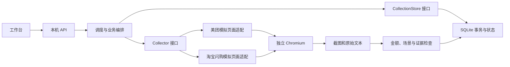

# 首版 MVP 开发与验证说明

应用 `0.1.0`，2026-11-05。运行入口和操作步骤见 [README](../README.md)，版本记录见 [CHANGELOG](../CHANGELOG.md)。本文件记录本次实现边界，不替代持续更新的验证报告。

## 一页读懂

**给谁使用**：平台运营团队。**解决什么**：先验证固定店、篮子、配送点和餐期下，能否可靠完成两套复杂页面操作并记录报价及失败。

**用户经历**：选演练或保存每日餐期，等待定时派发，在工作台看报价与缺失原因，点开每一步和结算截图，比较同场景历史变化。

**已实现**：本地服务、持久化调度、两套自有页面、实际浏览器执行、场景与金额校验、证据、重试、暂停、重启恢复、变化监控及四页工作台。

**当前没有**：真实竞对采价、真机操作、AI 模型调用、京东真实数据、生产 SaaS 的账号认证和多租户权限。只定义了 AI 建议接口，没有用固定规则冒充模型。

**怎样判断有效**：实际自动化运行验证固定独立金额，而不是检查“有字段且大于零”。结果写入 [验证报告](../artifacts/验证结果.md)。真实入口仍需要单独现场验收。

## 1. 对上一版技术方案的具体调整

| 上一版建议 | 本次实现 | 原因及限制 |
|---|---|---|
| PostgreSQL、pg-boss、多个运行进程 | SQLite、单进程持久化轮询 | 本机无现成 PostgreSQL，先做到一键本地运行。未声称数据库、消息队列或生产多进程已验证 |
| 常规 Web 框架 | Node.js 原生 HTTP + 明确路由 | 减少依赖。接口有输入校验、请求体大小限制、同源写入限制及本机 Host 检查 |
| Playwright 与 Android 两类执行器 | Playwright + 两套自有模拟页面 | 当前无真机、账号和获准入口。真实手机需要另写适配器，不是直接换网址 |
| AI 建流程、页面理解和修复 | 固定流程；定义 `PageAdvisor` 接口 | 没有模型配置及获准真实页面，未产生模型调用或费用 |
| 多客户 SaaS | 本机单用户研发样机 | 已限定本地租户与数据模式，尚未实现登录、生产多租户及权限体系 |

上述是工程实现顺序的调整。真实双平台和长期连续采集的验收条件保留。模拟通过只代表研发样机通过。

## 2. 模块之间怎样交接

目录、接口和执行步骤见代码。业务编排只依赖采集和存储接口，网页动作不在调度器里。两个适配器共享流程骨架，分别维护搜索、规格和结算定位。模拟页面的布局刻意不同，不能据此声称真实平台选择器已经确认。

**输入契约**：固定租户、入口、店铺、篮子版本、点位、账号引用、观察时窗、字段、动作及尝试上限。`JSON Schema 2020-12` 加业务检查，内部时间统一 UTC、界面按上海时间展示。

**输出保证**：每次实际执行都有结果和操作轨迹；有效报价必须有同屏证据、原值、金额、篮子和时间；仅部分费用不可见时保留总额和 `null + 原因`。

**不变量**：不把未知补零，不用菜单起价冒充应付，不产生真实订单，不将模拟混入实测。只恢复任务自己的自有模拟购物篮。失败后不重复已不确定是否发生的动作。

**失败与恢复**：短暂 HTTP 503 允许再试一次；验证码或购物车冲突停止并持久暂停对应会话。跨批次及重启仍保留暂停；显式开启新一轮模拟演练才重置模拟会话，旧任务不重跑。错过时窗只记漏采；执行中崩溃记中断；恢复后不续点旧坐标。

## 3. 四类验证不能混称

| 验证 | 本版做到什么 | 不能证明什么 |
|---|---|---|
| 代码与契约 | 类型检查、金额与空值、证据规则、账号锁、计划去重、失败分母 | 真机与竞对入口可用 |
| 本地浏览器 | 自有页面实际点击、规格数量、购物篮、结算、截图及异常演练 | 真实页面覆盖、账号权益、访问资格 |
| 真机现场 | 尚未开始 | 不能给出成功率、P95、长期成本 |
| 持续业务运行 | 尚未开始 | 不能宣布 14 天、全国覆盖或生产 SLA |

本次测试使用独立临时数据库。预览工作台内展示的演练也通过真实本地浏览器执行，全部标为 synthetic。没有从测试报告复制数字来制造运行记录。

## 4. 下一次真机接入的最小输入

1. **项目负责人**明确一个平台的具体入口、业务用途、字段、动作和使用依据。当前两家真实来源均未启用，不能只改状态布尔值。
2. **设备及账号持有人**提供受管设备与正常登录会话，核对一个点位及真实可用权益。凭证留在受控设备，代码和调研文档不收集 Cookie。
3. **运营与数据负责人**先确认三家真实店铺和两个篮子的规格映射；京东给一份脱敏同口径报价样例。
4. **开发负责人**新建对应真实适配器，先做一店一篮，再扩三店；复用调度、结果、证据与监控。真实 App 的按钮、弹层、购物车恢复、截图限制和异常需重新验证。

真机结果应另建 `observed` 数据集，不能给现有模拟记录换标签。没有符合条件的入口时，继续维护离线测试集，不启动竞对自动访问。
