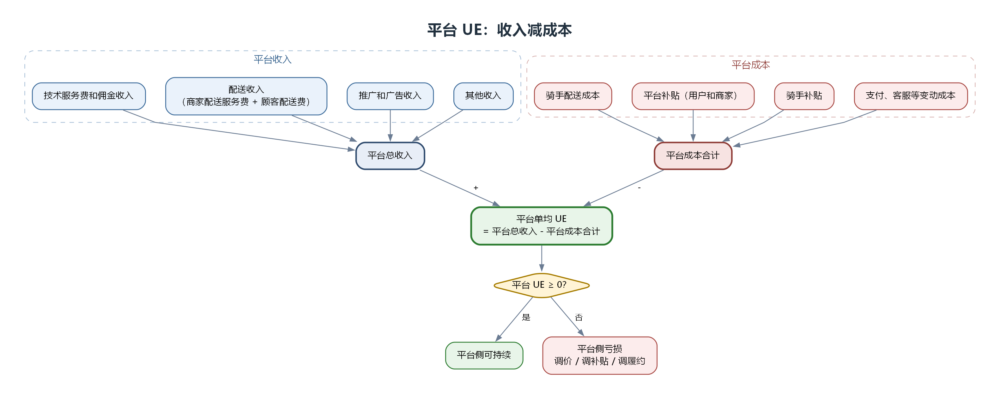
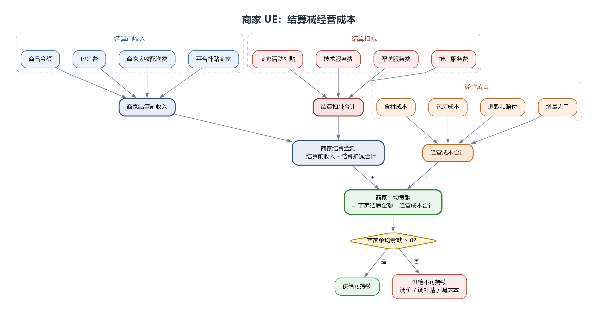
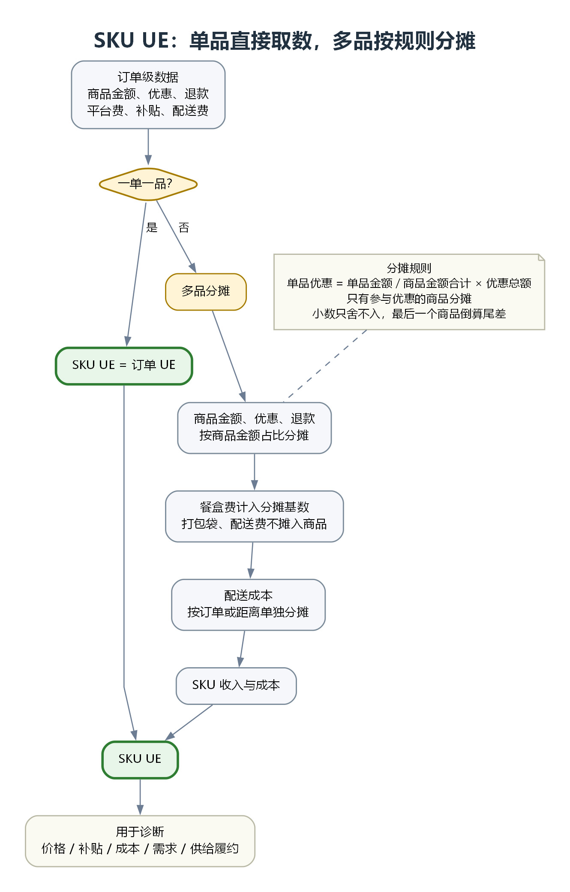
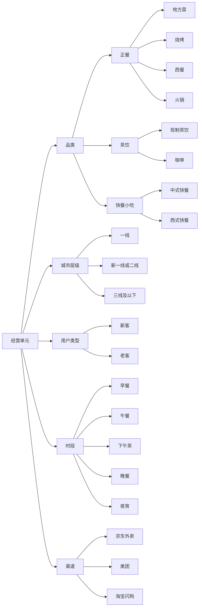
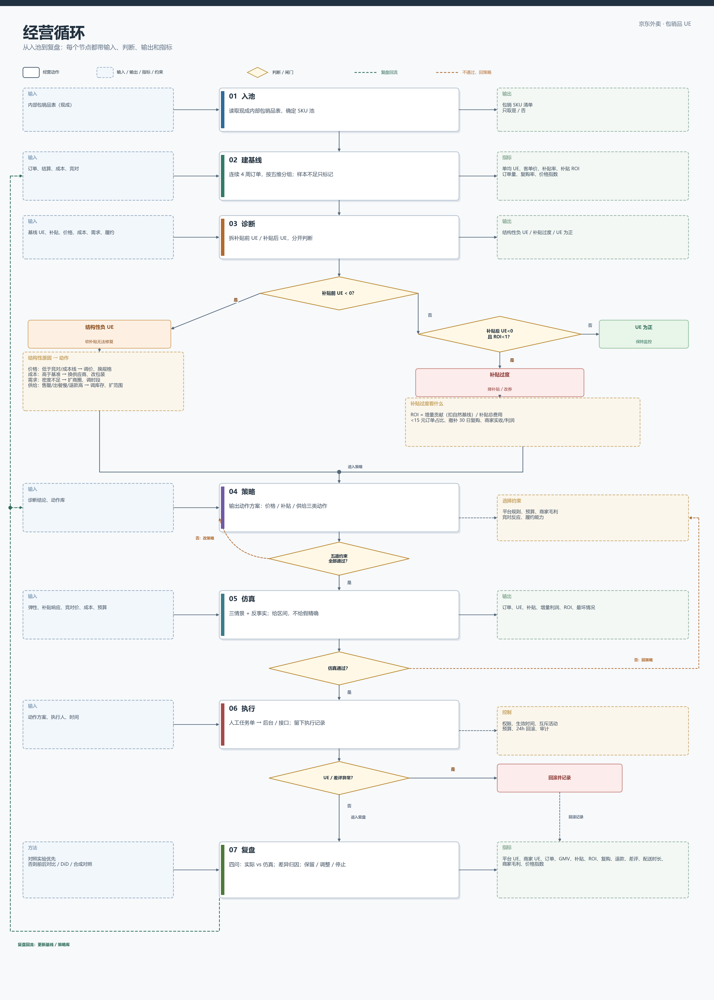
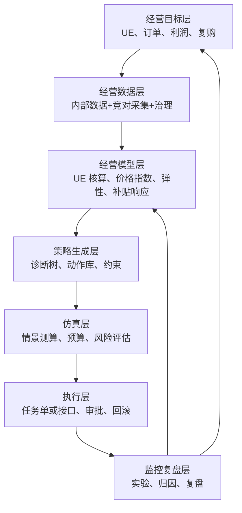

# 京东外卖包销品 UE 经营数据产品项目材料

版本 `3.3`，2026-11-07。本文是交付评审版，汇报版见 [17_包销品UE经营数据产品_精简版](17_包销品UE经营数据产品_精简版_2026-11-07.md)。本版在 3.1 节加入平台、商家、SKU 三张 UE 构成图，并将第四章经营循环改为一张判断导向流程图。包销品表口径、财务口径和试点数据权限仍需业务方审批后执行。

## 结论

京东外卖的包销品经营要同时满足三个条件：平台 UE 为正，订单增长健康，商家供给可持续。平台 UE 是平台侧的考核口径；商家 UE 是供给可持续性的底线；SKU UE 用来定位具体商品和场景的问题。

这套产品把包销品判定、UE 核算、竞争比价、诊断、策略、仿真、执行和复盘连成一条经营循环。试点先在一个城市、一个商圈、10 家门店、一个主力品类、20 至 30 个候选 SKU 上跑通，启动时至少有 10 个 SKU 确认属于包销。试点计划用 14 周，依次完成准备、建表、历史基线、策略和向前验证五项工作；目标是验证平台 UE 能否打正，暂不设数字目标。

## 一、为什么做

包销品是京东外卖支撑供给差异化和增长的主要方式。经营决策目前缺少可靠的数据依据，定价和补贴看不清、改不准。

### 1.1 行业从补贴战转向效率竞争

补贴退潮后，单均 UE 和履约效率决定平台能否持续经营。

| 事实 | 数字 | 说明 |
|---|---|---|
| 2026 年二季度单均 UE（公开报道和券商测算） | 美团 `+0.22 元`，淘宝闪购 `-2 元`，京东 `-4.8 元` | 京东外卖的 UE 压力最大 |
| 单均履约成本 | 美团约 `6.5 元`，竞对约 `6.9 元` | 履约成本存在差异 |
| 补贴期商户经营变化（复旦大学张军团队，四万余家商户） | 日均总订单 `+7%`，日均实收 `-4%`，总利润 `-8.9%` | 单量增长可以伴随利润恶化 |

京东外卖进入时间晚，订单密度和履约效率仍在追赶对手。2026 年京东把“爆品包销”列为“双百计划”的升级举措，计划打造 1000 个包销标杆大单品。包销规模越大，平台 UE 为负时亏损放大得越快。

### 1.2 当前经营的主要问题

问题集中在 UE 核算、竞争比价和执行记录。

第一，UE 核算不统一。订单、结算、成本、补贴和竞对数据散落在平台后台、商家系统、财务账单和人工表格里；商品金额、包装费、配送费、佣金、补贴、退款和食材成本的字段名与正负号不一致。经营会议只能看成交总额、单量和补贴率，无法判断每一单是否赚钱。

第二，缺少自动化竞争比价工具。当前比价主要靠人工截图和低频抽查，难以稳定覆盖同店、同品、同规格。单纯的比价又容易和经营决策脱节：即使知道对手便宜两块钱，也回答不了这两块钱来自平台补贴、商家让利还是履约成本差异，以及跟价之后订单和 UE 会变成多少。

第三，执行和复盘没有形成记录。调价、调补贴、换供给往往由人工在多个后台完成，执行了什么、什么时候执行、影响了哪些用户和时段、结果如何，缺少结构化记录。下一次决策仍然从经验开始。

### 1.3 产品目的

产品要把包销品经营从看成交总额、单量和补贴率，转到看 UE、增量利润和补贴效率。

产品交付四件事：第一，接入内部包销品表；第二，建立可核对的 UE 核算表；第三，建立按经营单元分层的基线；第四，建立从诊断到复盘的经营循环。

订单增长要建立在健康订单和可持续利润的基础上。

## 二、包销品范围

本项目直接使用京东内部维护的包销品表，不判断合同，也不做包销资格认定。表中 `is_baoxiao = true` 的 SKU 进入包销 UE；`false` 的 SKU 只做普通价格监测。

### 2.1 入池字段

| 字段 | 用途 |
|---|---|
| SKU、门店、区域、周期 | 确定包销范围 |
| is_baoxiao | 是否包销，只有 true / false |
| 供货价或结算价 | 结算核对 |
| 补贴分担 | 平台和商家补贴归因 |
| 表版本、更新时间、责任人 | 追溯数据版本 |

产品只读，不修改表；表更新后按新版本重新入池。字段缺失时标记数据缺失，不用合同推断补值。

### 2.2 行业背景

京东“爆品包销”由平台与品牌联合选品，平台负责营销、运营和履约，商家负责供货，是本项目的直接背景。京东“爆品一口价”和“超级补贴券”是成交形态，按订单记录，不改变包销归属。美团拼好饭、淘宝闪购定制只做机制参考，合同关系不同，不能直接套用。

成交形态按订单记录，分为直降、用券、两者叠加和未知；它用于校验价格和归因，不参与入池判断。

## 三、UE 口径与粒度

平台 UE、商家 UE、SKU UE 回答三个不同问题。UE 先按经营单元汇总和考核，诊断时下钻到 SKU，核对时回到订单。

### 3.1 三个 UE 口径

平台 UE 看平台侧是否赚钱。平台关心每一单的收入减去履约和补贴成本。公式是：

`平台单均 UE = 技术服务费和佣金收入 + 配送收入 + 推广和广告收入 + 其他收入 - 骑手配送成本 - 平台补贴（用户和商家） - 骑手补贴 - 支付、客服等变动成本`

配送收入包括商家支付的配送服务费和顾客支付的配送费。把总部费用、研发费用和管理费用也摊进来，得到的是平台经营利润。单均 UE 只保留变动项，用来判断这门生意在平台侧是否成立。

**图 1　平台 UE 的构成。蓝色为收入项，红色为成本项，绿色为计算结果。**

商家 UE 看商家供货是否可持续。商家关心结算到账减去食材、包装、退款和增量人工。先算结算金额：

`商家结算金额 = 商品金额 + 包装费 + 商家应收配送费 + 平台补贴商家 - 商家活动补贴 - 技术服务费 - 配送服务费 - 推广服务费`

再算单均贡献：

`商家单均贡献 = 商家结算金额 - 食材成本 - 包装成本 - 退款和赔付 - 增量人工`

平台账单的结算金额如果已经扣过技术服务费、配送服务费和商家补贴，贡献公式里不能再扣一次。财务对账以结算单为准，经营分析要明确使用的是结算前口径还是结算后口径。

**图 2　商家 UE 的构成。蓝色为结算前收入，红色为结算扣减，橙色为经营成本，绿色为单均贡献。平台补贴商家在商家口径计入结算前收入，在平台口径计入平台补贴成本，两个口径分别核算。**

SKU UE 用来定位具体商品和场景的问题。一单一品时，订单 UE 就是 SKU UE。一单多品时，要把订单级的平台费、补贴、配送费和退款分摊到 SKU。美团公开规则给出了一种可参考的方法：单品优惠等于单品金额除以商品金额之和，再乘优惠总额；只有实际参与该优惠的商品才分摊；餐盒费参与分摊，打包袋和配送费不摊入商品；小数除不尽时只舍不入，最后一个商品的实际金额由商品总额减其余商品倒算。外卖侧是否完全沿用这套规则，需要用商家后台账单复核。无论采用哪种规则，分摊比例、分摊金额和承担方都要落表，配送成本按订单或距离单独分摊。

**图 3　SKU UE 的构成。一单一品直接取订单 UE，多品按商品金额分摊后单独分摊配送成本。**

### 3.2 经营单元与维度

经营单元由品类、城市层级、用户类型、时段和渠道五个维度组合。同样的商品放在不同品类、城市层级、用户类型、时段和渠道，UE 会不同，所以目标和监控要按这五个维度拆到最小统计单位。

| 维度 | 细分 | 对 UE 的影响 |
|---|---|---|
| 品类 | 正餐（地方菜、烧烤、西餐、火锅等）、茶饮、快餐小吃 | 客单价、食材成本、履约复杂度和补贴敏感度不同 |
| 城市层级 | 一线、新一线或二线、三线及以下 | 订单密度、配送成本和竞对强度不同 |
| 用户类型 | 新客、老客 | 补贴目的、复购概率和券资格不同 |
| 时段 | 早餐、午餐、下午茶、晚餐、夜宵 | 需求密度、履约压力和可售 SKU 不同 |
| 渠道 | 京东外卖、美团、淘宝闪购 | 价格、补贴和用户条件不同 |

UE 先按经营单元汇总看结果，再下钻到 SKU 找原因，最后用订单核对证据。三个层级共用一套 UE 字典，按订单量加权汇总，不取简单平均。

### 3.3 核心字段

核心字段按商品、补贴、费用和成本四类拆分；跨平台比较前先统一口径。

| 字段 | 业务含义 | 典型来源 | 口径提醒 |
|---|---|---|---|
| 商品金额 | 商品成交金额，不含配送费 | 美团 `foodAmount`、饿了么货款字段 | 部分平台把餐盒费并进 `foodAmount`，要拆开 |
| 包装费 | 餐盒、袋、餐具、封签等 | `package_bag_money`、打包费、京东 `packageMoney` | 商家收入和成本要分开 |
| 顾客实付 | 用户实际支付 | 订单实付 | 与商家结算口径和成交总额不同 |
| 商家活动补贴 | 商家承担的满减、券、特价 | 美团 `totalActivityAmount` 中商家承担部分 | 只算商家承担，不把平台补贴算进来 |
| 平台补贴 | 平台对用户的补贴 | 平台活动补贴、平台券 | 与商家补贴分列，不计入商家结算 |
| 平台补贴商家 | 平台给商家的补贴 | 平台活动补贴、商家协议 | 计入商家结算，不计入用户补贴 |
| 技术服务费和佣金 | 平台按计费基数收取的费用 | `commisionAmount`、`commissionRate` | 新国标要求商家促销金额不计入技术服务费基数 |
| 配送服务费 | 平台履约配送费用 | 配送服务费、基础物流费 | 与顾客支付的配送费不同 |
| 推广服务费 | 推广、广告、随单转等 | 推广费、广告费 | 新国标要求与具体服务匹配，不得强制 |
| 商家结算金额 | 平台结算给商家的金额 | `settleAmount`、应结金额 | 先确认是否已扣费，再算贡献 |
| 食材成本 | 原料成本，含正常损耗 | 商家财务、配方 | 按实际成本，不按售价固定比例 |
| 包装成本 | 包装耗材成本 | 商家采购 | 与向顾客收取的包装费不同 |
| 退款和赔付 | 退款、售后、差评赔付 | 结算单、售后记录 | 按原订单数为分母 |
| 增量人工 | 因外卖新增的工时 | 排班、门店数据 | 固定工资不摊入增量贡献 |
| 骑手成本 | 平台履约成本 | 骑手结算、配送成本 | 平台 UE 使用，商家 UE 不重复扣 |
| 用户补贴 | 平台对用户的补贴 | 营销费用、活动账单 | 与商家补贴分开 |
| 场景 ID | 门店、SKU、规格、用户、时段、入口 | 数据治理表 | 缺一个条件，价差和 UE 都不可比 |

美团 `foodAmount` 是菜品原价加餐盒费加赠品原价，京东把包装费单列为 `packageMoney`。跨平台比较前要统一商品金额是否含包装费，否则会重复或漏计。美团 `activityDetails` 只披露商家承担部分，平台承担字段在 `activity`、`poiReceiveDetail` 等其他字段里，京东的 `plat` 系列补贴字段也可能为空。只有商家账单时，平台补贴要用“商家优惠后金额加顾客配送费原价减顾客实付”倒推，并与用户端截图双源核对。平台补贴是对用户的让利，不计入商家结算；平台给商家的补贴单列为“平台补贴商家”，在平台 UE 中计成本，在商家 UE 中计收入。

### 3.4 一个 30 元商品订单的双视角示例

以下数字是假设，只用于说明口径；实际业务数据以结算单为准。

| 项目 | 金额（元） | 说明 |
|---|---:|---|
| 商品金额 | 30.00 | 用户看到的商品价 |
| 包装费 | 1.00 | 向用户收取 |
| 顾客配送费 | 3.00 | 用户支付，平台收取 |
| 平台补贴 | 2.00 | 平台承担，对用户让利 |
| 商家活动补贴 | 4.00 | 商家承担 |
| 顾客实付 | 28.00 | 30 + 1 + 3 - 2 - 4 |
| 技术服务费 | 1.55 | 按商品加包装 31 元的 5% |
| 配送服务费 | 3.50 | 平台履约费用 |
| 推广服务费 | 0.30 | 假设 |
| 商家结算金额 | 21.65 | 30 + 1 - 4 - 1.55 - 3.5 - 0.3 |
| 食材成本 | 10.00 | 假设 |
| 包装成本 | 1.00 | 假设 |
| 退款摊销 | 0.20 | 假设，由商家承担 |
| 增量人工 | 0.80 | 假设 |
| 商家单均贡献 | 9.65 | 21.65 - 10 - 1 - 0.2 - 0.8 |

本单平台补贴商家为 0，平台补贴 2 元全部用于用户让利。顾客支付的 3 元配送费归平台，商家应收配送费为 0，所以商家结算公式里这两项不出现。平台侧同一单：佣金 1.55 元、配送服务费 3.5 元、顾客配送费 3 元、推广收入 0.3 元，四项合计 8.35 元，扣除平台补贴 2 元，平台净收入 6.35 元；骑手成本 6.5 元、支付成本 0.1 元，平台 UE 为 `-0.25 元`。顾客实付 28 元，等于商家结算 21.65 元加平台净收入 6.35 元。

同一笔订单，商家贡献 `+9.65 元`，平台 UE `-0.25 元`。两个视角的收入和成本范围不同，任何“UE 打正”的目标，都要先说明是平台 UE、商家 UE 还是 SKU UE。

### 3.5 UE 口径字典（V1）

公开的 UE 数字不能直接拿来当项目基线。不同券商对补贴的处理不一致，同一平台、同一月份的单均 UE 可以相差 3 元以上。项目要发布并锁定一份《UE 口径字典 V1》，所有模型、看板、材料引用同一版本号。字典明确六件事：

第一，分母用完成订单数还是支付订单数，退款、取消、重做是否计入分母，统计窗口用下单时间还是结算时间。默认口径建议用完成订单数，退款单独列示，分母保留原订单数。

第二，收入用总额法还是净额法，佣金、技术服务费、配送收入、推广收入、其他收入分别列示，平台补贴是冲减收入还是计成本。选定一种后全表一致。

第三，补贴按平台、商家、品牌三列分开，注明补贴发起方和出资方；券补贴、满减、直降、配送补贴分别列示；券订单和一口价订单分开统计。

第四，成本列出骑手配送、支付、客服售后、退款赔付和其他随单变动成本；固定成本单列，不摊进单均 UE；商家 UE 单列食材、包装和增量人工。

第五，符号统一。所有扣减项用正数记录，计算时明确加减；或者统一用负数记录支出。字段定义写清楚，避免两套写法混用。

第六，每个字段标注来源系统、账单类型、接口版本、采集时间和证据；估算值、推算值、实测值分开。公开报道和券商测算只用于校准量级和趋势。

### 3.6 同品比价的对齐规则

竞争比价要回答“同一个商品在同一个场景下，我们的价格位置在哪里”。对齐条件有五个：同一实体门店、同一商品和规格、同一用户条件、同一时间窗口、同一履约方式。门店要核对完整分店名和营业地址；商品要核对名称、规格、选项和数量；用户条件要记录新老客、会员和券资格；时间窗口尽量控制在几分钟内；配送和自提不能混比。

比价的对象是结算应付。菜单价、券后价、会员价、起送价和配送费要分开记录，用来解释价格构成。竞对是券后价、我们是直降价时，价差要标注价格形态不同，归因时先扣除价格形态差异。公开实测里，同一套餐在三台手机上出现过最大 37 元的差价，差额来自神券补贴。账号资格和券状态必须记录，一台手机的价格只代表该账号在该时点的条件。价格指数可以写成 `我方结算应付 / 竞对结算应付`，同时保留绝对价差和百分比；样本不足或条件不一致时，只展示单项证据，不计算指数。

## 四、经营循环

**图 4　经营循环。实线为经营动作，虚线为输入、输出、指标和约束；菱形为判断闸门；绿色虚线为复盘回流，橙色虚线为不通过回路。**

## 五、产品架构

产品架构从上到下分为七层，每层解决一个问题，层与层之间用同一套经营单元和 UE 字典连接。

| 层 | 回答的问题 | 核心产出 |
|---|---|---|
| 经营目标层 | 为什么做、做到什么程度 | 经营单元目标、指标树、审批权限 |
| 经营数据层 | 数据从哪里来、能不能信 | 订单、结算、包销品表、成本、竞对数据；统一 ID、场景版本、质量分级 |
| 经营模型层 | 这一单赚不赚钱、为什么 | 平台、商家、SKU 三个 UE 口径；价格指数、弹性、补贴响应 |
| 策略生成层 | 接下来做什么 | 动作卡：问题、动作、影响对象、预计 UE、预算、负责人、截止时间 |
| 仿真层 | 执行前会发生什么 | 乐观、基准、悲观情景；预算占用、回滚条件 |
| 执行层 | 怎么落地、怎么防错 | 任务单、审批、预算、回滚、审计 |
| 监控复盘层 | 做完有没有用、下次怎么改 | 实验或准实验归因、UE 与补贴效率复盘、结果回流 |

### 5.1 经营目标层

目标按经营单元设定，全国平均值只作为汇总参考。“快餐、二线城市、老客、午餐”这个单元的目标，和“正餐、一线城市、新客、晚餐”完全不同。结果指标包括平台 UE、订单量、复购率和补贴 ROI；驱动指标包括客单价、佣金率、配送成本、补贴率、履约时长、品类结构、城市密度、新老客结构和时段结构；约束指标包括商家 UE、商家毛利率、退款率、差评率、价格指数和补贴预算。

目标层还要定义审批权限：多大金额的补贴、多大比例的调价需要谁批准，哪些动作不能做。

### 5.2 经营数据层

数据层先把五个条件对齐，再决定采集多少数据。同店、同品、同规格、同用户条件、同时间窗口五个条件缺一个，价差就不能归因。竞对数据要保留截图、页面文本、采集时间和账号条件；内部数据要保留订单号、结算单号和财务口径。数据质量分四级：实测、推算、估算、缺失，四级不能混写。

数据层接入内部包销品表：SKU、门店、区域、周期、`is_baoxiao`、供货价或结算价、补贴分担、表版本。产品只读，不修改表；表更新后按新版本重新入池。没有这张表，UE 核算无法区分包销品和非包销品。

### 5.3 经营模型层

模型层用三个 UE 口径回答三个问题：平台 UE 看平台是否赚钱，商家 UE 看供给是否可持续，SKU UE 用来定位问题。三个口径按经营单元汇总，围绕 UE 建立价格指数、竞对价差、需求预测、价格弹性、补贴响应、履约成本、退款率和复购模型。

模型输出要能解释到具体原因，每个分数附上依据。例如，这个 SKU 在二线城市午餐时段 UE 为负，主要因为商家补贴 4 元、配送成本 6.8 元、订单密度不足；竞对同品价格低 2 元，但这 2 元来自券后价，需要按同口径还原后再比。模型保留版本、训练窗口、假设和置信度；金额计算用确定性规则，预测和归因用模型，两者分开。

### 5.4 策略生成层

策略层先做规则，再做模型。规则来自业务共识。例如，UE 为负且补贴 ROI 小于 1 的 SKU 优先降补贴，涨价作为后手；竞对券后价低但我们的实付价不低时不跟价；新客首单亏损但复购概率高的 SKU 单独评估用户生命周期价值。模型用于排序和估算，不替代业务判断。

每张动作卡包含问题、建议动作、影响对象、预计订单变化、预计 UE 变化、预计补贴支出、ROI、风险、负责人、截止时间和证据。

### 5.5 仿真层

仿真层把动作翻译成三种情景：乐观、基准、悲观。每种情景给出订单、UE、利润、补贴支出和 ROI，以及最坏情况和回本周期。仿真不通过的动作不进入执行。

### 5.6 执行层

执行层把通过仿真、通过审批的动作落成任务单。任务单写明对象、原值、目标值、生效时间和证据要求；审批和预算控制谁能改、改多少、改到什么时候；回滚保留原始配置和触发条件；审计记录操作人、时间、前后截图和结果。首版由业务在平台后台操作，系统只发任务单和核对结果。

### 5.7 监控复盘层

监控分实时和周期。实时看价格、活动状态、订单、退款、差评和履约异常；周期看 UE、补贴 ROI、复购、商家毛利和竞对价格。复盘用实验或准实验做归因，区分价格、补贴、供给、竞对和季节性。

复盘结果回到三个地方：经营目标层的目标是否合理，模型层的弹性和成本假设是否准确，策略层的动作库哪些该保留、哪些该停。

## 六、试点计划与数据权限

试点用 14 周，在一个商圈和一个主力品类上跑通五件事：包销品能否被稳定识别；平台 UE 能否和财务损益对上；竞对同品能否对齐；诊断能否转成可执行的动作；执行后的结果能否被复盘。自动调价留到后续阶段。

### 6.1 试点范围

| 项目 | 选择 | 说明 |
|---|---|---|
| 城市和商圈 | 1 个城市、1 个商圈 | 优先复用当前已授权、已跑通的天津试点门店和设备；如果业务主战场在北京，用北京一个商圈替换，口径不变 |
| 门店 | 10 家实体门店、2 个品牌 | 现有授权门店不足 10 家时，先做 3 家验证通道，再扩到 10 家，不伪造门店 |
| 品类 | 1 个主力品类 | 选包销 SKU 数量多、履约标准化程度高的品类；快餐优先，茶饮作为第二观察组 |
| SKU | 20 至 30 个候选 SKU | 启动时至少有 10 个 SKU 确认属于包销；其余按非包销处理，补齐证据后重判；优先一单一品，避免多品分摊误差 |
| 用户 | 新客、老客两类 | 新客按平台口径定义，记录会员、券资格和账号条件；不通过养号或伪造新客制造分层 |
| 时段 | 午市 11:00 至 13:00，晚市 17:00 至 19:00 | 茶饮可增加下午茶观察组，不设目标 |
| 周期 | 2 周准备、2 周建表、4 周历史基线、2 周策略、4 周向前验证 | 合计 14 周；历史数据不足时向前补采，不缩短基线 |
| 样本量 | 每个 SKU 四周至少 30 单，每个经营单元至少 100 单 | 不足时聚合到上一级或延长观察，标样本不足，不硬算 |

试点期间不提交订单、不支付、不操作退款、不做多账号轮换。竞对采集只使用已登记、已授权的入口和账号；淘宝闪购需要书面许可，美团按其条款评估，京东用内部数据和已授权前端。

### 6.2 数据权限

| 数据 | 主要字段 | 来源 | 权限 | 保存期限 | 限制 |
|---|---|---|---|---|---|
| 订单和结算 | 订单号、门店、SKU、商品金额、包装费、配送费、佣金、补贴、退款、时间 | 京东内部、商家后台 | 只读；财务和数据团队 | 12 个月 | 用户 ID 假名化，不含手机号和精确地址 |
| 平台损益 | 佣金、配送收入、补贴、骑手成本、支付成本 | 财务 | 只读；财务和数据团队 | 12 个月 | 聚合口径，不含个人信息 |
| 包销品表 | SKU、门店、区域、周期、`is_baoxiao`、供货价或结算价、补贴分担 | 业务维护 | 业务只读；产品只读 | 表版本加 1 年 | 不存合同全文，关键字段脱敏 |
| 成本 | 食材、包装、增量人工、退款赔付 | 商家、财务 | 聚合只读；财务审核 | 12 个月 | 商家级保密，不对外披露单店成本 |
| 活动 | 活动 ID、类型、发起方、出资方、预算、规则、生效时间 | 商家后台、内部活动系统 | 只读；业务和财务 | 12 个月 | 必须记录平台、商家、品牌三方出资 |
| 竞对 | 同店同品价格、活动、配送费、可售状态、截图证据 | 已授权账号和入口 | 数据和分析只读 | 6 至 12 个月 | 不绕验证码、不采个人信息、不超授权范围 |
| 用户 | 新老客、会员、券资格、复购 | 内部订单 | 假名化、聚合 | 12 个月 | 不存手机号、地址和支付信息 |

权限按最小必要、目的限定、角色分离、可审计四项原则执行。产品管理员、业务分析、财务、法务、数据工程各自看到与职责相关的字段，跨角色取数要审批。数据接入前完成来源登记、用途确认和法务评审；项目人员与平台的任职、实习或合作关系单独披露并取得书面确认。

### 6.3 时间表

| 阶段 | 时间 | 主要工作 | 交付物 |
|---|---|---|---|
| 准备 | 第 0 至 1 周 | 包销品表接入、数据审计、权限审批、试点选点 | 包销 SKU 清单、数据字典 v1、权限清单、试点名单 |
| 建表 | 第 2 至 3 周 | 接订单和结算、建 UE 字典和指标服务、财务对账 | UE 核算表 v1、对账报告、字段映射表 |
| 基线 | 第 4 至 7 周 | 四周历史基线、数据看板、竞对同品对齐、诊断树 | 基线报告、数据看板、问题清单 |
| 策略 | 第 8 至 9 周 | 动作卡、情景仿真、人工执行 2 至 3 个低风险动作 | 动作卡、仿真报告、执行记录 |
| 验证 | 第 10 至 13 周 | 1 至 2 个对照实验、复盘、继续或停止的决策 | 复盘报告、扩展建议 |

### 6.4 验收标准

数据侧的验收标准是：平台 UE 与财务的平台损益表差异不超过 1%；商家 UE 与商家结算单的差异不超过 1%；核心字段完整率不低于 95%；包销 SKU 映射准确率不低于 95%；竞对同品匹配准确率不低于 90%；每个结论能追溯到订单和证据。

业务侧的验收标准是：识别出至少 3 个负 UE 或补贴过度的经营单元；完成至少 2 张动作卡的人工执行；完成 1 至 2 个对照实验；平台 UE 方向改善或问题被证伪；商家 UE 不低于设定底线；补贴 ROI 不低于 1；没有合规事故。

产品侧的验收标准是：试点团队每周使用；动作卡能被业务采用；看板能从经营单元下钻到 SKU 和订单证据；所有缺失字段有原因。

### 6.5 试点边界

第一版不做自动调价、不做自动补贴、不做订单提交和支付。价格和补贴动作保留人工审批和回滚。内部包销品表字段缺失的商品标记数据缺失，不进入包销 UE；补齐后重新入池。竞对数据只用于诊断，不直接驱动自动定价。促销动作必须满足新国标：平台促销成本由平台承担，不得强制或变相强制商家参加，至少提前 7 天告知。

## 七、主要卡点和解决方案

卡点集中在包销品表完整性、UE 口径、成本数据、竞对同品匹配、归因与执行权限。前四类决定 UE 能不能算准，最后一类决定动作能不能落地。

| 卡点 | 表现 | 解法 |
|---|---|---|
| 包销品表完整性 | SKU 清单、供货价或结算价、补贴分担、表版本不完整 | 业务补表；产品只读；缺字段标记数据缺失，不用合同推断 |
| UE 口径 | 券商和财务对补贴、配送、固定成本的处理不一致，同一平台同一月份的单均 UE 可以相差 3 元以上 | 发布并锁定《UE 口径字典 V1》，所有报表引用同一版本，财务对账以结算单为准 |
| 成本数据 | 食材、包装、人工和退款数据在商家和财务手里，颗粒度不够 | 用商家成本模板、财务对账和品类基准补齐；估算值明确标注，不对外称实测 |
| 竞对同品匹配 | 同店同品同规格难对齐，个性化价格、账号层级和券后价会干扰 | 五条件对齐、场景化账号、证据链和人工复核；采集前取得许可，不绕验证码，不采个人信息 |
| 归因与执行权限 | 没有实验时，补贴和竞对同时变化，前后对比不可信；价格和补贴在多个后台，产品没有写权限 | 优先做对照实验，没有条件时用双重差分或合成对照，并标注置信度；执行从人工任务单起步，建审批矩阵、预算上限、回滚和审计日志 |

这些卡点对应三条底线：金额计算用确定性规则，模型只做预测和归因；价格和补贴执行保留人工审批；数据质量和证据链优先于模型复杂度。

## 八、未来迭代方向

迭代按以下四个阶段推进，每个阶段解决一个具体问题。

| 阶段 | 目标 | 解决的问题 |
|---|---|---|
| 第一阶段 | 把 UE 核算和数据看板做准 | 看不见的问题 |
| 第二阶段 | 把诊断和策略建议做出来 | 不知道怎么调的问题 |
| 第三阶段 | 把仿真和执行接起来 | 调了不知道结果的问题 |
| 第四阶段 | 做因果模型和自动优化 | 规模大了靠人跟不上的问题 |

迭代方向包括：从一个品类扩到多品类；从一个城市扩到多城市；平台从京东扩到美团和淘宝闪购，做功能等价比较；从价格和补贴扩到供给、包装、履约和供应链；从 UE 扩到用户生命周期价值；从人工策略扩到增量模型和智能体辅助。

## 九、决策记录与待确认项

**已确认的决策。**

1. 平台 UE 是平台侧的考核口径，商家 UE 是供给可持续性的底线，SKU UE 用来定位具体商品和场景的问题。
2. UE 按经营单元汇总和考核，诊断时下钻到 SKU，核对时回到订单。
3. 包销范围从内部包销品表读取，`is_baoxiao` 只有 true 和 false 两种结果；产品不做合同判断。成交形态按 direct、coupon、mixed、unknown 单独记录，券订单的包销归属继续成立。
4. 目标先把平台 UE 打正，跑通健康盈利模型；暂不设数字目标，用四周滚动平台 UE、商家 UE 底线和补贴 ROI 管理。
5. 试点按第六章执行：一个城市、一个商圈、10 家门店、一个主力品类、20 至 30 个候选 SKU（启动时至少有 10 个 SKU 确认属于包销）、新老客两类、午晚两个时段、2 周准备、2 周建表、4 周基线、2 周策略、4 周验证，合计 14 周。
6. 第一版不做自动调价、不做自动补贴、不做订单提交和支付；价格和补贴动作保留人工审批和回滚。

**仍需确认的事项。**

1. 需要确认包销品表中的供货价或结算价、保底量、账期、补贴分担、违约责任和退出机制。
2. 需要确认京东内部 UE 的财务口径：收入确认用总额法还是净额法，平台补贴和商家让利如何归因，配送费和包装费如何分摊，退款和骑手保障成本是否计入。
3. 需要确认平台补贴在商家账单中的可见性，以及 `activity`、`poiReceiveDetail`、京东 `plat` 系列字段的开放范围和字段为空时的取证方式。
4. 需要确认竞对数据的许可边界：美团、淘宝闪购的具体入口、账号、字段、保存期限和使用范围，以及淘宝闪购的书面许可。
5. 需要确认执行权限：总部、中台、城市经理、商家各自能决定哪些价格、补贴和供给动作，审批额度是多少。
6. 需要确认组织归属：谁对平台 UE 最终负责，业务、财务、数据、商家如何分工，日周月季的复盘节奏如何安排。
7. 需要确认新国标和促销合规评审的边界：平台促销、商家促销、品牌补贴如何划分，7 天告知期如何进入审批流程。
8. 需要确认项目人员与美团、淘宝闪购、京东等平台的任职、实习或合作关系是否需要披露并取得书面确认。

## 十、参考资料

1. 京东外卖“爆品包销”定义与 2026 年目标：[中华网财经](https://finance.china.com/TMT/13004688/20260212/49248098.html)、[网易转载](https://m.163.com/dy/article/KLJI09EA05118A6A.html)，2026-02-12。
2. 京东外卖“双百计划”升级：[同花顺财经](https://news.10jqka.com.cn/20260212/c674767132.shtml)，2026-02-12。
3. 京东“爆品一口价”与“超级补贴券”的区别：[商家运营教程](http://mp.weixin.qq.com/s?__biz=MzI4MjA1OTQ4NQ==&mid=2247488455&idx=1&sn=0df78d2a10efa2d75f3aa2a008333539)。
4. 美团拼好饭的托管与结算模式：[钛媒体](https://m.tmtpost.com/7235917.html)。
5. 美团拼好饭 C2M 与商家数据：[经济参考报](http://dz.jjckb.cn/www/pages/webpage2009/html/2025-07/17/content_108646.htm)，2025-07-17。
6. 淘宝闪购定制和独家首发模式：[中华网财经](https://huadongnews.com.cn/article/redian/2606010885)。
7. 《外卖平台服务管理基本要求》报道：[光明网](https://m.gmw.cn/toutiao/2025-12/05/content_1304251379.htm)，2025-12-05；促销成本自担和提前 7 天告知见[人民日报解读](http://paper.people.com.cn/rmrb/pad/content/202512/05/content_30118690.html)。
8. 标准信息：`GB/T 46862-2025`，[国家标准全文公开系统](https://openstd.samr.gov.cn/bzgk/std/newGbInfo?hcno=62392BB3AFF5E315AF9FA202390A12A6)。
9. 美团外卖 UE 与行业对比：[钛媒体](https://m.tmtpost.com/8128242.html)，2026-09-04。
10. 长江证券美团 UE 测算：[证券之星](https://wap.stockstar.com/detail/IG2026091100026833)。
11. 外卖商家贡献利润公式：[九数云](https://www.eshutong.com/archives/149845.html)；补贴对商户利润的影响：[第一财经](https://www.yicai.com/news/102931554.html)，2025-11-27；券商 UE 口径差异：[虎嗅](https://www.huxiu.com/article/4833891.html)，2026-02-10。
12. 各平台结算字段说明：[乐檬零售帮助中心](https://lemeng.dochelp.cn/d/2110559583185412097.html)；美团订单和结算字段：[美团外卖开放平台](https://developer.waimai.meituan.com/home/docDetail/181)；一单多品优惠分摊规则：[美团闪购规则页](https://tscc.meituan.com/home/questionDetail/4613)。
13. 外卖商家亏损案例：[央广网](https://news.cnr.cn/native/gd/20250810/t20250810_527312058.shtml)，2025-08-10。
14. 餐饮品类人均消费：红餐产业研究院 2025 年三季度数据，具体链接以检索页为准；餐饮外卖品类差异：[国信证券专题报告](https://www.fxbaogao.com/detail/5147958)，2025-11。
15. 即时零售全时段消费洞察：[网经社转载尼尔森 IQ](https://www.100ec.cn/detail--6650763.html)。
16. 外卖增量贡献计算：[丰智达](https://www.fengzhi13.com/zh/blog/s013-c-calculate-incremental-contribution-takeaway-orders)。
17. 京东外卖佣金计划：[蓝鲸财经](https://www.jingpt.com/d/5d148efc-a389-4910-aa2f-92906964e68f)，2025-04-15。
18. 淘宝闪购和饿了么计费说明：[阿里法律条款](https://terms.alicdn.com/legal-agreement/terms/suit_bu1_other/suit_bu1_other202111251946_14275.html)。
19. 外卖补贴 ROI 与运营指标：[运营 SOP 文章](http://mp.weixin.qq.com/s?__biz=MzU4Mzc0NTY5NQ==&mid=2247483660&idx=1&sn=55d8c0770b9c3e8611736891db69c0d0)。
20. 美团外卖 UE 模型（华创证券）：[研报 PDF](https://bigdata-s3.wmcloud.com/researchreport/2021-10/145ca2aafc89a9ffba82e1fcb8f70396.pdf)。
21. 美团拼好饭固定结算价：[证券时报](https://www.stcn.com/article/detail/3565465.html)，2025-12-31。
22. 京东百亿补贴“全民补贴+爆品直降”机制：[新浪财经](https://finance.sina.com.cn/jjxw/2025-04-10/doc-inessynn5649886.shtml)，2025-04-10。
23. 同一套餐三台手机价差 37 元：北京日报 2026-08-20 公开实测报道，具体链接以检索页为准。
24. 外卖“爆品团”强制上架执法案例：北京市场监管部门 2026-03-23 通报，网易、新浪财经 2026-03-30 转引，具体链接以检索页为准。
25. 复旦大学张军团队关于外卖补贴对商户利润影响的研究：全国四万余家餐饮商户交易数据，具体链接以检索页为准。
