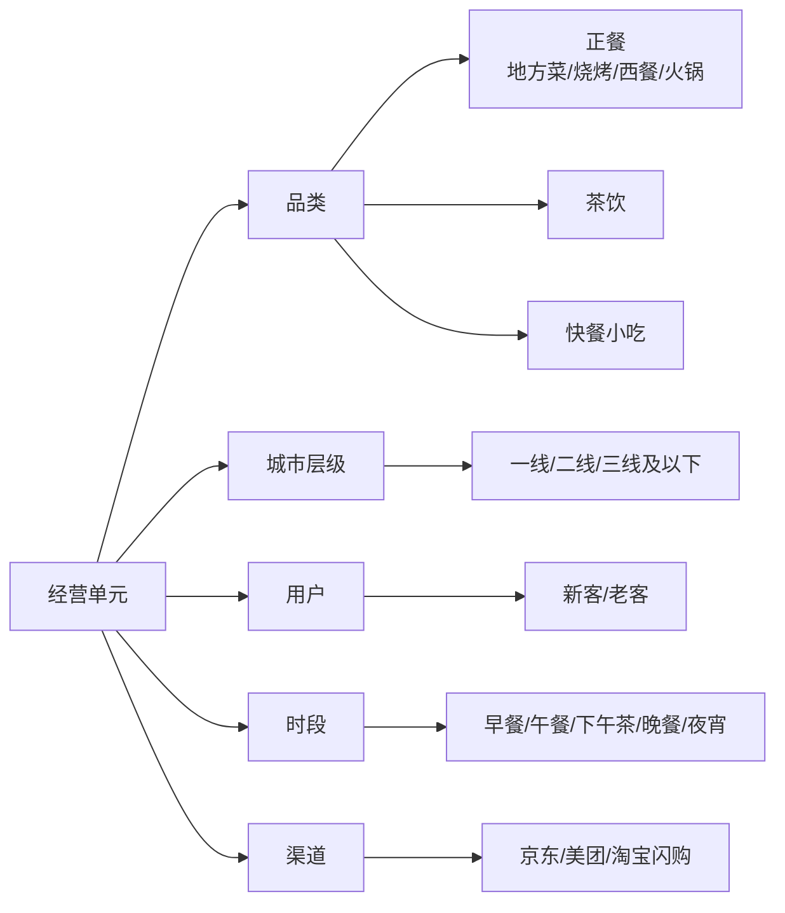
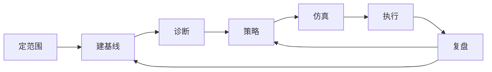

# 京东外卖包销品 UE 经营数据产品（精简版）

版本 `2.1`，2026-11-07。本版按内部包销品表口径调整。完整版见 [16_包销品UE经营数据产品](16_包销品UE经营数据产品_2026-11-06.md)。

## 结论

京东外卖的包销品经营要同时满足三个条件：平台 UE 为正，订单增长健康，商家供给可持续。平台 UE 是平台侧的考核口径；商家 UE 是供给底线；SKU UE 用来定位具体商品和场景的问题。

这套产品把包销品池、UE 核算、竞争比价、诊断、策略、仿真、执行和复盘连成经营循环。试点在一个城市、一个商圈、10 家门店、一个主力品类、20 至 30 个候选 SKU 上跑通，14 周完成，目标是验证平台 UE 能否打正。

## 一、为什么做

包销品是京东外卖支撑供给差异化和增长的主要方式。行业效率压力在上升。

| 事实 | 数字 | 说明 |
|---|---|---|
| 2026 年二季度单均 UE（公开报道和券商测算） | 美团 `+0.22 元`，淘宝闪购 `-2 元`，京东 `-4.8 元` | 京东外卖的 UE 压力最大 |
| 补贴期商户经营变化（复旦大学张军团队，四万余家商户） | 日均总订单 `+7%`，日均实收 `-4%`，总利润 `-8.9%` | 单量增长可以伴随利润恶化 |
| 京东包销计划 | 2026 年计划打造 1000 个包销标杆大单品 | 包销规模会放大平台 UE 的盈亏 |

当前经营有三处短板。

| 问题 | 表现 |
|---|---|
| UE 核算不统一 | 订单、结算、成本和竞对数据分散，字段口径不一致；会议只能看单量和补贴率，判断不了单均盈亏 |
| 比价工具缺失 | 人工截图、低频抽查，覆盖不了同店同品；单纯比价回答不了价差来源，容易和经营决策脱节 |
| 执行无记录 | 调价、调补贴、换供给在多个后台完成，结果没有结构化记录 |

产品要交付四件事：接入内部包销品表，建立可核对的 UE 核算表，建立按经营单元分层的基线，建立从诊断到复盘的经营循环。

## 二、包销品范围

本项目直接读取京东内部维护的包销品表，表中 `is_baoxiao = true` 的 SKU 进入包销 UE，`false` 的 SKU 只做普通价格监测。产品不做合同判断。成交形态按订单记录，用于校验价格和归因，不改变包销归属。

## 三、三个 UE 口径

| 口径 | 回答的问题 | 公式 | 用途 |
|---|---|---|---|
| 平台 UE | 平台这一单赚不赚钱 | 佣金 + 配送收入 + 推广收入 + 其他收入 - 骑手成本 - 平台补贴 - 支付客服成本 | 平台侧考核 |
| 商家 UE | 商家供货是否可持续 | 结算金额 - 食材 - 包装 - 退款 - 增量人工 | 供给底线 |
| SKU UE | 哪个商品、哪个场景出问题 | 商品金额、优惠和退款按商品金额分摊；配送成本按订单或距离分摊 | 定位问题 |

一笔 30 元示例订单有两个结果。

| 口径 | 结果 |
|---|---|
| 商家 UE | `+9.65 元` |
| 平台 UE | `-0.25 元` |

顾客实付 28 元，等于商家结算 21.65 元加平台净收入 6.35 元；平台补贴 2 元是对用户的让利，不计入商家结算。两个视角的收入和成本范围不同，提 UE 打正之前，要先说明用的是哪个口径。

## 四、经营单元与维度

经营单元由品类、城市层级、用户类型、时段和渠道五个维度组合。五个维度决定客单价、履约成本和补贴敏感度，所以 UE 要按经营单元分组。

UE 先按经营单元汇总看结果，再下钻到 SKU 找原因，最后用订单核对证据。三个层级共用一套 UE 字典，按订单量加权汇总。

## 五、经营循环

经营循环分七步：团队先定范围，再建基线，然后依次做诊断、策略、仿真、执行和复盘。

诊断先拆补贴前 UE 和补贴后 UE。补贴前 UE 为负，问题在价格、成本、需求或供给履约；补贴前 UE 为正、补贴后 UE 为负，属于补贴过度。

| 原因 | 判断依据 | 动作方向 |
|---|---|---|
| 价格 | 成交价低于竞对或成本线 | 调价、换规格 |
| 补贴 | 增量贡献低于补贴成本 | 降补贴、改券 |
| 成本 | 食材、包装、配送或人工高于基准 | 换供应商、改包装 |
| 需求 | 订单密度不足，配送成本摊不薄 | 扩商圈、调时段 |
| 供给履约 | 售罄、范围小、出餐慢、退款高 | 调库存、扩范围 |

| 环节 | 关键动作 |
|---|---|
| 策略 | 价格、补贴、供给三类动作；每个动作过合同、平台规则和法规、预算、商家毛利、竞对反应五道约束 |
| 仿真 | 给出乐观、基准、悲观三种情景；不通过的动作不进入执行 |
| 执行 | 保留审批、预算、回滚和审计 |
| 复盘 | 用实验或准实验归因；结果回流到基线、模型和策略库 |

## 六、产品架构

| 层 | 核心产出 |
|---|---|
| 经营目标层 | 经营单元目标、指标树、审批权限 |
| 经营数据层 | 订单、结算、合同、成本、竞对数据；统一 ID、场景版本、质量分级 |
| 经营模型层 | 平台、商家、SKU 三个 UE 口径；价格指数、弹性、补贴响应 |
| 策略生成层 | 动作卡：问题、动作、影响对象、预计 UE、预算、负责人 |
| 仿真层 | 乐观、基准、悲观情景；预算占用、回滚条件 |
| 执行层 | 任务单、审批、预算、回滚、审计 |
| 复盘层 | 归因、UE 与补贴效率复盘、结果回流 |

七层用同一套经营单元和 UE 字典连接。竞争比价的数据从数据层接入，价差在模型层和策略层解释，效果在复盘层验证。

## 七、试点与数据权限

| 项目 | 安排 |
|---|---|
| 范围 | 1 个城市、1 个商圈、10 家门店、2 个品牌（城市待定；授权不足先 3 家） |
| 品类与 SKU | 1 个主力品类，20 至 30 个候选 SKU，启动时至少有 10 个 SKU 确认属于包销 |
| 用户与时段 | 新客、老客；午市 11:00 至 13:00，晚市 17:00 至 19:00 |
| 周期 | 2 周准备、2 周建表、4 周历史基线、2 周策略、4 周向前验证，合计 14 周 |
| 样本 | 每个 SKU 四周至少 30 单，每个经营单元至少 100 单 |

试点只做数据、看板、诊断和人工策略，不自动调价。数据权限按最小必要、目的限定、角色分离、可审计执行。

| 数据 | 权限与限制 |
|---|---|
| 订单和结算 | 财务、数据团队只读；用户 ID 假名化 |
| 平台损益 | 财务、数据团队只读；佣金、配送收入、补贴、骑手和支付成本 |
| 包销合同 | 业务、法务只读；产品只看摘要 |
| 商家成本 | 聚合只读，财务审核；单店成本不对外 |
| 活动与补贴 | 业务、财务只读；记录发起方、出资方、预算 |
| 竞对数据 | 数据、分析只读；保留截图和采集条件，淘宝闪购使用前取得书面许可 |

## 八、主要卡点

| 卡点 | 解法 |
|---|---|
| 包销品表不完整 | 业务补表；产品只读；缺字段标记数据缺失 |
| UE 口径不一致 | 发布并锁定《UE 口径字典 V1》，财务以结算单对账 |
| 商家成本颗粒度不足 | 用成本模板、财务对账和品类基准补齐，估算值单独标注 |
| 竞对同品难对齐 | 同店、同品、同规格、同用户条件、同时间窗口五条件对齐，保留截图证据 |
| 归因与执行权限 | 优先做对照实验；执行从人工任务单起步，建审批、预算、回滚和审计 |

## 九、迭代

| 阶段 | 目标 | 解决的问题 |
|---|---|---|
| 第一阶段 | 把 UE 核算和看板做准 | 看不见的问题 |
| 第二阶段 | 把诊断和策略建议做出来 | 不知道怎么调的问题 |
| 第三阶段 | 把仿真和执行接起来 | 调了不知道结果的问题 |
| 第四阶段 | 做因果模型和自动优化 | 规模大了靠人跟不上的问题 |

## 十、待确认

| 事项 | 需要确认的内容 |
|---|---|
| 包销合同 | 供货价、保底量、账期、补贴分担和退出条款 |
| 财务口径 | 收入确认、补贴归因、配送费和包装费分摊 |
| 数据开放 | 平台补贴字段的范围和取证 |
| 竞对许可 | 美团、淘宝闪购的入口、账号、字段和保存期限 |
| 合规边界 | 平台、商家、品牌促销的出资与告知流程 |
| 试点授权 | 城市、门店数量和品牌授权 |
| 组织权限 | 价格和补贴动作的审批权限与最终负责人 |
