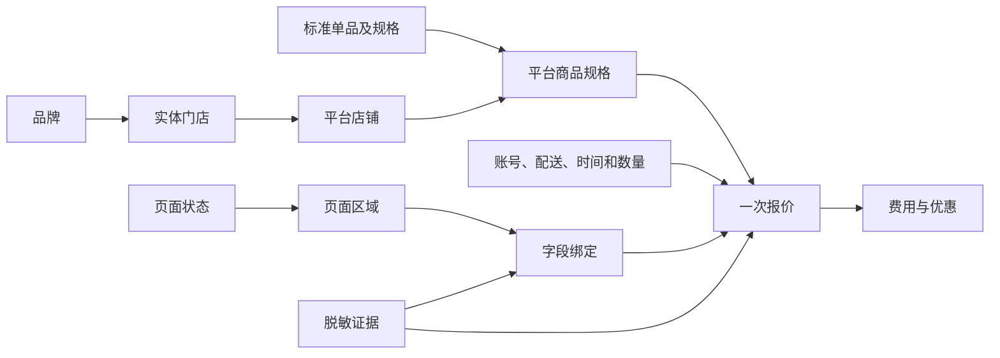

# 三平台页面本体与取数地图

## 一页读懂

这份地图解决“同一个业务字段，在不同平台、不同页面版本中到哪里取，怎样确认没取错”的问题。给采集开发、接入和核验人员维护，BD 只选清单商品，不维护控件。

业务本体定义品牌、实体门店、平台店铺、单品规格、采集条件、报价、费用、优惠和证据。页面本体定义页面状态、区域、字段绑定和操作前后关系。字段绑定把两者关联起来。保持 SQLite 和类型化配置，不增加图数据库。

当前业务定义在 [page-ontology.ts](../src/domain/page-ontology.ts)，实际取数代码引用同一份字段定义。`GET /api/market/page-maps` 可查看三平台当前配置和历史地图版本。已登记配置仍标为校准中，不能据此宣称全部页面或字段已验证。美团、淘宝闪购没有本机验证页面，不填写猜测坐标，不自动启用。

## 关系如何组织

内部实体门店编号和平台门店编号分开。本地商品编号也不能冒充平台 SKU。物理地址、规格和账号条件属于业务事实；像按钮文字、资源编号和页面位置则属于某个版本的页面配置。

## 每条字段绑定必须有什么

| 内容 | 示例与要求 |
|---|---|
| 稳定业务字段编号 | `fee.delivery.actual`，含义为本次实际收取配送费 |
| 所属对象与口径 | 费用明细、当前一份商品结算；不等于原配送费，不从总额倒推 |
| 页面与区域 | 京东当前入口 → 结算页 → 费用区域；不能把菜单预估配送费填过来 |
| 定位与提取 | 资源编号、完整业务标签、所属容器、文字与视觉提取；固定像素只能作为经过检查的辅助位置 |
| 核验 | 页面文字与模型金额一致，区分原价和实收；不一致留待复核 |
| 证据 | 原始脱敏截图、时间、取数区域、模型版本、提示版本、字段核对结果 |
| 版本和状态 | 本体版本、页面规则版本、App 版本、地图摘要；未验证／校准中／已验证／失效 |

金额以分保存。未知为空、明确免费为零。商品现价、划线参考价、订单应付、历史实付分别定义。预计送达不等于实际配送表现。优惠抵扣不等于平台补贴出资。

## 页面状态和动作

| 状态 | 确认什么 | 允许做什么与离开条件 |
|---|---|---|
| 品牌搜索与候选列表 | 当前搜索词、候选分店 | 进入候选；榜单名次只可辅助定位，不能确认分店 |
| 门店资料与菜单 | 完整分店名、城市、区县、营业地址或已核实平台店号 | 确认后找指定商品；同品牌或第一条结果不够 |
| 商品详情或规格弹层 | 单品名称、规格、选项、现价及参考价 | 保存证据并加一份；两种详情样式分别识别 |
| 本次购物车 | 商品、规格、数量、全车总件数 | 只在本次商品可核对时进结算；不能按背景菜单里的同一个“数量1件”判断购物车 |
| 结算与只读明细 | 同一商品条件、应付、费用、优惠和配送 | 只读展开，跨屏核对合计；不提交订单、不支付 |
| 恢复 | 当前页面、购物车行及总件数 | 返回后重新确认本次商品再移除。恢复不确定时暂停设备 |

“去结算”与“领券结算”是不同业务动作。默认不领券。2026-11-08 用户另外明确允许本机试采点击“领券结算”；本次授权进入任务快照和日志，限定已登记试采门店，不扩展为生产自动领券。是否点击、实际抵扣、优惠规则分别留证。

## 如何治理和更新

1. 先确认字段的业务含义，再定位页面。新增金额字段必须说明属于谁、当前或历史、单品或订单、优惠前后、原价或实收。
2. 首次接入留存脱敏样本，注明入口和 App 版本；把每个字段绑定到本体编号。未验证的字段保持未验证，不因为配置存在就写已验证。
3. 页面位置或控件变化时增加规则版本，历史地图快照保存在 `page_map_versions`，旧任务仍指向当时版本。金额含义变化时增加本体版本，并明确旧数据处理方式。
4. 使用已知真值样本检查错店、同名不同规格、套餐、真实零元、费用划线、重复优惠、不同详情样式、滚动后商品隐藏，以及背景菜单与购物车同时显示数量等情况。
5. 在本机限定范围复测，从开始采集到恢复都通过后再扩大范围。字段的发布状态仍取决于该次证据，不能因地图曾通过就跳过新报价读取。
6. 出现无法识别的新页面时停止有副作用的动作，保存脱敏证据和阶段；核实后更新地图与检查样本。不得自行把新按钮当成旧动作。

当前代码保存地图版本和逐字段证据；完整三平台地图、人工核验发布流程和持续回归样本库仍需随各平台接入补齐。本文件不代表三平台已通过验收。

## 2026-11-08：减少进入“商家”页

此前每次采价都进入“商家”核对地址，用户容易把反复切页理解为误触，也增加了耗时。现在先读取当前门店身份，与三十分钟内、同一入口配置下的完整店名和地址证据核对。一致则继续找商品，不进入商家页；换店、证据过期、入口配置变化或当前身份缺失时仍重新核对地址，不能以提速为由跳过错店检查。

确需进入时，只识别当前页面的“商家，未选中”标签。点击前重新读取页面、重新定位，排除商品详情遮挡，不使用上一次读取的坐标。日志 `store_address_open` 记录进入原因、目标及重新定位结果。该操作在本体地图中登记为 `store_menu → verify_business_address → store_identity`；它用于核对门店，不用于找商品。商品名称、规格、现价仍每次重新读取。

同一轮真机记录 `8405932d-73ab-4c5f-85e0-13d6f76eac5f` 已验证跳过该页面，门店核对耗时 4 毫秒。该轮随后在加购后等页面失败，购物车已恢复；不能据此宣称全链路通过。相关失败记录原样保留。
