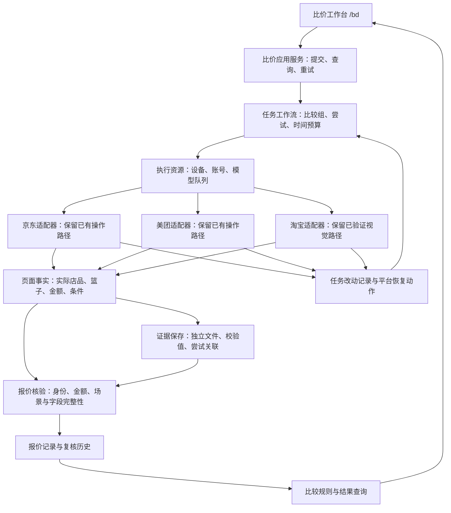

# 三平台比价工具：恢复与优化实施计划

日期：2026-11-16。状态：实施提案，尚未按本计划完成验收。

本计划依据当前工作区、历史验收材料及本 session 的最新决定编写。本轮只做只读核对和文档整理，没有修改实现、启动采集或操作手机。用户已明确：**当前只完成三平台比价工具，不安排 UE 工作台改造，也不把扩展到几十个商品作为本轮交付前提。**

## 一页读懂

**目标是让一个完整、可信、可重复的三平台比价流程真正成立。先恢复已有能力，再补齐原计划要求的数据和执行规则。**

- **给谁使用**：需要核对指定商品价格的 BD 和运营人员。
- **用户会经历什么**：选择城市、品牌、商品、规格与采价条件，一次提交；看到三平台各自的进度；得到实际分店、结算应付、费用、条件差异和证据；失败时知道原因，并能只重试失败的平台。
- **本次交付**：以天津麦当劳板烧鸡腿堡、单品一份为验收样例，完成京东、美团、淘宝闪购的正式界面到结果展示。解决比较组、证据、购物车恢复、实际店品核验、弹窗、失败测试和流程回归。
- **本次边界**：沿用现有手机 UI 技术路径与各平台已经验证过的读取方法。当前一台手机依次操作三个 App。UE、扩量采价、硬件采购、生产 SaaS、自动下单或支付不属于本次交付。
- **架构选择**：使用模块职责清楚的单体应用，配合可记录和恢复的工作流、统一报价契约、平台独立适配和不可覆盖的证据。这些能力优先落在现有 TypeScript、SQLite 和采集接口上，不以更换技术栈为起点。
- **如何验收**：先分别恢复三条链路，再从正式入口完成同一比较组，最后用冻结版本完成小批量回归。报价正确、费用完整、状态恢复、比较条件分别检查，不再合并成一个含糊的“成功”。
- **已完成与未完成**：已有备份；本轮改动中已有比较组、独立证据等代码；部分定位函数已恢复。三平台完整恢复及组级真机验收仍未完成，不能写成已经稳定可用。

**“架构更先进”的实际标准**：换一家的页面定位方法，不需要重写产品流程；换模型，不改变金额含义；一家的采集失败，不抹掉另外两家的结果；服务中断，不会盲目重复加购；每个结果都能追到当时的页面和执行记录。

## 1. 已确认的产品范围

| 项目 | 本次采用的决定 |
|---|---|
| 当前优先级 | 只完成比价工具。UE 工作台保持现状，相关功能不列入本期开发 |
| 验收对象 | 麦当劳板烧鸡腿堡，核实为指定单品、规格与一份数量，不换成双层款、套餐或其他商品 |
| 门店口径 | 同城、同品牌、同品；允许不同分店。显示实际分店与条件差异，不假装三家为同一实体店 |
| 输入与实际结果 | 输入是希望采什么；结果是实际看到了什么。两者分开保存 |
| 设备 | 先完成一台手机串行执行。三机只在未来迭代中评估，不预设采购 |
| 优惠弹窗 | 本次采用用户已允许的统一关闭方式；保留页面自动应用的优惠并记录。不新增主动领券、购会员或寻找最优券流程 |
| 购物车 | 保留用户已有商品；只撤销可证明属于本任务的改动。不能要求清空现有购物车来掩盖恢复能力不足 |
| 数据 | 不删除历史任务、失败记录或旧报价；不拿历史报价代替本次采集 |
| 技术路径 | 京东、美团保留已有控件读取及视觉补充；淘宝保留已跑通的视觉定位路径。具体页面按实证选择读取方式 |
| 许可记录 | 用户已声明淘宝具有平台书面许可，依据待提供核查。记录声明和核查状态，不把旧文档中的“未获许可”继续当成最新事实，也不虚构已核查证据 |

此前确认的“小规模业务试点”作为未来使用场景保留，不等于本次还要交付几十商品、定时监测和长期无人值守。

## 2. 当前起点：哪些是事实

| 已检查的依据 | 能说明什么 | 不能说明什么 |
|---|---|---|
| [36 号暂停记录](36_暂停状态_2026-11-13.md)，对应提交 5b5d21c | 历史记录显示三平台曾分别通过 /bd、调度器与采集器走到报价；记录耗时约京东 84–86 秒、美团 102 秒、淘宝 137 秒 | 不能据此认定当前代码可用，也不能拼成一次三平台成功 |
| 当前 HEAD 为 4940a58，工作区仍有大量未提交改动 | 恢复和优化交织在一起，需要逐项归类 | HEAD 不是三平台全部能力已经验收的统一基线 |
| 2026-11-15 恢复备份清单 | 已保存当时的代码差异、相关文件、配置、证据、运行产物及数据库备份；清单记载数据库完整性检查通过 | 不包括模型二进制和依赖目录，也不等于恢复后代码已验证 |
| 当前代码与前次恢复记录 | 淘宝 tapByVision、美团视觉定位及等待、京东有限读屏重试等函数已做部分恢复 | 淘宝后续店品、购物篮和金额读取仍有强制控件依赖，整体恢复未完成 |
| 最近一次淘宝任务 c4947e00-836a-491b-9c44-28a99ce465ce | 日志显示进入闪购并完成品牌搜索，随后门店定位反复失败；最终结果为 failed、cleanup 为 untouched | 不是三平台或淘宝全流程成功；数据库中的 completed 仅表示任务已结束 |
| 本轮只读数据库检查 | 当时没有 running 或 queued 的任务 | 不证明设备、模型或服务现在已具备下一次测试条件 |
| 当前比较与证据实现 | 一次提交共用运行编号、失败平台重试、独立证据文件等已有实现 | 仍需检查重试、超时、旧数据和前端是否遵守相同口径 |

恢复备份位于：`.runtime/recovery-backups/2026-11-15-1794752191637/`。实施前核对备份清单与当前差异；恢复代码时不把数据库回滚到旧快照。

早期审查记录为 97 项测试中 4 项失败。后续局部通过或新增用例通过，不能替代对这 4 项原始失败的说明。本计划要求形成逐项结论。本轮没有重新运行自动测试，也没有新增真机测试。

另一个已确认问题是文档存在新旧口径冲突，例如“同一家实体店”与用户后来确认的“同城不同分店”。实施时统一当前说明，历史材料保留日期和适用范围，不继续让旧规则决定新功能。

## 3. 产品架构：围绕一次完整比价组织能力

### 3.1 四个产品模块

| 产品模块 | 用户要完成的事 | 负责的能力 | 不承担的工作 |
|---|---|---|---|
| 采价对象与条件 | 说清采什么、按什么条件采 | 商品清单、标准规格、数量、城市品牌、账号和配送点位配置、门店选择范围 | 不把清单中的期望店品当成实际观测 |
| 采集任务 | 一次提交，知道每家进行到哪里 | 比较组、三条平台任务、排队、进度、停止、重试和恢复提示 | 不直接决定哪个价格可信或谁最便宜 |
| 报价与比较 | 看清三家实际报价及差异 | 结算价、费用明细、实际分店、条件差异、观察时间、可比较范围 | 不把消费者优惠推断为平台出资，不宣称全平台最低价 |
| 证据与复核 | 能核对、追溯和纠错 | 店品与结算证据、字段出处、复核结论、历史尝试、失败原因 | 不把截图存在或模型返回 JSON 当成正确性证明 |

这四个模块可以继续放在现有 /bd 界面：顶部对象与条件，中间三个平台的进度和结果，下方比较及证据详情。无需为了架构新增四套页面。

### 3.2 用户主流程

1. 选定“天津市／麦当劳／板烧鸡腿堡／已核实规格／一份”。复用已保存的账号和配送条件，并让用户看到本次使用哪一组配置。
2. 一次提交建立一个比较组和三条平台任务。单机提示“依次采集”；排队与执行明确区分。
3. 每个平台返回实际分店、商品与规格、数量、当前结算应付、可读费用、优惠条件和观察时间。
4. 逐家显示“已核验报价”“仅有待核实记录”“业务无报价”或“采集失败”。恢复状态另外显示。
5. 满足比较条件后展示样本差额；条件不一致时说明差在哪里。缺一家时保留其失败位置和另外两家的结果，不称三平台已完整交付。
6. 点击证据可以核对本次页面。重试失败平台保留原尝试；如果报价时差已经超过本组要求，则重新发起一组，不把过时结果拼成同期报价。

本次不加入自动推荐补贴、自动调价、自动支付和新的复杂优惠策略。

### 3.3 比较规则分三层

| 展示层级 | 条件 | 用户看到什么 |
|---|---|---|
| 单家实测报价 | 实际店品、数量、结算应付与证据可信 | 该账号、该分店、该时刻的应付；允许费用部分缺失，注明原因 |
| 同城同品牌样本比较 | 同城同品牌、相同商品规格数量、同配送点位和履约方式，观察时差不超过 5 分钟；影响报价的已知条件差异能够列明 | 样本差额、实际分店、会员和用券差异；不把差额归因于平台本身 |
| 条件核对一致的比较 | 以上成立，且已登记的重要会员、新老客和用券条件核对一致 | 更有约束的比较结果；不同分店仍明确展示，不冒充同店控制实验 |

资格未知与资格不同分开处理：**已知不同可以展示带条件说明的样本差额；关键条件未知则先并列报价，显示待核实，不输出同条件优劣结论。** 这一点需要在现有 comparePair 的严格检查之外明确表达，不能简单删掉校验，也不能让所有不同条件的样本都消失。

“本组最低观测应付”只针对本组已核验且适用比较规则的报价。三家不齐不能称三平台最低。菜单价、购物篮应付、历史实付分别显示，不能互相替代。

5 分钟约束沿用已有比较口径；它约束三个 observed_at 的最大差值，不等于任务可以只运行 5 分钟。组截止时间、结果新鲜度和恢复超时是三个不同概念。

## 4. 工程架构：稳定接口，允许平台内部不同

### 4.1 目标结构

图中的框表示职责，不表示要拆成独立服务。当前继续采用单体应用和本地 SQLite。手机操作、模型调用、数据存储分别通过小接口调用；避免让一次服务化重构成为功能跑通的前提。

### 4.2 SOLID 在本项目中的具体要求

SOLID 是一组让模块职责清楚、修改影响可控的设计原则。本项目用下面这些可检查的行为落实。

| 原则 | 在本项目怎样落地 | 验证方式 |
|---|---|---|
| 单一职责 | 平台适配器负责操作和取页面事实；核验模块负责报价是否有效；比较模块负责差额和限制条件 | 修改淘宝定位，不需要修改金额算法或比较规则 |
| 对扩展开放 | 新页面读取方法通过对应平台适配器接入 | 新方法可以单独回放与试验，不强制替换另两家 |
| 实现可替换 | 三家都返回同一份事实及错误约定，但允许能力和证据形式不同 | 替换适配器不改变成功定义；不能靠伪造字段通过契约 |
| 接口小而清楚 | 分开采集、证据、资源操作和存储接口 | 不建立一个要求所有平台实现所有控件的巨大基类 |
| 业务不依赖具体工具 | 工作流依赖采集接口；比较规则不依赖 ADB、模型或 SQLite 细节 | 业务规则可以用固定事实独立检查；手机能力可以单独替换 |

沿用已有 application、domain、adapters、infra 的目录。只在修改某项功能时拆出必要职责，不先做大面积搬文件、换框架或重命名。

### 4.3 最小数据对象与关系

| 对象 | 一条记录表示什么 | 关键保证 |
|---|---|---|
| 采价对象及场景快照 | 标准商品、规格数量、城市品牌、门店范围、账号与配送条件的本次版本 | 任务开始后不因配置修改而偷偷变化 |
| 比较组 | 同一次提交要比较的三家报价 | 当前一品一次提交可继续复用现有 run 与 comparison_group 关系，不重复建两套等价模型 |
| 平台任务 | 组内一家平台的交付要求，沿用 slot | 重试不新造任务分母；一家失败保留另两家结果 |
| 执行尝试 | 一次真实执行，沿用 attempt | 每次重试有新编号、起止时间、版本、步骤和原始错误 |
| 报价快照 | 某次尝试实际采到的一份报价及核验结果 | 请求与观测分开；报价不被后续尝试覆盖 |
| 证据 | 一张页面或一段结构化读数，以及采集时间、来源和校验值 | 与尝试、页面阶段及字段关联，不能被下一轮截图覆盖 |
| 购物车改动记录 | 本任务的初始状态、计划动作、实际变化和恢复核对 | 只恢复任务拥有的变化；状态未知不伪称成功 |
| 复核记录 | 对一份报价的人工判断和更正理由 | 保留原记录，关联更正，不直接重写历史事实 |

数据库优先复用已有表。当前 observations 对 slot_id 的唯一约束，需要核对其是否会覆盖重试后的旧报价；若需要保存多次报价，采用追加记录和“当前选用报价”引用，保留历史映射。迁移前做备份并在副本验证，禁止用删库重建实现升级。

### 4.4 报价状态与执行状态分开

一份结果至少回答五个问题：

1. **执行是否结束**：排队、执行、恢复中，还是已经结束？
2. **报价是否有效**：实际店品、数量和应付是否有充分证据？
3. **明细是否完整**：请求的费用和优惠字段哪些读到了，哪些缺失？
4. **购物车是否恢复**：未改动、已恢复到原状态，还是仍需核对？
5. **能比较到什么程度**：只有单家报价、样本比较，还是条件核对一致？

报价有效但恢复未确认时，可以保留并明确展示已核实报价，同时标记执行未完整完成、暂停相关后续操作。不能把真实报价抹掉，也不能把任务标成完整成功。

“有效总额、明细缺失”允许成为 partial；“只有菜单价”不能计为结算报价；售罄、闭店或不配送是业务无报价；技术失败保留错误和证据，不能被写成售罄。

### 4.5 可恢复工作流与资源边界

- 任务依次经过排队、检查运行条件、导航、读取、核验、恢复和结束。具体点击仍由各平台已有流程执行，不强制三家使用同一套页面状态。
- 设备和账号在提交时绑定明确配置。单机共用一个设备执行队列；模型请求另行排队。不能在执行中临时选择第一台在线手机或第一个账号。
- 排队、实际采集、恢复分别计时；用户看到的总耗时包含排队。三家进度从任务记录读取，不再只依赖“当前平台”的固定日志文件。
- 加购前记录动作意图和初始状态，加购后保存实际变化。手机操作不具有数据库事务的保证：点击成功但记录失败时，重启后先核对页面，不能直接再点一次。
- 取消和超时必须传到所有可能继续点击或输入的步骤。结束采集后保留独立的恢复时间；旧步骤确认停止前不能把设备交给下一家。
- 原有购物车有商品但本任务尚未修改，属于“该采价条件暂不可用”，不应无差别隔离整台手机。只有动作仍可能进行、改动归属不明或状态无法恢复时，才阻止可能受影响的后续执行，并记录具体范围。
- 服务重启后先处理未结束尝试及其副作用，再恢复排队。采集进程崩溃不能导致一次任务被悄悄当作从未执行。

本次不引入分布式任务系统。只有实测发现某个底层调用无法可靠取消、必须终止独立进程才能隔离时，再做最小的执行进程隔离；不把这一项提前扩大成微服务改造。

### 4.6 模型的职责

模型用于页面定位、文字或结构提取、候选匹配。程序负责金额单位、状态、条件检查和最终发布决定。模型的置信度不能替代证据。

按平台、按页面保留已验证的方法：可可靠读控件的页面用控件；依赖视觉的页面继续用视觉；必要时局部文字识别。不能要求“先读到控件，才允许视觉定位”，也不能因为一个页面读不到节点就判断整个 App 永远只能视觉。

模型配置与健康检查集中管理。健康检查应覆盖真实图片请求，而非只测文本接口。对同一组已标注截图评估定位、金额读取、耗时与失败类型，才决定是否调整模型。当前不默认购买云模型或替换本地模型。

## 5. 分阶段实施：每一步有交付和退出条件

### P0：固定当前状态与恢复范围

**工作**：复核现有备份；补存备份之后的代码差异；将改动分为“需要保留的正确性修复”“需要恢复的操作路径”“尚未证明必要的新增行为”。区分原有用户改动和本轮 Agent 改动。

恢复对照以 5b5d21c、b7bd34a、4940a58 等提交及对应日志逐函数确认。不是机械选择某个日期整体回滚，更不能恢复删除历史、清空整车、伪造字段等已确认的问题。

**交付**：三平台恢复清单、各自基线版本与证据索引；当前服务配置和构建版本的可复现说明。配置不输出密钥。

**通过条件**：每项拟改行为都能指出原行为、当前差异、恢复依据与保留边界。现有数据和用户改动有可恢复备份。

### P1：恢复三条原链路，并以板烧鸡腿堡做对照

| 平台 | 恢复重点 | 必须保留的修复 |
|---|---|---|
| 京东 | 原有入口、商品流程、有限读屏重试；按原实际流程检查立即购买是否隔离购物篮，不用未经证明的全车为空条件直接替代原流程 | 不清空整车；不把同一运费填入两个费用字段；保留证据、前台核对和取消能力 |
| 美团 | 原有控件路径和不依赖控件先验的视觉补充；回到已验证的页面时机读取身份与金额 | 独立证据；实际店品与请求分离；不能重新宣称加购后 untouched |
| 淘宝 | 原有闪购入口视觉定位、搜索、进店、单品与结算读取；核对视觉预热、原等待与已校准参数 | 不用“闪购外卖”精确节点替代视觉入口；不盲目重复加购；不删除实际校验与恢复责任 |

先恢复正常页面路径。不要在未完成对照前同时引入新的启动策略、弹窗框架、身份前置检查和等待优化。某一步确有安全或错品问题，就在该步骤修正并单独记录，不能以“恢复”为由重新启用已知破坏行为。

对照按相同商品、点位、账号条件和尽量接近的时段开展。价格随时间变化，不能要求与历史金额相等；核对的是当次页面、店品与金额。

**交付**：每家一份可回看的完整轨迹，记录到达页面、当时读数、失败位置、购物车前后状态和版本。导航恢复与报价发布分别下结论。

**通过条件**：三家分别完成目标商品到结算的原链路；未解决的数据缺口明确保留，不伪装成业务成功。已有购物车不能因对照测试被删除。

### P2：补齐原计划的四个核心问题

#### A. 比较组：让一次提交确实对应一笔比价

- 同一次提交建立完整的三平台任务，未执行、无报价和失败都保留。
- 提交加入请求标识，同一请求重复发送返回同一组；同标识但内容不同拒绝，防止网络重试触发重复采价。
- 重试沿用原组和平台任务，新增尝试；成功后也不删除先前失败。
- 统一组级状态与结果选取规则，前端、比较、统计读取同一来源。现有 group-delivery 纯函数应接入或合并，避免并存两套“已交付”判断。
- 重试后重新检查时间窗口；不在旧组中静默替换另两家历史结果。需要重新同期采价时建立新组并关联原组。
- 显示本次实际使用的账号与配送配置，不由 API 静默挑选第一条可用资料。

**验收**：一次提交三任务；重复提交不重复加购；失败平台重试后尝试完整；超时、取消、缺一家均有正确组级结果；过时数据不能凑成同期三家成功。

#### B. 证据保存：让历史报价能被核对

- 每份证据使用独立编号，关联组、任务、尝试、页面阶段、采集时间和校验值。延续当前独立文件的实现，补齐关联和读取检查。
- 保存实际门店、商品规格、购物篮、结算总额及恢复依据。总额裁切图不能独自证明店品正确。
- 写入证据后再发布引用。截图或元数据写入中断时，不发布一个指向残缺文件的有效报价；保留错误供排查。
- 原始读数、规范化金额和字段证据一一关联。不同页面的金额不能未经核对拼成同一时刻的费用表。
- 根据真实页面使用已有裁剪或遮罩方式处理个人信息；没有控件时也要允许经过验证的视觉区域方案，不能以脱敏名义取消整条视觉能力。
- 旧错价、证据校验不一致、关联缺失的记录保留并标记待复核或无法追溯，不补造证据、不删除。

**验收**：连续采两次、服务重启后，第一次证据仍可读取且校验值一致；缺文件、覆盖、错误页面和个人信息处理失败能被明确识别。

#### C. 购物车恢复：恢复到原状态，而非统一清空

| 实际起点 | 允许的处理 |
|---|---|
| 本店购物车明确为空 | 记录基线，加入本次商品；完成后仅移除本次加入的一份并核对恢复 |
| 已有商品，原流程支持独立立即购买 | 先证明本次结算篮仅包含指定商品且不会混入原车；再按该平台已验证方式执行，结束后核对原车未变 |
| 已有商品，结算必然混合 | 不把混合篮总额当成单品价格；在用户已允许的同城同品牌范围内选择另一家适用分店，并显示实际分店 |
| 不能确认初始状态或改动归属 | 不猜测、不盲减、不整车清空；记录原因。只在自主核对仍无法恢复时请用户提供最小必要确认 |

商品相同也不能自动认领原有数量。例如原来两份、任务确实增加到三份，只有完整证据支持时才能减回两份。未看清原来数量，不得直接减成零。

恢复动作由平台适配器完成；共同接口接收“基线、任务改动、恢复后证据”。不能把“必须出现某一句空车文本”作为三家共同要求。未加购的失败不冒充已恢复；加购后的失败不能返回 untouched。

**验收**：空车、原有其他商品、原有同名商品、重复加购风险、采途中断、超时恢复分别有验证；没有非本任务商品减少；恢复状态与页面证据一致。

#### D. 实际店品核验：同样严格，但不强制同一种读取方法

- 分开保存 requested 与 observed，目标名称不回填成实测名称。
- 门店核验使用实际分店名、城市与店铺证据；有已核实映射时复用其身份依据，并检查当前页面没有切店。存在歧义时补查地址或店铺信息。
- 不要求每个平台在每一步同时出现完整店名和带“营业地址：”前缀的控件。视觉页面的有效证据同样可以核验。
- 商品核对单品、规格选项和数量，专门覆盖“板烧鸡腿堡／双层板烧鸡腿堡／套餐”等近似结果。已核实映射可以复用，但当次结算篮仍要核对。
- 金额用整数分保存。原价、实收、已含费用、优惠与总额分开；明细完整且口径明确时才做加减核验。没有展示的费用保留未知和原因，不填零，不重复填一笔运费。
- 视觉读取须关联当次页面区域、身份和数量证据，经过已验证的字段校验后才能进入自动报价；尚未校准的读取方法先标待核实。验收时以独立标注或可靠字段为依据，不能把同一模型的第二次回答当作唯一真值。这里不要求视觉页面必须额外读到控件，也不把每次人工代读作为自动流程的一部分。
- 原来可读取的费用继续保留。不能为了通过校验把全部费用改为未知，也不能用“未展示”解释尚未实现的读取能力。

**验收**：错店、错规格、数量多一份、混合购物篮、目标字段冒充实测、总额误填包装费等情况不能进入已核验报价；正确的视觉页面也不能因缺少节点被一律拒绝。

### P3：补齐弹窗、停止与本机回归

**弹窗处理**：沿用用户许可的统一关闭策略，仅处理确有浮层、明确关闭目标的页面。确认关闭后主页面恢复，再继续原步骤。普通首页领券入口不算弹窗；未知“确认”按钮不自动点击。设置有限重试，失败保存页面和原因，不能无限等待。

**停止行为**：任何阶段超时或取消，后续业务点击必须停止；已发生的任务改动走独立恢复。模型返回过晚、旧坐标和旧步骤不能影响下一平台。

**失败测试**：找出早期 4 项失败的用例名、版本和原始输出，逐项判断为实现缺陷、环境条件、过期断言或未能复现。需要复现旧版本时只在隔离副本运行离线测试；不让旧代码操作当前手机。缺少原始证据时标明缺口，不编造根因。修改断言前先确认业务要求，不能仅为“全绿”放宽测试。

**本机检查范围**：类型检查、构建、已有自动测试、受影响的契约和回放测试、正式 HTTP 入口和 /bd 浏览器流程。测试使用独立数据目录，不操作真实购物车或污染运行数据库。UE 不改功能；共享代码变化只做必要回归。

**交付**：一次完整的本机验证报告，以及仍需真机才能成立的结论清单。没有真实页面支撑的模拟测试明确标注。

### P4：正式入口真机验收与交付

先检查设备连接、前台、账号和配送配置、App 版本、本地模型图片请求及服务构建版本。已有购物车按 P2 的策略处理，不以用户清空整车作为默认准备步骤。

随后按同一冻结版本执行：

1. 逐平台检查恢复后的板烧鸡腿堡链路和页面事实，补齐 P1 对照中尚未确认的内容。
2. 从正式 /bd 入口一次提交三平台，手机串行完成，保存完整组结果。
3. 建议连续完成 **3 个完整比较组**，覆盖首次进入、连续执行和重新进入。期间不修改代码；若修改，另开回归批次，之前的失败保留。
4. 逐份对照当时页面人工复核关键字段与可见费用，并核对恢复证据。手动代点关键链路不能算自动流程通过。
5. 检查证据历史、失败平台重试、组级比较和时间显示。真实未出现的弹窗类型以回放结果说明，不能宣称全部真机覆盖。

3 组是本轮功能回归建议，不是长期成功率证明。20 轮、多商品和长期稳定性验收留在下一阶段，不以无限循环调试替代当前明确交付。

**本轮完成条件**：正式入口能产生可信的三平台同组报价；正确显示实际分店和条件；关键金额与证据一致；本次改动已恢复且已有购物车保留；本机检查通过，原失败测试有逐项结论；没有把待验证项写成完成。

若某平台结算页确实没有显示全部费用，可交付有效总额与明确标记的部分明细。若没有取得目标商品的真实结算应付，或依靠手工代点才能完成，则不能宣布三平台功能已跑通。

## 6. 验收矩阵与统计口径

| 场景 | 本机可以验证 | 真机必须验证 |
|---|---|---|
| 一组三任务、重复提交、失败重试 | ID、状态、历史和请求幂等 | 同机三家实际切换与输入互不干扰 |
| 证据独立保存 | 覆盖防护、缺文件、校验值、重启读取 | 截图确实来自本次目标页面，脱敏没有遮掉关键事实 |
| 实际店品 | 已标注页面上的规则、近似品排除 | 当前 App 的实际分店、商品、规格与数量 |
| 金额与明细 | 分与元、未知与零、费用含义、错误输入 | 当时真实页面金额与所保存报价一致 |
| 购物车恢复 | 归属规则、重复动作、取消和中断状态 | 各平台真实加购、立即购买、原有商品及恢复行为 |
| 弹窗 | 正常领券入口不能误判；弹窗样本关闭策略 | 本次遇到的真实弹窗能关闭并回到原流程 |
| 模型和性能 | 相同截图的正确率与耗时对照 | App 加载、模型排队、完整采价及恢复耗时 |
| 产品展示 | /bd 进度、部分结果、失败说明、比较限制 | 三家结果与对应现场事实一致 |

报告至少保留：计划组数、平台任务数、尝试数、有效报价数、已复核正确数、明细完整数、三平台有效报价完整组数、可比较组数、恢复确认数、业务无报价数、失败数和未执行数。

- 有效报价率＝有效报价的平台任务数／计划平台任务数；不能把重试次数加入任务分母。
- 已发布报价正确率以接受独立复核的报价为分母，并单列复核覆盖率。发现错价保留在错误统计中，不能撤回后当作从未发布。
- 三平台完整率和可比较率都以计划比较组数为分母；任务结束率不等于这两项。
- 所有失败、未执行和业务无报价都保留在计划分母，同时分项解释原因。
- 耗时区分排队、采价、模型等待、恢复与全程；同时报告失败的耗时，不能只看成功样本。3 组先报逐组实数，不把小样本 P90 当稳定性承诺。

## 7. 关键假设：必须能被验证或推翻

| 假设 | 当前依据与未知 | 怎么验证 | 不成立时怎么办 |
|---|---|---|---|
| H1：原三条路径在当前版本仍可恢复 | 有历史单独成功记录；当前版本和页面可能变化 | 冻结环境后逐平台对照，保存失败位置与页面 | 修正有证据的具体变化；不能据此默认替换整条路线 |
| H2：页面足以确认实际店品、数量与应付 | 结算取价曾成功；完整身份与篮子证据不足 | 对关键页面独立标注，对照程序结果 | 保留待核实记录；改进该页面读取或明确人工复核，不能靠任务输入补齐 |
| H3：能在不损害原购物车的条件下采单品价 | 单品流程存在；三平台副作用尚未统一证明 | 空车、原有商品、立即购买和中断对照 | 使用范围内适用分店或返回条件不满足；不强清原车 |
| H4：当前本地视觉模型足以支持指定页面 | 历史能跑通，但最近仍有多次定位超时 | 相同已标注截图比较定位、读数、耗时；先分清模型服务故障与识别错误 | 局部调整输入或读取方式；更换模型需独立对照，涉及云费用另行决定 |
| H5：一台手机足以完成当前功能目标 | 三 App 可以串行，完整组尚未验收 | 正式入口跑同一组，检查切换、排队与恢复 | 修复串行执行与状态管理；不靠“增加并发”解决同屏争用 |
| H6：同城不同分店的样本对用户有参考价值 | 用户已确认接受该口径 | 用真实组展示分店与条件差异，检查结果能否解释 | 调整展示和比较范围；不把样本差异当因果结论 |
| H7：恢复与额外核验不会把总耗时推高到不可用 | 当前没有可信的统一全程基线 | 每阶段记录耗时，先测完整正确流程 | 优化最大耗时环节；速度要求与硬件选择在证据后确定 |
| H8：统一关闭弹窗能覆盖当前主流程 | 用户允许；现有规则曾把普通领券入口误判 | 正常页和真实弹窗成对回放，现场核验已遇到类型 | 按具体弹窗补充，不放开所有“确认”按钮 |
| H9：已知账号和配送条件能维持可解释的比较 | 已有配置，不代表每次资格都已核实 | 保存本次实际条件，检查自动用券、门店新客和地址变化 | 降为单家报价或带差异样本；不输出同条件结论 |

这些假设不是承诺。尤其没有证据支持“换一个模型即可达到 100%”“淘宝天花板就是 70%”或“三台手机自然能在 120 秒内完成”。

## 8. 未来迭代：由已测问题决定下一步

| 阶段 | 进入条件 | 才安排的工作 | 不通过时的选择 |
|---|---|---|---|
| 本期：完整功能 | 当前任务 | P0–P4；板烧鸡腿堡三平台真实同组比价 | 记录明确未完成环节，针对根因修复，不扩功能掩盖缺口 |
| 后续一：重复稳定性 | 本期完整交付，用户决定继续 | 每平台至少 20 次、冷暖启动、弹窗和中断覆盖；少量不同商品；冻结版本统计 | 对主要失败类别做限定轮次改进与复测，保留每轮结果 |
| 后续二：效率与设备容量 | 正确性及恢复可靠，存在明确等待或容量需求 | 根据耗时优化等待、复用会话、减少重复模型调用；再验证三机与模型队列 | 若共享模型成为瓶颈先测模型容量；不先采购再寻找收益 |
| 后续三：单平台替代采集方式 | 某一平台经对照仍无法满足已确认要求 | H5 等作为独立适配器试验；检查账号、入口、优惠和结算口径是否等价 | 不等价则作为另一种来源显示，保留原路线，不静默替换 |
| 后续四：多人使用和更大范围 | 用户提出真实业务试点与协作需求 | 服务端账号权限、证据访问、定时计划、容量控制、备份与运维 | 没有实际需求不引入复杂分布式架构 |

UE 工作台不属于以上本期实施。将来若重新启动 UE 工作，只通过经过核验的报价查询接口接入，不让 UE 直接依赖平台点击流程。

单机和三机分别评价：单机组耗时约为三家执行与恢复耗时之和；三机理想上接近最慢一家，但仍受模型并发、账号及服务资源影响。历史 84–86／102／137 秒只是单次参考，不能作为当前预测或承诺。

原长期 120 秒、98% 等目标作为历史目标保留，不静默宣布达标或取消。当前功能交付不以购买三台手机为条件。将来恢复这些性能和质量承诺前，明确样本量、计时口径与运行环境。20 次全对只能作为初筛；长期正确性仍需要更充分且覆盖实际场景的证据。

## 9. 实施控制：让迭代更快，也更容易回退

每次提交只处理一个可验证的行为变化。先写清证据、预期改善和可能影响，再改动；保留改前、改后同一页面或同一商品的对照。

恢复期间优先处理已有链路退化；比较组、证据和字段校验沿接口逐项接入。新方法先在留存页面或隔离任务验证，证明有效后才成为默认。不要因为“更规范”就把节点检查塞进原视觉路径的每一步。

同一根因连续两轮调整仍无改善，应停止继续堆补丁，提交已测证据、剩余选项和代价。停止的是没有收益的试验方向，其他不受影响的实施继续进行。需要换核心路径、增加费用或扩大范围时再请用户决定；普通修复不反复索要批准。

回退恢复代码和配置版本，保留本轮运行记录及失败证据。数据库采用兼容迁移和副本验证，不能用恢复旧数据库抹掉新历史。

### 主要代码落点

| 责任 | 现有代码位置 | 改动边界 |
|---|---|---|
| 正式提交与页面 | src/http/competition-api.ts、public/bd.js | 组、条件选择、进度和结果；不写平台定位 |
| 编排与接口 | src/application/scheduler.ts、ports.ts | 执行状态、预算、重试；不写页面控件要求 |
| 业务口径 | src/domain/contracts.ts、competition.ts、group-delivery.ts | 报价、状态和组交付的唯一规则 |
| 比较结果 | src/application/comparison.ts | 实际条件、样本比较和严格比较，不依赖手机操作 |
| 平台操作 | src/adapters/android-collector.ts、meituan-collect.ts、meituan-collector.ts、taobao-collect.ts、taobao-collector.ts | 保留原路径；平台内部提取和恢复分别验证 |
| 执行与页面辅助 | device-lock.ts、android-transport.ts、cart-safety.ts、observed-identity.ts、popup-safety.ts | 共用输入输出约定；不能强制三家共享节点假设 |
| 存储与证据 | src/infra/sqlite-store.ts、competition-store.ts、evidence.ts | 追加历史、关联、事务和证据完整性 |
| 验证入口 | scripts/bd-stability.ts、相关 tests | 正式入口统计；页面回放和真机结果明确分开 |

不把表中的每个文件都视为必须修改。以具体证据确定必要改动，避免为了“架构完整”扩大代码差异。

## 10. 最终交付清单与当前决策

本轮实施完成时，交付：

1. 三平台恢复清单，以及最终代码、配置、设备、App 和模型版本。
2. 可从正式 /bd 入口使用的完整三平台比价流程。
3. 板烧鸡腿堡同组真机结果、当次实际店品与费用证据、前后购物车状态。
4. 本机检查结果和原 4 项失败测试的逐项说明。
5. 每次失败与重试完整保留的验收报告，包括真实未验证项。
6. 简短操作说明：怎样发起、查看条件差异和证据、重试、识别需要人工处理的状态。

**当前无需再确认产品方向。** 用户已明确先完成比价工具，并允许同城不同分店。后续实施按本计划的恢复顺序推进。更换主技术路径、付费模型、设备采购、扩大商品范围和重启 UE 改造，都留到有证据且实际需要时另行决定。

本计划中 3 组功能回归、比较展示层级和阶段门槛为明确提出的实施建议；本文件本身不代表这些内容已经完成开发或获得真机验证。
