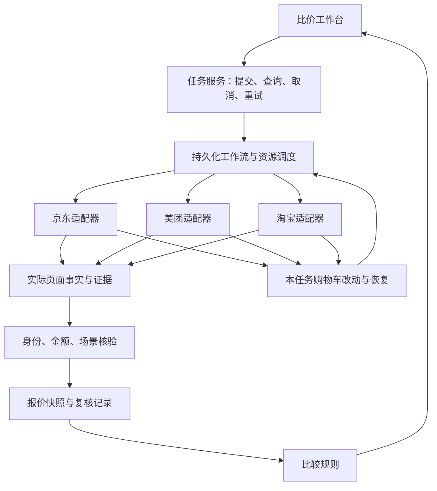

# 三平台比价工具优化计划 v2：以真实报价、可靠执行和可测收益为核心

日期：2026-11-16。状态：已保存的实施计划，尚未按本计划完成实施与真机验收。

本文件保存本 session 最后确认的 v2 方案，完整替代 [37 号初版计划](37_三平台比价工具恢复与优化实施计划_2026-11-16.md) 的实施口径。配套材料见 [39 号执行 Agent 交接说明](39_执行Agent交接说明_2026-11-16.md)。本次只保存文档和更新索引，不启动实施。

## 一、目标、验收标准与边界

**本次要交付的是：用户一次提交后，系统能够稳定取得三平台的真实结算报价，清楚展示差异，保留证据，并恢复本次操作造成的购物车变化。**

从第一性原理看，这不是单纯的“识图点击”问题，而是四件事必须同时成立：

1. 手机确实进入了目标门店、商品和结算页面。
2. 保存的是实际看到的店品、数量和金额。
3. 每个报价都能追溯到当时的证据。
4. 本次操作结束后，设备能够安全地执行下一项任务。

因此，优化顺序固定为：**正确性与购物车保护 → 完整交付率 → 效率 → 使用体验。** 提速不能靠减少必要核验、隐藏失败或复用历史价格实现。

### 已确认的验收目标

| 维度 | 本轮验收要求 |
|---|---|
| 功能样例 | 天津麦当劳板烧鸡腿堡，指定单品、规格、一份数量 |
| 稳定性 | 优化版执行 20 个三平台比较组，至少 19 组完整成功 |
| 正确性 | 对交付报价逐份独立复核；实际店品、数量、结算应付不得出现已发现的错误 |
| 购物车 | 不减少用户原有商品；本任务改动均得到明确处理；需要人工恢复的组不计为自动完整成功 |
| 效率 | 同等条件下，完整组耗时的 P50、P90 均比可信基线下降至少 20% |
| 对照规模 | 20 组基线＋20 组优化版，共 120 项平台任务；重试另计 |
| 用户体验 | 在比价页内完成提交、查看进度、查看结果与证据、重试和恢复处理；刷新页面不丢失任务 |

P50 是中位耗时；P90 是较慢一端的耗时指标。它们都使用**包含排队、重试、取证和购物车恢复的完整耗时**。

“完整成功组”必须同时满足：

- 三家均取得目标单品的有效结算应付。
- 实际分店、商品规格、数量、配送点位和观察时间可以核对。
- 三家观察时差不超过现有口径的五分钟。
- 报价及证据可读取，本次购物车改动已恢复。
- 无人工代点关键步骤、人工读价补录或人工代替恢复。

费用确实未展示时，允许“有效总额、部分明细”，但必须说明缺失原因。**尚未实现读取，不能写成页面未展示。**

### 必须遵守的边界

- 本轮只优化比价工具，不改造 UE 工作台，不扩到几十商品。
- 使用当前一台手机，三个 App 串行操作；保留未来按设备扩展的接口。
- 保留已跑通的 App 技术路径及平台差异。淘宝视觉路径不能再被统一的控件检查替换。
- 先限定现有本地模型，不采购设备、不接入付费云模型。
- 允许同城同品牌不同分店，必须显示实际分店。
- 会员、新客资格不完全可读时，可以显示**三个账号的实测样本差额**，明确未知条件；不能称为同条件比较或推断平台补贴。
- 优惠弹窗默认关闭，记录页面实际应用的优惠；不新增主动领券或最优券搜索。
- 不下单、不付款、不清空现有购物车、不删除历史记录、不修改手机持久设置。
- 已授权范围内的常规修复直接推进；更换主技术路径、增加费用或扩大范围时另行决定。

这些是验收目标，不是预先保证。未达到时必须报告未达项，不能改变统计口径来宣布完成。

## 二、产品与工程架构

### 2.1 产品围绕一次完整比价组织

保留现有 `/bd` 入口，形成四项能力：

| 产品能力 | 用户获得什么 |
|---|---|
| 采价设定 | 明确商品、规格、数量、城市、账号、配送点位和优先分店 |
| 任务进度 | 看见哪家排队、哪家执行、目前阶段、已用时间及失败原因 |
| 比较结果 | 在同一页看见三家实际报价、费用、分店、条件差异和观察时间 |
| 证据与处理 | 核对页面，查看历史尝试，重试失败平台，处理未确认的恢复状态 |

当前“查看结果跳转到 UE”的行为必须修正。**比价工具应能独立完成业务流程。**

页面分别显示：

- 报价是否取得、是否通过核验。
- 明细是否完整。
- 购物车是否恢复。
- 能进行样本比较，还是条件核对一致的比较。

不能把“任务结束”“报价有效”“恢复完成”混成一个绿色成功状态。

### 2.2 工程采用职责明确的单体应用

继续使用现有 TypeScript、SQLite 和采集接口。架构中的模块是职责边界，不要求拆成多个服务。

各模块遵守以下规则：

- **任务服务**管理用户请求，不包含平台选择器。
- **工作流**管理执行、预算、恢复和状态，不要求三家拥有相同控件。
- **平台适配器**负责实际操作及事实提取，不自行降低报价有效标准。
- **核验与比较**使用统一事实结构，不依赖具体手机操作方法。
- **存储与证据**保留历史，不通过覆盖旧记录更新结果。

这就是本项目对 SOLID 的落实：**模块职责单一、平台实现可替换、接口足够小、业务规则不依赖具体操作工具。**

### 2.3 数据对象与接口

核心关系固定为：

> 一个比较组 → 三条平台任务 → 每条任务的一次或多次尝试 → 当次事实、报价、证据和恢复记录。

任务保存不可变的请求快照，实际观测单独保存。配置或映射变化不能静默修改历史任务。

报价存储增加按尝试关联的追加快照，解决当前“一条平台任务只能保存一条报价”的限制。新增记录使用新的报价快照表；原报价表保留历史读取，统一查询层兼容新旧记录，不删表重建。

公开接口调整如下：

| 接口 | 明确行为 |
|---|---|
| `POST /api/bd/runs` | 接收客户端请求编号、商品与场景配置；重复提交返回原比较组；同编号但内容不同返回冲突 |
| `GET /api/bd/runs/:id` | 返回统一的组级结果，包括请求快照、三家状态、实际报价、恢复状态、证据及比较限制 |
| `POST /api/bd/runs/:id/actions` | 统一处理取消、失败平台重试、仅恢复购物车、人工确认恢复；动作带编号，重复请求不重复执行 |
| 既有接口 | 原重试接口转接到同一业务处理；保留旧查询兼容，不复制另一套状态规则 |

请求冲突检查必须包含平台集合、商品及场景版本，不能只比较商品名称。

结果增加独立维度：执行状态、报价核验状态、明细完整性、恢复状态、比较层级。前端展示和验收脚本都读取这份结果，不各自推断成功。

### 2.4 一个执行依据，一份状态来源

现有 SQLite 已对设备和账号做互斥。本轮以它为执行依据，不再叠加独立排队体系：

- 同一物理设备只允许一项手机操作流程持有执行权。
- 任务绑定明确设备、平台账号和配送配置。
- 按比较组顺序执行，优先完成当前组，避免新组任务插入后拉大三家报价时差。
- 每次尝试绑定有效的执行标识；取消、结束或重启后，旧步骤不能继续输入。
- 设备执行权只有在旧操作停止、恢复状态明确后才能释放；不能仅凭超时就交给下一项任务。
- 当前本地模型并发先固定为一，模型等待单列，防止后台检查与正式任务争抢模型。

所有关键阶段写入按组、任务、尝试关联的步骤记录。平台固定日志文件只作调试材料，不再作为产品进度的权威来源。

## 三、稳定性和效率的核心机制

### 3.1 操作必须形成“观察—动作—核对”

每个关键动作记录起点、动作和预期结果。判断成功依据是目标页面或目标状态出现，不是 ADB 返回成功，也不是模型给出了坐标。

- 京东、美团保留已有控件读取和视觉补充。
- 淘宝保留已有视觉定位及裁剪规则。
- 读取方式按具体页面确定，不能要求视觉定位先获得可用控件。
- 已确认的瞬时读屏故障允许有限重试；失败后保留原始原因。
- 每次输入和取证检查目标 App 前台，不能沿用旧页面坐标操作其他应用。

条件等待只在已有可靠页面判据时启用。没有验证过的视觉页面先保留原等待，再逐页校准。Android 官方同样强调条件等待和明确的页面状态管理；本项目采用这一原则，不以升级框架作为前提。[Android 官方说明](https://developer.android.com/training/testing/other-components/ui-automator)

### 3.2 重试由错误原因决定

统一保留错误发生阶段、具体原因、是否可能改动购物车、是否可重试，修复目前把多种问题统一包装成“定位失败”的行为。

| 情况 | 处理 |
|---|---|
| 短暂读取或连接失败 | 在剩余预算内有限重试 |
| 模型超时 | 检查模型与请求状态；不能连续重复同样的长超时请求 |
| 页面已变化、目标不唯一 | 保存现场，停止该定位步骤 |
| 加购是否生效不确定 | 先核对购物篮，不直接再次加购 |
| 商品售罄、不配送、未达起送 | 记录业务无报价，不换商品或自动凑单 |
| 用户取消、权限或访问限制 | 停止新业务动作；需要时进入本任务恢复 |

工作流最多允许一次整任务自动重试，且必须确认前次没有未处理的改动。读取和定位内部的尝试也纳入日志及共同时间预算，避免多层重试相乘。

初始预算沿用现有采价上限：京东 180 秒，美团、淘宝各 240 秒；恢复单独预留最多 45 秒；组预算 900 秒包含排队与恢复。重试不重置原组提交时间和截止时间。超预算是失败保护，不是速度目标。

手机点击不能由数据库保证“只发生一次”。因此，修改购物车前先记意图，修改后核对事实；中断恢复必须先检查实际状态。这个设计遵循工作流中对重复副作用的处理原则。[幂等与重试的设计依据](https://docs.temporal.io/activity-definition#idempotency)

### 3.3 购物车恢复以原状态为基准

- 初始空车：记录证据，加入本次商品，结束后仅撤销本次增加的数量。
- 原有商品且支持独立立即购买：先证明本次结算篮与原车隔离，再使用该路径。
- 原有商品会混入结算：不取混合篮总额；按固定分店策略选择已允许范围内的备用分店。
- 初始状态或改动归属不清：不盲减、不整车清空，保存原因并停止相关操作。

优先分店与备用分店策略在任务开始前固定，不能看到价格后再择低选择。

恢复是独立阶段，不能被采价取消信号一并取消。服务重启后，先核对未结束尝试和改动记录，再恢复队列。

已取得可信报价但恢复未确认时，保留报价并显示“恢复待处理”；该组不计完整成功。人工处理明确留痕，不能改写成自动恢复成功。

### 3.4 报价核验与证据保存

- 目标输入、页面原文、规范化结果分别保存。
- 核对实际分店、单品与套餐区别、规格选项、数量及结算篮。
- 店品身份可以引用已核实映射，但当次页面必须与映射一致；价格每次重新读取。
- 金额以整数分保存；未知不是零；配送费与包装费不能重复使用同一笔读数。
- 明细完整且口径一致时才做加减核验，不从总额倒推缺失费用。
- 视觉方法可以产生有效报价，但必须经过真实样本校准、关联当前证据和字段校验，不能依赖同一模型重复回答自证正确。

证据使用独立编号，保存页面阶段、时间、尝试关联及校验值。先完成证据保存，再发布报价引用；保存失败不能返回一个带失效证据链接的成功结果。

门店、商品、购物篮、金额和恢复分别保留必要证据。原始记录不可覆盖；发现错误通过复核和更正记录处理，错误仍保留在质量统计中。

### 3.5 弹窗和用户体验

弹窗处理限定在已识别的浮层及明确关闭目标，关闭后核对原页面恢复。普通领券入口不能被当成弹窗；未知“确认”按钮不自动点击。

比价页面采用真实阶段提示：

- “等待手机”“正在进入门店”“已取得报价，正在恢复”“需要处理”等状态分别展示。
- 报价可读后立即展示，不必等另外两家结束。
- 刷新或短暂断网后按比较组恢复查看，不重新提交采价。
- 取消后显示停止或恢复过程，不立即伪称已结束。
- 只提供当前有效的操作：重试采价、重试恢复、重新发起同期比较。
- 会员资格未知时显示实测样本差额与未知项，不阻断所有有用结果，也不输出同条件优劣结论。

本机正常环境下，提交确认目标不超过两秒；后端阶段变化在两秒内呈现。没有可靠耗时估计时显示已用时间，不伪造倒计时或进度百分比。

### 3.6 提速只针对已测瓶颈

优化顺序固定：

1. 消除重复健康检查、无效重试和错误状态下继续执行。
2. 在已验证页面上用条件等待替换固定长等待。
3. 复用已确认的会话和门店状态，减少不必要的冷启动。
4. 对同一张不可变截图合并必要字段读取，减少重复模型请求。
5. 在已标注样本上比较裁剪和图片尺寸，保留识别能力后再调整。
6. 统一记录模型排队、推理、页面等待、读屏和恢复耗时，继续处理占时最高的环节。

任何优化都不能复用旧报价、使用操作前的旧坐标、降低字段覆盖，或把本应计入的准备工作移出计时范围。

## 四、实施顺序与真机对照方案

### 4.1 实施阶段

| 阶段 | 工作 | 退出条件 |
|---|---|---|
| M0：固定现状 | 核对已有备份，补存后续差异，逐项区分恢复内容、保留修复和未验证行为 | 每项拟改行为有依据；代码、配置和数据可恢复 |
| M1：恢复原链路 | 按历史成功版本逐函数恢复；保留必要的购物车归属记录和证据；逐平台验证板烧鸡腿堡 | 三家分别完成真实目标链路；没有清空原车或伪造成功 |
| M2：统一产品与契约 | 完成比较组、证据、实际店品、恢复状态、独立结果页和错误分类 | 本机回归通过，正式入口完成三个功能检查组 |
| M3：冻结基线 A | 固定代码、模型、页面规则、设备配置和核验口径 | A 已具备可信报价与恢复能力，可作为效率基线 |
| M4：优化候选 B | 按阶段耗时优化等待、重试、状态复用和模型调用；每项单独验证 | B 与 A 采用同等质量要求，相关回归和功能检查通过 |
| M5：正式对照 | 执行 20 组 A、20 组 B，独立复核并生成报告 | 稳定性、正确性、恢复、效率和体验分别给出结论 |

每阶段只处理与目标直接相关的改动。恢复不能采用整体硬回滚；优化不能同时改入口、读取方法、启动策略和金额口径后再寻找原因。

### 4.2 40 组对照怎样执行

- 两个版本分别冻结，使用独立构建产物；任何时刻只有一个版本控制手机。
- 跨两个营业时段，每个版本每个时段执行十组。
- 每个版本共四组应用冷启动、十六组连续执行，准备条件一致。
- 在对应场景中交替执行 A、B，交替先后顺序，降低时段和设备状态造成的偏差。
- 商品、数量、配送点位、账号、分店选择政策、用券政策和核验要求保持一致。
- 模型准备状态保持一致；提交后发生的预热全部计时，启动前的准备成本另列。
- 批次开始前固定任务清单。中途改代码另开批次；失败、未执行和外部状态变化不得删除。

价格随时间变化，不要求两版价格相等；要求各自结果与当时页面一致。

### 4.3 统计不能美化结果

稳定性分母始终是二十个计划组，平台分母是六十项计划任务。自动重试的尝试数另列，首次成功率和重试后成功率同时报告。

完整耗时从正式入口提交开始，到三家结果与证据可读且恢复结束。首个报价时间另外报告，不能替代完整组耗时。

提速计算采用固定的分位数算法：

- 完整成功组使用实际完整耗时。
- 未完成或事后核实为错误的组，在验收用排序中视为未完成，不用“提前失败的短耗时”提高成绩。
- 失败的实际结束耗时仍单独展示。
- 基线不足以形成有效 P90 时，不能声称提速百分比成立；先修复并重新冻结基线，保留原批次。

最终报告至少包括：组完整率、各平台有效报价率、首次与重试成功率、独立复核结果、明细覆盖、恢复结果、P50/P90、模型调用数、设备耗时和人工介入时间。

20 组达到 19 组成功，只能证明**本次覆盖场景的验收达标**，不能外推为长期 95% 或接近 100% 的保证。

### 4.4 必须覆盖的测试

本机与页面回放覆盖：

- 重复提交、重复重试、取消、刷新恢复、过期报价。
- 同设备互斥、旧任务迟到动作、模型迟到结果。
- 证据覆盖、缺文件、写入中断和历史更正。
- 错店、双层款、套餐、数量错误、混合购物篮。
- 未知与零、金额单位、费用重复、错误页面截图。
- 正常领券入口、真实弹窗、加载中、无结果和前台切换。
- 存储迁移兼容与原有共享模块回归。

真机必须验证：

- 三家当前 App 的实际链路、金额和证据。
- 实际加购、立即购买是否隔离、原有商品保护和恢复。
- 三家连续切换、冷启动及模型等待。
- 取消、受控服务中断后的停止和恢复行为。

故障注入单独建批次，不混入正常二十组，但完整保留报告。只能模拟的断连或未出现的弹窗明确标注，不能当成真机覆盖。

验收复核由实现方逐份对照证据完成，用户查看汇总并可抽查；不能把全部诊断工作转交给用户。

## 五、关键假设、停止条件与后续迭代

### 5.1 关键假设必须接受验证

| 假设 | 验证方法 | 不成立时的处理 |
|---|---|---|
| 历史路径可以恢复 | 同设备、同商品逐平台对照 | 修复有证据的具体退化；不自动替换整条路线 |
| 页面足以确认店品与结算 | 真实页面独立标注、错误样本回放 | 保留待核实记录，明确缺少哪种证据 |
| 可以保护原购物车 | 初始状态、任务增量、恢复后状态对照 | 使用允许的备用分店或返回条件不满足 |
| 当前模型可以支撑验收 | 同一批截图评估定位、读取、超时和调用成本 | 本轮不擅自换模型；形成瓶颈证据供下一阶段决定 |
| 单机可以满足本轮时差与效率目标 | 组级真机对照 | 如实报告未达项，不增加同屏并发或放宽口径 |
| 条件未知的样本差额有使用价值 | 在结果页展示真实样本及未知项 | 调整说明和展示层级，不把未知解释为一致 |

### 5.2 明确停止无效修补的条件

出现错价、非本任务商品变化或取消后的继续操作，立即停止相关批次，保存现场，修复后重新验收。

同一根因经过两轮有对照的调整仍无改善，停止继续叠加补丁，提交证据和可选方向。其他不受影响的工作继续推进。

最终不能以“功能已写完”结案。交付结论必须分别写明：

- 功能是否跑通。
- 二十组稳定性是否达标。
- 关键字段和购物车保护是否通过。
- 两项耗时指标是否下降至少 20%。
- 仍有哪些真实环境没有覆盖。

### 5.3 后续迭代的进入条件

- 本轮达标后，才评估更多商品、门店和更长时间运行。
- 单机吞吐成为已测瓶颈后，才评估三机；先验证设备与模型资源隔离。
- 当前模型成为已确认瓶颈后，才决定更大本地模型或云模型对照。
- 某个平台在原路径上持续不达标，才评估 H5 等独立适配器，并重新核对报价口径。
- UE 接入和多人生产使用另立任务，不随本轮自动扩展。

**本轮核查状态：**类型检查通过；现有测试在沙盒内为 111/113，通过允许本机 HTTP 连接的环境复跑，其余两项均通过。这说明本轮两项失败来自运行环境，不能替代对历史四项失败的追溯，也不能证明真机稳定。

本版为完整替换计划。本次仅保存本计划及交接说明并更新索引，没有修改实现或操作手机；执行 Agent 在实施时再同步更新当前规范及数据口径。
