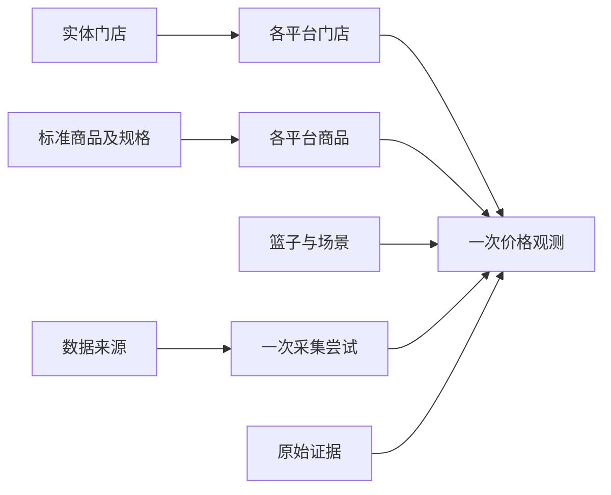

# 三平台数据治理表

版本 `0.6.4`，更新日期 `2026-11-08`。本文件是持续维护的字段和来源台账。本地样机保存示例记录和京东真机技术验证，仍无真实竞对报价。UE 接入指定单品采集；真实经营订单、合同与成本尚未接入。

## 一页读懂

本阶段给平台运营团队建立可追溯的数据底座。先回答同一家店、同一份商品，在什么条件下、什么时间、显示了哪一种价格。

目前确认京东内部数据可提供，具体样本待接入。美团和淘宝闪购的生产采集来源尚未成立。下面规定“需要的数据”，不表示这些字段都能取得。

维护时直接修改本文件，更新版本和末尾记录。字段定义集中维护，已开发部分同步落实到 [机器契约](../src/domain/contracts.ts)。应用 0.2.0 已建立用户分层、店品映射、结算与展示价格分离和三平台观测口径。真实字段覆盖待试点验证。

**设计优先级**。基础层采门店、规格、展示价、可售和证据。固定篮子结算是 MVP 必须分别验证的第二层，只有对应入口满足运行条件才在线执行。新老客、会员分开记录；未观察的分层显示未覆盖。

## 1. 最小本体

这里的“本体”指统一定义对象及其关系。先用普通表和 ID 表达，不需要图数据库。

| 对象 | 一条记录代表什么 | 稳定标识 |
|---|---|---|
| 门店映射 `store_map` | 一个实体门店在某平台某入口的店铺 | `store_mapping_id` |
| 商品映射 `item_map` | 一个店铺内的一种明确商品规格 | `item_mapping_id` |
| 采集场景 `scenario` | 购物篮、收货点位、入口、身份资格等条件的一个版本 | `scenario_id` |
| 价格观测 `observation` | 一次采集时，对一个商品或购物篮观察到的一种价格 | `observation_id` |
| 数据来源 `source_registry` | 某提供者、访问入口、取得方法和用途的组合 | `source_id` |
| 采集尝试 `collection_attempt` | 一个任务的一次实际执行或被条件检查阻止的记录 | `attempt_id` |

一个购物篮的商品明细保存在场景中。一张页面含多种价格时，各价格分别建观测，共享证据。平台门店 ID、商品 ID 均按字符串处理，保留前导零。

页面本体增加 `page_state`（页面状态）、`page_region`（区域）、`field_binding`（业务字段的页面取数规则）、`action_transition`（操作及前后页面）。字段绑定引用稳定业务字段 ID，例如 `fee.delivery.actual`；其原价、实收、预计或历史口径不能因页面位置相近而混用。定义位于 `src/domain/page-ontology.ts`，代码提取和结果核对引用同一定义。地图快照保存在 `page_map_versions`；尝试结果 `pageMap` 保存本体、规则摘要和 App 版本，`fieldResults.propertyId` 指回业务字段。治理流程见 [21 号页面本体说明](../前期调研/21_三平台页面本体与取数地图.md)。

配置存在仅代表校准中。未验证平台标为未验证；每次报价字段仍按新证据核对，不能把地图可用等同本次金额正确。仅本机授权的领券结算另外记录任务政策和授权依据，不能扩张为默认自动领券。

## 2. 字段采集优先级

`P0` 表示首版必须建立口径和缺失记录，不能理解成必须凭空取得。`P1` 在来源可用后扩展。`P2` 本阶段预留，不作为采集验收目标。

| 数据组 | 具体需要什么 | 京东路径 | 竞对候选路径 | 优先级及限制 |
|---|---|---|---|---|
| 门店 | 平台门店 ID、名称、品牌、营业地址、营业状态 | 内部门店主数据 | 经评估可用的门店页面 | P0，先核实同一物理门店 |
| 商品 | 平台商品 ID、名称、规格、数量单位、套餐内容、可售状态 | 内部商品表 | 经评估可用的菜单或详情页 | P0，平台 ID 不可见时留空并保留页面定位 |
| 页面价格 | 现价、划线参考价、起价标识、价格适用条件 | 内部展示日志或获准页面 | 菜单、详情或活动页 | P0，不能改名为结算到手价 |
| 活动 | 满减门槛、时段、限量、券或会员条件的原文 | 内部活动规则 | 页面明确展示的活动规则 | P1，只看见一部分就记录一部分 |
| 结算报价 | 同篮商品小计、包装费、配送费、其他费用、优惠和应付总额 | 报价接口或报价日志，字段待确认 | 获准运行条件下的结算页 | P1 指来源满足后实施；两竞对结算均为真实 MVP 验收必测。记录真实资格和点位 |
| 实际支付 | 支付时间、实际扣款、退款状态 | 内部交易数据，字段待确认 | 当前没有可用来源 | P2，不为采价创建真实订单 |
| 资金承担 | 平台、商家、支付机构等实际承担金额 | 内部财务数据，范围待确认 | 当前不可见 | P2，不从前端优惠反推 |
| 证据和质量 | 原值、来源、时间、截图或原始记录引用、缺失与失败原因 | 随导入生成 | 随每次执行生成 | P0，和业务字段一起采集 |

## 3. 门店与商品字段

| 字段 | 类型及所属对象 | 定义和检查 | 缺失处理 |
|---|---|---|---|
| `canonical_store_id` | string/null，门店 | 统一实体门店 ID。可用京东实体门店主数据作初始锚点，但一个店铺不必然对应一个实体店 | 未核实不能强行合并 |
| `store_mapping_id` | string，门店 | 映射记录 ID | 必须生成 |
| `platform` | enum，门店与观测 | `jd`、`meituan`、`taobao_instant` | 必填 |
| `entry_point` | string，门店与场景 | 具体 App、H5、小程序或业务入口，不只填平台名 | 必填 |
| `platform_store_id` | string/null，门店 | 平台原始店铺 ID | 不可见可为空，以来源页面定位作为临时键 |
| `store_name_raw` | string，门店 | 页面或内部记录原始店名 | 名称缺失则无法确认店铺 |
| `brand_name` | string/null，门店 | 品牌名称及来源 | 推断值与确认值区分 |
| `business_address_raw` | string/null，门店 | 商户营业地址，不能混入消费者地址 | 缺失时降低匹配确定性 |
| `store_locator` | string，门店 | 去除凭证后的页面地址、平台记录键或内部引用 | 必填，不保存含 Cookie 或令牌的链接 |
| `canonical_item_id` | string/null，商品 | 统一商品及规格 ID | 未核实保留候选关系 |
| `item_mapping_id` | string，商品 | 店铺内商品规格映射 ID | 必须生成 |
| `platform_item_id` | string/null，商品 | 平台商品 ID，可能还需规格 ID | 不可见时保留页面定位，不能编造平台 ID |
| `item_name_raw` | string，商品 | 原始品名 | 必填 |
| `spec_raw` | string/null，商品 | 原始规格，如大杯、500ml、两件装 | 规格未知不能自动按同品比较 |
| `spec_normalized` | object/null，商品 | 容量、份量、口味、温度、配料、数量单位、套餐组成等有证据的属性 | 不猜测克重或套餐内容 |
| `match_status` | enum，门店和商品 | `unmatched`、`candidate`、`verified`、`rejected` | AI 推荐默认 candidate，不能自行声明已核实 |
| `match_evidence` | array，门店和商品 | 地址、规格、原始记录和核验方式的引用 | verified 必须有依据 |

同名商品在不同店的规格可能不同。套餐和单品分别建映射。对映射的更正保留版本，不能把历史观测静默改成另一个门店。

### 京东单品爆品

BD 只登记城市、区县、品牌和完整分店名。记录以 `savedStoreId` 复用。新任务快照保存负责人提供的门店范围、已核对的门店依据和配送账号条件。营业地址从门店证据取得。首次同名歧义或地址证据不足时停止并说明原因。

当前按内部包销品清单指定商品，采价数量固定为一份。一个任务只包含一家店的一款单品；套餐、缺规格或找不到目标时停止，不换品、不凑单。新任务不扫描销量、不生成榜单。以下销量字段仅保留历史解释，不作为当前必填项或选品规则。

| 字段 | 类型及含义 | 核验及缺失处理 |
|---|---|---|
| `rawName`、`kind`、`spec` | 菜名原文、单品／套餐／未确认、规格原文 | 名称、类型、规格及选项能核对后才进入单品榜单 |
| `salesRaw`、`sales.window` | 页面销量原文、未注明窗口／月售 | “已售 39”窗口未注明，不能写作月售。销量无法解析时保留原文和排除原因 |
| `sales.value`、`sales.qualifier` | 可解析的展示值和类型，类型为展示整数或下限 | “1.2 万+”记为下限 12000。区间和无法确认的简称留空。已售零保留原值 |
| `position`、`coverage`、`scannedCount`、`stopReason` | 菜单位置、扫描覆盖、扫描件数及结束原因 | 区分扫描到尾、已核验的销量顺序和部分覆盖。保留原位置和证据 |
| `selected`、`excludedReason`、`evidence` | 入榜名单、排除原因及来源证据 | 只有能核对单品规格及证据的条目可以入榜 |

有可用“已售”展示值时按这一组排序，否则用明确的月售。不同时间口径分开，按展示值或下限从高到低，同值按原菜单位置。已售为零、数量缺失或口径不同的条目不参与该组数字排名。入口明确显示且已核验按销量排序时，可按其顺序取已核实单品，数量缺失仍留空。普通推荐顺序不可作为销量排名。部分覆盖标记为“已扫描范围内”，禁止宣称全店名次。

单品试采使用 `coverage=direct_single`。记录一款规格已有证据的商品，销量留空，只用于验证商品现价和单份结算报价。该记录不作为销量榜单或后续跨平台爆品入选依据。

## 4. 场景字段

| 字段 | 类型 | 定义和检查 | 缺失处理 |
|---|---|---|---|
| `scenario_id` | string | 不可变的场景版本 ID | 必须生成 |
| `basket_items` | array | 每项保留平台商品定位、具体选项、数量、单位和可用的统一商品 ID | 单品展示可含一个商品。结算观测必须完整 |
| `delivery_point_id` | string/null | 可复用的受控收货点位标识，精确地址存于受限配置 | 未设置时记录 unknown，不能只凭“同商圈”判相同 |
| `fulfillment_mode` | enum | `delivery`、`pickup`、`unknown` | 配送与自提不能合并 |
| `account_state_ref` | string/null | 账号状态的受控匿名引用，不记录手机号或账号密码 | 匿名页面可以为空，注明 anonymous |
| `customer_eligibility` | object | 分别记录平台新老客、店铺新老客、会员、券资格及其证据。各项允许 unknown | 不能用一个“新客”字段覆盖所有资格 |
| `coupon_policy` | string | 不主动领券、系统已选券、指定已有券等实际任务约定 | 不知道选了什么券就记录 unknown |
| `client_context` | object | 入口、App 或浏览器版本、设备类型，必要时记录可见实验标识 | 无证据的实验分组留空 |

“午市”“晚市”是时间的派生标签。原始采集时间必须保留，不能只保存时段。规则变化会影响同一账号的资格，场景需要重新版本化。

## 5. 价格观测字段

| 字段 | 类型 | 定义和检查 | 缺失处理 |
|---|---|---|---|
| `observation_id` | string | 一次价格观测的唯一 ID | 必须生成 |
| `attempt_id`、`source_id` | string | 连接采集尝试和来源登记 | 必填 |
| `store_mapping_id` | string | 连接已发现的店铺 | 店铺尚未确认时只保存尝试记录 |
| `item_mapping_id` | string/null | 单品价格关联的商品 | 购物篮总价可为空，篮子必须完整 |
| `scenario_id` | string | 连接场景条件 | 必填，即使部分场景属性未知也建记录 |
| `price_kind` | enum | 见下一张价格类型表 | 必填，不用含糊的 final_price |
| `price_scope` | enum | `item` 或 `basket` | 必填，不将整篮优惠当作某个单品的优惠 |
| `amount_fen` | integer/null | 对应类型的金额，人民币分 | 未知填 null，零必须有明确证据 |
| `price_qualifier` | enum | `exact`、`from`、`range`、`unknown` | “9.9元起”不得当成精确 9.9 元 |
| `amount_max_fen` | integer/null | 区间报价上限，区间下限保存在 amount_fen | 非区间为空 |
| `currency` | enum | 首版只接受 CNY | 其他币种不得无声换算 |
| `components` | object | 原始商品小计、包装、配送、其他费用和优惠明细，各项含金额、含义、证据 | 子项未知为 null，不能自动补零 |
| `promotion_raw` | array | 页面展示的活动和适用条件原文及引用 | 未展示不代表没有活动 |
| `availability` | enum | `available`、`sold_out`、`closed`、`out_of_range`、`minimum_not_met`、`unknown` | 区分业务无报价和技术访问失败 |
| `observed_at` | datetime/null | 实际观察价格的时刻，或来源明确提供的价格快照时刻，ISO 8601 含时区 | 原始历史记录没有此时刻则标记未知，不能用导入时间冒充 |
| `collected_at` | datetime | 系统拿到这份证据的时刻，含时区 | 必填 |
| `effective_from` | datetime/null | 来源明确提供的价格或规则开始生效时刻 | 与 observed_at 分开，不知道就为空 |
| `valid_until` | datetime/null | 来源明确提供的报价或活动有效期 | 未显示就为空，不杜撰有效期 |
| `raw_value` | string/object | 金额和条件在来源中的原始值 | 脱敏后保留 |
| `evidence_refs` | array | 证据文件、记录键、SHA-256 和必要的位置引用 | 实测值必须可追溯，哈希不等于来源合规证明 |
| `value_origin` | enum | `observed`、`derived`、`inferred`、`synthetic` | 四类分开，不混为实测 |
| `missing_reasons` | object | 字段路径到缺失原因的映射 | 每个未知的请求字段都要有原因 |
| `quality_status` | enum | `raw`、`validated`、`quarantined` | validated 只表示约定的数据检查通过 |
| `contract_version`、`collector_version` | string | 口径版本和采集实现版本 | 必填 |
| `supersedes_id` | string/null | 更正哪条旧观测 | 新观测为空，更正不能删除原证据 |

### 价格类型

| `price_kind` | 含义 | 不能据此声称什么 |
|---|---|---|
| `merchant_configured` | 商家或内部商品系统设置的渠道价格 | 消费者当前一定看到此价 |
| `display_current` | 具体页面展示的当前售价 | 结算一定支付此价 |
| `display_reference` | 划线价或页面参考价 | 这是历史实际成交价或合法“原价” |
| `checkout_payable` | 当前账号和场景下，提交订单前显示的应付 | 已支付、每个人都能得到、必然是最低可用价 |
| `actual_paid` | 有支付记录支持的实际扣款 | 商家净收入、退款后净支出 |
| `merchant_settlement` | 商家结算收入 | 消费者支付金额 |
| `estimated_payable` | 依据已知规则计算出的预测金额 | 实测结算价 |

第一版不建立全套优惠模拟器。保留页面显示的合计与明细。只有费用组成明确且完整时才做加减校验，不能因为明细不全而把缺项补零。`actual_paid` 后续启用时需要另行定义支付组合、退款和状态口径。

## 6. 数据来源登记

来源的“可见”“能被自动操作”“允许采集和用于该业务”分别记录，不能互相替代。当前登记如下。

| `source_id` | 来源和取得方式 | 已确认事实 | 技术状态 | 使用条件状态 | 当前可做 |
|---|---|---|---|---|---|
| `JD_FRONTEND` | 京东外卖当前应用页面 | 与历史订单为不同来源 | 真机已验证用户确认分店后的单品加购和读价，工作台完整流程待验收 | 需登记和校准具体入口、测试账号、用途及菜单控件 | 通过已核查入口采集当前货架和报价 |
| `JD_ORDER_IMPORT` | 已脱敏京东历史订单 | 用户可提供，实际样本待接入 | 导入与去重已实现 | 依实际导出和处理范围 | 供给参考和历史实付 |
| `JD_INTERNAL` | 京东内部文件或接口 | 用户确认能提供自身数据 | 待样本及接口契约 | 待确认本项目字段和处理范围 | 建映射和导入契约，收到样本后验证 |
| `MT_FRONTEND` | 美团具体 App 或网页前端 | 已查到程序采集限制的公开协议 | 本项目未实测 | 无竞对监测许可，具体入口及条款待评估 | 保留候选，不能登记为已接通来源 |
| `TB_FRONTEND` | 淘宝闪购具体前端 | 现行声明要求第三方自动化事先取得书面许可 | 本项目未实测 | 当前假设下不满足许可前置条件 | 暂不启用该入口的生产自动采集 |
| `MT_PUBLIC_ACTIVITY` | [美团域名下的活动汇总页](https://source.meituan.com/activities) | 已核对存在日期、范围和活动说明，也发现状态与截止日期不一致 | 仅查阅研究材料，未运行定时采集 | 自动监测、再交付用途未核实 | 只作候选活动线索，不得充当门店实测价 |
| `OTHER_PUBLIC` | 品牌官网、公开宣传或许可数据集等独立来源 | 尚无核实的持续报价清单 | 待逐个来源核验 | 逐个评估，不继承平台或搜索引擎权限 | 可研究线索，不能当作当前竞对结算价 |
| `LOCAL_SYNTHETIC` | `demo/` 中的模拟数据 | 已存在，明确虚构 | 可离线运行 | 仅内部演示和开发验证 | 禁止混入真实价格数据 |
| `LOCAL_FIXTURE` | 本机两套自有模拟页面，虚构门店与商品 | 页面和数据由项目自建，浏览器实际执行 | 本地样机与独立验收脚本已实现 | 仅本地开发验证 | 固定 `value_origin=synthetic`，无生产启用入口，不代表真实平台 |

每个来源正式启用时，必须补齐提供者、具体入口、取得方法、允许用途、字段范围、访问条件、保存期限、证据引用、核查日期、复核触发条件和责任人。责任人目前为“项目负责人，姓名待定”，不能编造法务已批准。

来源状态建议采用 `pending`、`ready_for_defined_scope`、`restricted`、`retired`。`ready_for_defined_scope` 只适用于已经记录的范围，不能扩张到全平台、其他客户或其他用途。页面规则、账号权利、用途发生变化或收到限制提示时重新评估。

来源依据见 [采集路线与证据](../前期调研/11_零外部资源下的数据采集路线_2026-11-04.md)。此处记录项目状态，不作法律裁判结论。

## 7. 采集尝试、失败与质量

| 字段 | 含义 |
|---|---|
| `task_id`、`attempt_id` | 任务及本次尝试标识，重试不能删除前次失败 |
| `requested_fields` | 原本要求获取的字段，覆盖率据此计算 |
| `status` | `success`、`partial`、`unavailable`、`blocked`、`failed`，定义见 agent.md |
| `error_code` | 明确阻断或失败原因，成功时为空 |
| `block_reason` | 槽位因同账号或同设备暂停而未执行、或因进程中断停止时，从该槽位的最后一条事件取得原因 |
| `started_at`、`finished_at` | 运行时间及超时判断 |
| `cost` | 模型费用、设备运行、人工分钟等，未知成本不填零 |
| `evidence_refs` | 脱敏证据或结构化错误日志引用 |

统一缺失或失败原因包括 `not_requested`、`not_visible`、`not_provided`、`unknown_eligibility`、`login_required`、`access_restricted`、`rate_limited`、`captcha_required`、`schema_changed`、`parse_failed`、`network_error`、`not_applicable`。业务无报价用 availability 表达。到期数据标记为过期，不删除其历史价值。

| 检查编号 | 规则 | 不满足时怎样处理 |
|---|---|---|
| Q01 | 请求字段的值、原值和缺失原因一致 | 隔离错误记录 |
| Q02 | 门店和规格匹配有证据 | 保留原始观测，禁止进入严格同场景比较 |
| Q03 | 价格类型、商品或篮子范围和币种明确 | 隔离含糊价格 |
| Q04 | 零值和未知分开，起价和精确价格分开 | 不自动补零或改写价格含义 |
| Q05 | 结算观测有篮子、点位、资格、入口和时间 | 保存缺失项，不能声称可比 |
| Q06 | 实测价格有对应证据，证据先脱敏再提交模型 | 无证据不发布为实测 |
| Q07 | 新观测不覆盖历史，同一证据重放不重复入库 | 按任务、观测时刻及证据标识检查 |
| Q08 | 来源范围覆盖本次采集和使用 | 停止未满足条件的任务，保留原因 |
| Q09 | 失败、部分成功及不可售任务进入统计分母 | 报告计划数、执行数和有效数，不只展示成功数 |
| Q10 | 模拟、推断、计算与实测隔离 | 阻止混合展示 |

跨平台可比性单独检查，不把 `validated` 自动当成“可比”。允许的观测时差需按用途明确设置，尚未约定时不默认声称同步。新鲜度也按字段和用途设定，不能给所有价格统一承诺有效一天。

从应用 0.2.1 起，结束采集尝试与写入相关账号、设备的暂停在同一次事务中完成。恢复中断的真机尝试时，排队中的关联槽位标记为暂停，仍计入计划分母。历史槽位的暂停原因来自事件记录。

## 8. MVP 的定时采集与监控字段

以下最初为 0.2.0 设计增量。应用 0.1.0 已实现其中的本地槽位、尝试、固定场景观测及事件；不是生产表或真实数据。计划、槽位、比较组和事件用于管理采集过程，不把一次计划误当作一次实测。字段由采集开发负责人维护；来源和抽样方案由项目负责人核实。

| 对象及字段 | 类型与来源 | 含义、必填条件及校验 |
|---|---|---|
| 计划 `tenant_id`、`monitor_id`、`plan_version` | string、string、integer；计划配置 | 业务范围冻结后必填。相同逻辑槽位的旧修订不重复计入分母 |
| 槽位 `slot_id`、`comparison_group_id` | string；计划生成 | 每平台一个交付要求，各平台同组共用比较组 ID。重试不创建新槽位 |
| 槽位 `due_at`、`deadline_at`、`max_time_skew_seconds` | 带时区时间、带时区时间、非负整数；计划配置 | 到期晚于开始；三端时差按实际 observed_at 最大值减最小值。缺时间不能判同步 |
| 槽位 `slot_outcome` | enum；调度与质量系统 | 待执行、有效报价、确定业务无报价、部分字段、来源受限、错过窗口、执行失败、取消。旧修订状态 superseded 单独留痕 |
| 场景 `basket_version`、`mapping_version`、`account_set_version` | string；确认的配置 | 结算任务固定三项版本。更换钱包或关键资格会产生新场景，不据此直接判断变价 |
| 映射 `match_relation` | enum；匹配核验 | exact、variant、similar、unknown。严格同篮需要已核实的 exact；核实规格一致的变体可另建精确关系 |
| 资格 `eligibility_observed_at`、`session_epoch` | 时间/null、integer；受控执行端 | 记录本次资格证据时刻和会话代次。资格未知时存原因，不将重登录视为已核实 |
| 菜单 `catalog_scope`、`pagination_complete`、`visible_item_count` | enum、boolean/null、integer；页面证据 | 标明全店或目标子集。未完整加载时缺少某项不能认定下架 |
| 起送 `minimum_order_fen`、`minimum_order_basis`、`minimum_order_gap_fen` | integer/null、string/null、integer/null；页面证据 | 存门槛、计算基数、页面显示的差额。未知留空，不能自动加购或补零 |
| 费用 `components.*.amount_fen`、`basis`、`included_in` | integer/null、string/null、string/null；报价证据 | 区分原价、折后与已包含项。缺明细但总额有效时单列，防止重复加费用 |
| 观测 `page_stage`、`evidence_quality` | enum；采集器 | 区分菜单、购物车、结算；空帧、黑屏、遮挡、错误页面不可作为价格证据 |
| 质量 `quote_valid`、`detail_complete`、`comparability_reasons` | boolean、boolean、array；发布检查 | 字段完整、总额可用、三端可比是三种判断。partial 可交付有证据的有效总额 |
| 发布 `dataset_release_id`、`published_at` | string、带时区时间；发布系统 | 通过检查才生成。晚发布不回写原 observed_at |
| 变化 `before_observation_id`、`after_observation_id`、`change_status` | string/null、string、enum；事件引擎 | 初次观测建立基线，不发变价。修正可撤回事件；采集故障不生成商品下架 |

**报价请求标识**。`checkout_payable` 映射到整篮应付的 `price_kind + amount_fen`；`delivery_fee`、`packaging_fee` 分别映射到对应费用的 `amount_fen`。请求不全时按标识记缺失原因。两端都称“会员”并不足以认定资格相同。详细任务样例及结果语义见[定时采集技术方案](../前期调研/13_两平台自动定时采集技术方案_2026-11-04.md)。

## 9. 应用 0.1.0 的实现映射

| 字段或对象 | 当前实现 | 使用限制 |
|---|---|---|
| 来源、数据模式 | 任务与报价 `source_id=LOCAL_FIXTURE`；`data_mode=synthetic`、`value_origin=synthetic` | 真实来源没有启用接口；不能改标签变成实测 |
| 门店及篮子映射 | `store_id` 指三家虚构实体店；`basket_id` 指不可变的本地篮子定义 | 两平台模拟条目均关联相同目录；真实映射尚未建立 |
| 费用 | `components.delivery_fee.amount_fen` 与 `packaging_fee.amount_fen`，各自保留 `raw_value`、`basis`、`included_in` | 未显示时 amount_fen、raw_value、included_in 为 null，basis=unknown；请求字段有缺失原因 |
| 页面标价 | 目标商品原文与起价标识保存在尝试轨迹 | 尚无独立全店菜单观测表，不声称采全菜单 |
| 比较组 | `comparison_group_id`、两端共同 `due_at`、5 分钟截止 | 只验证模拟双端时差，不产生真实三平台比较 |
| 发布与更正 | 报价事务写入后形成历史及变化事件 | 生产发布批次、历史修订与事件撤回尚未实现 |
| 账号独占与暂停 | SQLite locks、paused_resources、同账号串行；暂停跨批次持久保存 | 仅单进程本地；真实设备租约及多进程隔离待实现 |
| 身份、资格和店铺分层 | 固定虚构钱包、固定点位、固定场景版本 | 没有真实会员、新客或券资格验证，不作为真实可比数据 |

## 10. 应用 0.2.0 的实现口径

| 对象 | 代码字段或存储 | 检查 |
|---|---|---|
| 品牌与实体门店 | `market_brands`、`market_stores` | 京东门店键指向实体门店，地址与城市分别保存 |
| 商品与平台映射 | `market_targets`、`market_mappings` | 规格、选项、套餐项及数量进入版本。平台店品、入口、证据与确认结果一同保存 |
| 历史订单 | `market_orders`，`priceKind=actual_paid` | 订单行键去重，保存实付时间及导出编号。金额属于订单，不作单品报价 |
| 用户条件 | `market_profiles`、`Task.live.profile` | 平台账号代号、新老客、会员产品、等级、权益及核对依据分别保存；门店新老客按店和平台登记，比较校验资格核对有效期 |
| 监测条件 | `market_plans`、原有槽位及 `Task.live` | 同批同组，保存映射、数量、点位、餐期与入口配置版本。优惠使用方式为页面已应用 |
| 展示价与参考价 | `AttemptResult.market.prices` | 起价和区间保留原文，不转为精确价 |
| 结算费用与配送 | `Observation.details` | 商品小计、包装、配送、其他费用、优惠及预计配送均关联证据。未知填空 |
| 券规则和实抵 | `details.coupons` | 规则、门槛口径、范围、时段、会员与叠加条件，与资格及实抵分别保存 |
| 人工复核 | `market_quote_reviews` | 记录独立核对结果、备注和用时，判为不符时停止用于价差，保留原始观测 |
| 模型与执行成本 | `market_audit`、尝试成本、映射核对用时 | 保留成功及失败调用。模型单价未知时不填零，设备和人工时间分开统计 |

同期比较要求同组且两端观察时差不超过 5 分钟。15 分钟以前标记为历史，保留当时的可比结果。两边的费用明细完整且口径一致时，才解释费用对价差的贡献。三平台最低金额要求三方均可比。

## 11. 包销品 UE 工作台契约（示例数据）

对应 [16 号产品方案](../前期调研/16_包销品UE经营数据产品_2026-11-06.md)与应用 0.3.1。计算位于 `src/domain/ue.ts`，筛选与级联位于 `src/ue/scope.ts`，固定示例输入位于 `src/ue/fixtures.ts`。此处登记不改变上述真实采集来源的权限和接入状态。

| 对象 | 字段与含义 | 不变量与缺失处理 |
|---|---|---|
| 示例来源 | 订单 `origin=synthetic`；凭据 `LOCAL_UE_SYNTHETIC` | 仅本地 UI 验证，不导入真实采集库；界面只保留一处“示例数据”标识，导出保留“来源”列；演示说明不进入业务页面 |
| 包销身份与合同 | 内部 `is_baoxiao` 为 true / false / null；合同编号、区域、周期、结算价及凭据另外保存 | 只读取内部标记；null 为待补齐，不推断为包销或非包销。合同核对活动执行资格，不重判包销。试采单独标注；真实合同和财务尚未接入 |
| 实际成交形态 | 订单 `form=direct/coupon/mixed/unknown` | 不以是否用券决定包销归属；四种形态可分别统计；合同允许形态与订单实际形态分开 |
| 经营单元 | 品类、城市、商圈、城市等级、新老客、午晚市、流量入口 | 天津为主样本；北京和饮品小样本只验证筛选，不代表多城市试点；流量入口指超级补贴/首页推荐/搜索进店，不等同跨平台渠道；平台 UE 按订单加权，SKU 用于诊断 |
| 平台 UE 口径 | 佣金、商家及顾客配送收入、广告及其他收入，骑手成本、用户/骑手补贴与变动费用；界面称“平台单均收益” | 金额为整数分；固定成本不计入；未知费用使对应 UE 留空，覆盖数另列 |
| 商家 UE 口径 | 商品、顾客包装费、商家应收配送费、平台补贴、商家让利、费用、结算、食材、包装成本、退款、增量人工；界面称“商家单均收益” | 商家结算后的贡献不再扣已经结算的费用；顾客包装费与耗材成本分开；缺食材成本使商家贡献留空 |
| 分母与基线 | 完成订单数；下单日期；2026-10-10 至 11-06 的四周示例窗 | 退款原订单仍在分母，取消与未完成不计；经营分组少于 100 单、SKU 少于 30 单或观察窗不足四周时，不作正式诊断 |
| 补贴 ROI | 补贴前实际贡献减自然订单基线贡献，再除平台补贴费用；界面称“补贴回报” | 自然订单及成本按历史数据估算；零补贴不除零；负 UE 且 ROI<1 才提示补贴过度，补贴前负值先诊断结构 |
| 多品分摊 | 分摊基数、参与范围、资金承担方、逐分金额 | 仅参与商品分摊，餐盒入基数，袋和配送不入基数；只舍不入，最后一个参与商品承接尾差；真实分摊方法待账单复核 |
| 同品比较 | 实体店、规格及数量、用户资格、时间、履约方式、配送点位、结算应付与证据 | 时差≤5分钟；不符仅保留证据；样本不足不算指数；竞对零应付不作为指数分母；历史快照与实时价分开 |
| 仿真 | 动作、目标、订单变化假设、竞对响应、仅老客范围、预算、商家底线和最大亏损 | 乐观/基准/悲观均展示条件；不动作作为反事实；新客样本不能推算老客；缺样本/成本阻断；全为规则情景，不是真实模型输出 |
| 人工任务 | 原值、目标值、负责人、截止、生效起止、发起/出资方、商家确认、退出记录、双审批、凭据和审计 | 仿真失败、超预算、商家底线、活动冲突、七天告知或权限不符时阻断；合同需覆盖完整活动窗；示例共享预算 5000 元，真实额度待批 |
| 复盘 | 基线、情景预期、实际结果、方法、置信度、保留/调整/停止意见 | 实际结果未接入；前后对比不能证明因果。30 日停补复购、用户生命周期价值未取得，不用短期订单替代 |

浏览器保存键为 `baoxiao-ue-demo-v2`，保存任务、审计、反馈和筛选条件；不保存包销登记修订（登记已移出工作台）。关闭页面后可恢复，但不是服务端持久化或生产身份鉴权。正式合同、财务字典、内部字段范围、来源许可、审批权限、负责人、促销适用规则和人员关系披露仍按 16 号材料待确认。

## 12. 指定包销品清单与采集字段

| 对象 | 字段与实现 | 口径 |
|---|---|---|
| 清单行 | `monitor_catalog`；city、district、brand、storeName、itemName、spec、is_baoxiao | 最低输入；营业地址由页面取得。包销标记允许 true / false / null，缺失不推断 |
| 身份与版本 | 本地 id、revision、source、sourceVersion、importedAt；可选 storeId、skuId、options | 缺少平台编号时使用本地 ID，不冒充平台编号。内部实体编号与平台门店编号分开；清单语义变化后旧映射失效 |
| 导入 | `monitor_catalog_imports`；批次、时间、原记录 | 预览不入库，同批重复不新增；新版本保留导入记录和旧任务快照 |
| 任务 | `Task.specified`、`jdOrigin`、`live` | 固定一店、一款指定单品、一份。新任务没有 shelf，找不到指定品不能替换 |
| 本次核实对象 | `AttemptResult.resolvedLive` | 复用同一任务中已核对门店和规格；不能修改账号、配送、数量、来源和用户条件 |
| 字段核对 | `details.fieldResults` 的 raw、modelRaw、fen、status、reason、evidenceId、box | 页面文字与模型一致才给 verified 金额；模型单独读数为 unverified，不进入已核对金额 |
| 补充证据 | `supplementaryEvidence`、逐屏时间 | 结算最多补三屏，只读展开；跨屏应付改变不发布。只传脱敏图片给模型 |
| 优惠 | `coupons`、`couponCandidates` | 已核对优惠与模型候选分开；缺少门槛、范围、叠加规则留空，不自行领券或计算最优券 |
| 性能 | quoteReadyAt、quoteMs、elapsedMs、timings；节点 elapsedMs | 首次已核对报价时刻与最终结束分开。记录页面读取、截图、等待、重试、恢复；并行节点时间不可简单相加 |
| 恢复 | cleanup=untouched / restored / quarantined | 分别表示未改动、已恢复、恢复未确认。恢复不确定暂停设备；不能把取得报价等同完整成功 |

配送费与包装费保留实收口径；划线原费单独留存核对结果。免费为 0，未知为 null。缺失原因区分未展示、未展开、解析失败、读数不一致。其他费用只有明确页面标签才读取，不从总额倒推。

单次同期价差不要求三十笔订单；汇总指数、经营诊断、策略测算仍按各自样本要求。实际采集清单不填入示例财务收益。

## 12.1 通道、设备几何与组交付

三平台并行采集按 [24 号长程计划与规约](../前期调研/24_三平台并行采集长程计划与规约_2026-11-08.md)实施。以下字段在实现时落入任务、证据与结果，当前为口径定义。

| 对象 | 字段 | 含义与约束 |
|---|---|---|
| 采集通道 `channel` | `channel_id`、`platform`、`device`、`account`、`point`、`entry`、`app_version`、`selectors_version`、`geometry_profile` | 通道是调度与并行单位；同通道串行、同账号串行；跨城或跨商圈新增通道；历史任务保留当时通道，不因换通道静默改写 |
| 设备几何 `geometry` | `model`、`sdk`、`wm_size`、`wm_density`、`orientation`、`font_scale`、`screenshot_size`、`viewport_size`、`overlay_scale` | 随任务与每条证据保存；超出支持矩阵返回 `unsupported_device_geometry` 并阻断；缺项不得标记已验证 |
| 比较组与交付 `comparison_group` | `comparison_group_id`、`group_state`（delivered/partial/blocked）、`group_delivered_at`、`queue_ms` | 交付时延为提交时刻到组交付时刻，排队时间单列；三平台并行只缩短总墙钟，不改变单平台链路 |
| 证据几何 | 证据元数据中的 `geometry` 与 `capture_size` | 截图物理尺寸须等于 `wm size`；裁剪区域须在画面内；隐私遮罩须覆盖地址节点 |

正确性统计口径：单平台任务级正确率 ≥98%（95% 置信下界 ≥97%）、字段级 ≥99.5%；组级全对率单独统计，目标 ≥96%，不并入单平台 98%。失败、未执行与中断任务计入分母。

## 13. 维护流程和变更记录

报价详情固定展示来源入口、营业地址、商品规格及数量、用户条件、配送地址简称、观察时间、可售状态、结算应付、预计配送、商品标价、划线参考价、商品小计、包装费、配送费、其他费用和实际优惠。优惠条件有证据时分项展示。缺失显示“未取得”。`elapsedMs` 表示发起到最终完成的耗时，`queueMs` 表示首次执行前的等待，`executionMs` 表示首次执行至最终结束。每次尝试保留实际执行耗时与步骤记录。

京东采集后台按运行、任务和尝试关联节点记录。保留阶段、开始和结束时刻、状态、脱敏输入和返回值摘要、失败代码及证据引用。出现中断时保留已写入节点。设备或购物车状态不明时以失败或暂停呈现。凭证、手机号、收货地址明文和未脱敏截图不得作为日志或模型输入。

新增字段时填写定义、类型、原始来源、必填条件、空值原因和核验方式。发现来源状态改变时立即更新第 6 节。改变含义或单位时按 [项目规范](../agent.md) 升级契约版本，不能只修改列名。

| 日期 | 版本 | 变更 | 实际验证状态 |
|---|---|---|---|
| 2026-11-08 | 0.6.4 | 增加通道、设备几何与组交付口径；明确单平台正确率与组级全对率分开统计。字段为口径定义，代码尚未实现 | 依 24 号长程计划与规约；三平台并行与跨机型验收需要统一口径 |
| 2026-11-08 | 0.6.3 | 目录整理与版本控制初始化，历史产物归档；20 次连续真机测试全部完整成功，金额 20 次一致。字段定义与来源状态未变 | 类型检查、56 项单元与回归、构建通过；真机质量目标通过，首页出发性能未通过；见 19、23 号材料 |
| 2026-11-08 | 0.6.2 | 执行日志区分前台应用变化、控件读取和模型超时；最大执行时间与性能目标分开。保留修正前批次和新版复测，不能把未执行或失败任务删掉 | 56 项本地回归、6 项采集浏览器检查通过；真机最终统计见 19 号材料及完整批次报告 |
| 2026-11-08 | 0.6.1 | 页面地图按业务对象、稳定字段编号、页面状态和动作前后条件维护；每次任务保留地图快照。近期同店证据仅复用身份，不复用报价 | 京东本机试采已验证费用提取与恢复；连续运行目标未通过，竞对页面未验证 |
| 2026-11-08 | 0.6.0 | 新任务改为指定包销单品、取消排名；包销读取内部标记；新增版本化清单、逐字段核对、独立恢复与细分计时 | 回放、浏览器和真机分别记入 19 号验收文档；性能目标不预先标为通过 |
| 2026-11-07 | 0.5.1 | 工作台收敛为六页；包销范围改为只读；经营单元补城市、商圈、城市等级和流量入口；示例来源只保留一处标识；保存键更新为 v2 | 六页 UI、筛选级联和只读范围本地浏览器验证；真实财务、合同、竞对来源和效果未接入 |
| 2026-11-07 | 0.5.0 | 增加包销品 UE 演示契约与字段实现映射 | UI 与规则做本地验证；真实财务、合同、竞对来源和效果未接入 |
| 2026-11-04 | 0.1.0 | 建立最小本体、字段字典、来源登记、失败语义和质量规则 | 文档已建立，真实数据尚未接入 |
| 2026-11-05 | 0.2.0 | 增补定时槽位、比较组、账号组合、目录完整性、费用基数、发布追溯和候选活动线索。明确 partial 与有效总额的关系 | 设计口径，尚无生产消费者。旧模拟记录保留原版本，不补造时间和资格 |
| 2026-11-05 | 0.3.0 | 登记 LOCAL_FIXTURE、任务与结果机器契约及本地实现映射，费用组件保存原值和包含关系 | 自有页面本地验证，真实来源保持原状态；详见应用验证报告 |
| 2026-11-06 | 0.4.0 | 落实三平台店品匹配、分层、报价证据和比较约束，业务契约 2.0.0 | 本地回放与 HTTP 测试服务验证，真实覆盖待试点 |
| 2026-11-06 | 0.4.1 | 增加京东单品货架、爆品口径和后台执行日志 | 已有单次技术读价证据，正式京东入口待校准和工作台真机验收 |
| 2026-11-06 | 0.4.2 | 增加负责门店复用、固定报价指标和全程耗时口径 | 真机与回放分开记录 |
| 2026-11-06 | 0.4.3 | 单品试采单独记账，保留规格和报价证据，销量留空 | 真机已核对单品规格，报价链路另行验收 |
